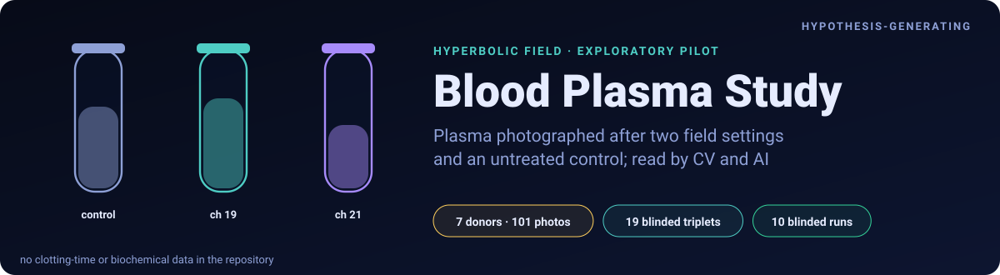
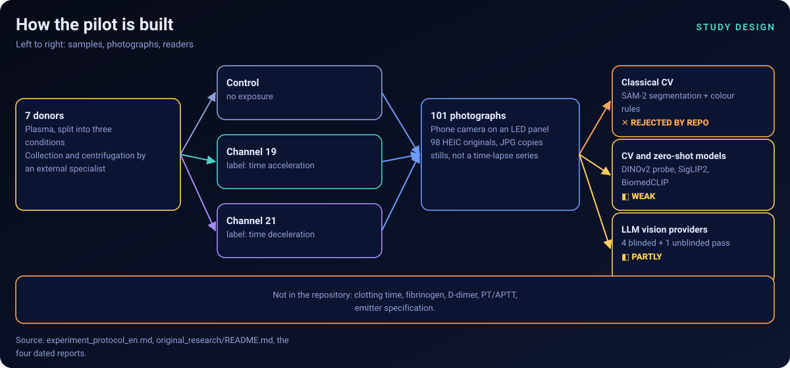
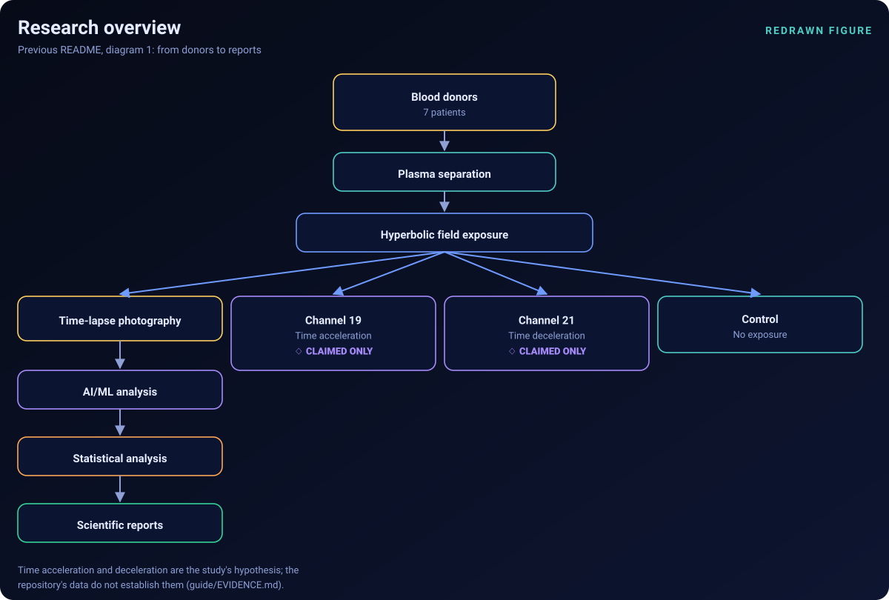
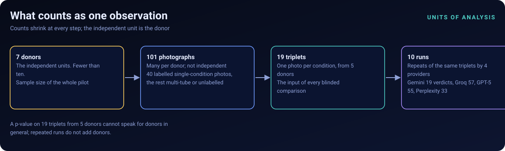
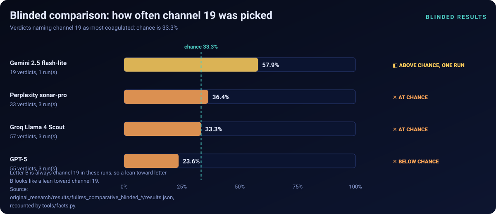
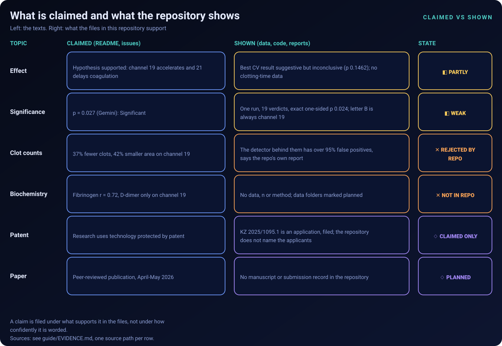
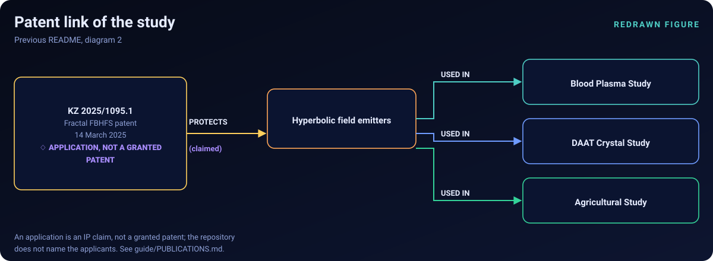

**English | [Русский](README.ru.md)**

<div align="center">



# HYPERBOLIC FIELD BLOOD PLASMA STUDY

**Experimental datasets, imaging results and analytical materials from blood plasma exposure to hyperbolic field emitters. Includes raw data, controlled environment documentation and protocol references.**

| Repository | Status |
|---|---|
| `Hyperbolic_Field_BloodPlasma_Study` | Active Research (preliminary; content last updated 26 March 2026) |

**Part of the Advanced Scientific Research Projects (ASRP) Ecosystem**

[](https://github.com/AdvancedScientificResearchProjects)


<!-- badges -->


<!-- /badges -->

[](https://asrp.tech/en/patrons)

> **If this work is valuable to you, support us.** 7 patron tiers from Principal Philanthropist to Individual Contributor.
>
> **Support:** <https://asrp.tech/en/patrons><br>
> **Investment inquiries:** _pending, URL to be provided when available_

</div>

> This is a public research repository. The results are preliminary and hypothesis-generating. A patent application is an IP claim, not validation of this study.

<!-- legacy-anchors --><a name="hyperbolic-field-blood-plasma-study--исследование-плазмы-крови-после-воздействия-гиперболических-полей"></a><a name="research-at-a-glance--исследование-в-цифрах"></a><a name="quick-navigation--быстрая-навигация"></a><a name="quick-links--быстрые-ссылки"></a>
## At a glance

- **What it is.** An exploratory pilot: plasma from <!--n:donors-->7<!--/n--> donors, split into an untreated control and two hyperbolic-field emitter settings (channel 19, label "time acceleration"; channel 21, label "time deceleration"), photographed with a phone. The <!--n:photos-->101<!--/n--> photographs are scored by computer vision, vision models and LLM vision providers.
- **What exists.** A real, consistent dataset: <!--n:photos-->101<!--/n--> photographs, <!--n:pdfs-->11<!--/n--> scanned protocols, <!--n:result_files-->47<!--/n--> LLM result files, <!--n:ml_result_files-->102<!--/n--> per-photo ML outputs, about <!--n:scripts_lines-->7290<!--/n--> lines of analysis code, four dated reports.
- **What was shown.** The best blinded LLM run picked channel 19 in <!--n:gemini_ch19-->11<!--/n--> of <!--n:triplets-->19<!--/n--> triplets (<!--n:gemini_pct-->57.9<!--/n-->%), but letter B is always channel 19 and the exact one-sided p is <!--n:gemini_p_exact-->0.024<!--/n-->; the other providers are at or below chance; no computer-vision model reaches p below 0.05. The authors call the best CV result "suggestive but inconclusive".
- **What is not established.** There is no clotting-time, fibrinogen, D-dimer, PT or APTT measurement in the repository. The previous README listed p = 0.027 as "Significant" and called the signal "reproducible"; the repository's own reports do not support that. No emitter specification is given.
- **IP.** The patent connection is an application, KZ 2025/1095.1, filed and not granted; applicants are individuals.
- **Where to start.** [Evidence](guide/EVIDENCE.md) (claimed versus shown, with sources), then [Results](guide/RESULTS.md).
- **What is open.** Protocol documents that disagree, an unverified clock offset, and a publication whose status the repository does not record: see [Open questions](guide/OPEN.md).

## Quick navigation

| &nbsp;&nbsp;Icon&nbsp;&nbsp; | Section | What is inside |
|:---:|---|---|
|  | **[The study](guide/STUDY.md)** | what the pilot is, hypothesis, design and protocol, sample IDs |
|  | **[Data and photographs](guide/DATA.md)** | <!--n:photos-->101<!--/n--> photographs, imaging, categories, data volume |
|  | **[Analysis methods](guide/METHODS.md)** | CV, zero-shot and LLM readers, blinding, the dated reports |
|  | **[Results](guide/RESULTS.md)** | the earlier tables, then the blinded counts recomputed |
|  | **[Figures gallery](guide/FIGURES.md)** | every chart and diagram of the repository, with its source folder |
|  | **[Evidence](guide/EVIDENCE.md)** | claimed versus shown, with a source path for every row |
|  | **[Patent, preregistration, publication](guide/PUBLICATIONS.md)** | the KZ application, the OSF registration, the paper plan |
|  | **[Team, issues, ecosystem](guide/ECOSYSTEM.md)** | team, issue table, sibling studies |
|  | **[Navigation and structure](guide/NAVIGATION.md)** | where things are, reading routes, folder tree |
|  | **[Open questions](guide/OPEN.md)** | what disagrees, what is not verified |
|  | **[Ethics, support, contact](guide/ETHICS.md)** | donor data, classification, corporate contact |

Full list: [guide index](guide/README.md).

**On this page:** [What this study is](#what-this-study-is) · [Design and protocol](#design-and-protocol) · [Data and photographs](#data-and-photographs) · [Analysis methods](#analysis-methods-and-reports) · [Results](#results-and-how-to-read-them) · [Claimed versus shown](#claimed-versus-shown) · [Patent and preregistration](#publications-patent-and-preregistration) · [Team](#research-team) · [Issues](#active-issues) · [Ecosystem](#asrp-ecosystem) · [Structure](#navigation-and-structure) · [Open questions](#open-questions) · [Ethics](#ethics-and-security) · [Contact](#contact) · [License](#disclaimer-and-license)

---

<!-- legacy-anchors --><a name="research-overview--обзор-исследования"></a>
## What this study is

<!-- excerpt STUDY 0 -->
This repository documents a **small, exploratory pilot** of the effect of hyperbolic-field emitters on blood plasma. Plasma from <!--n:donors-->7<!--/n--> donors is split into an untreated control and two samples placed on emitters set to "channel 19" and "channel 21". The channel names are labels only: the repository calls channel 19 "time acceleration" and channel 21 "time deceleration" and gives no frequency, power or geometry of the emitters. After exposure the tubes are photographed with a phone on an LED panel, and the <!--n:photos-->101<!--/n--> photographs are scored by computer vision, vision models and LLM vision providers.

The hypothesis of the protocol issue is that hyperbolic-field exposure affects plasma coagulation dynamics through temporal modulation: a fast clot followed by lysis on channel 19, a delayed but dense clot on channel 21. The study is the first biological test of the emitters described in the patent application and the plasma branch of the 2026-2027 hyperbolic-field programme (see [Publications, patent, preregistration](guide/PUBLICATIONS.md)).

**What it is not.** There is no clotting-time, fibrinogen, D-dimer, PT or APTT measurement anywhere in the repository. Everything below the photographs is computed from pictures. The authors' own computer-vision report calls its best result "suggestive but inconclusive". Read the study as hypothesis-generating, not as evidence that the field affects coagulation (see [Evidence](guide/EVIDENCE.md)).

| Repository | Status |
|---|---|
| `Hyperbolic_Field_BloodPlasma_Study` | Active Research (self-declared; content last updated 26 March 2026) |

**Organization:** Advanced Scientific Research Projects (ASRP), part of the ASRP ecosystem. The repository is public.
<!-- /excerpt -->

Full page: [The study](guide/STUDY.md)

---

<!-- legacy-anchors --><a name="research-methodology--методология-исследования"></a><a name="experimental-protocol--протокол-эксперимента"></a><a name="sample-identification--идентификация-образцов"></a>
## Design and protocol

<!-- excerpt STUDY 1 -->
<div align="center">
<a href="guide/assets/diagrams/study-design.en.svg"></a>
</div>

The protocol summary (`original_research/reports/experiment_protocol_en.md`) states:

- <!--n:donors-->7<!--/n--> donors; blood is centrifuged (2000 RPM, 5 min) and the plasma separated.
- Plasma from 4 tubes is combined and split into 4 samples: 2 controls (not irradiated, placed 1.5 m from the emitters), 1 sample in the channel 19 emitter, 1 sample in the channel 21 emitter.
- Irradiation is about 1 h 12 min per donor; volume 1 ml per sample (some 1.5 ml); temperature 17°C constant (smart home system).
- Photography: smartphone camera (HEIC, converted to JPG), backlight from below (LED panel), glass test tubes, artificial lighting.
- Laboratory work (blood collection, centrifugation, equipment) is attributed to an external plasma specialist of an independent laboratory; the research lead designed the experimental programme.

**The protocol documents disagree** on several points (exposure time, tube type, centrifugation settings, anticoagulant); the differences are listed on [Open questions](guide/OPEN.md) and none is resolved here. The preregistered design (OSF) is a mixed between- and within-donor design with 5-10 donors and 30-60 aliquots, primary outcomes clot-formation time and clot degradation rate, ANOVA with two-sided p below .05 and Tukey-Kramer comparisons. The clot-time outcomes were never measured; the photographs stand in for them.

<a href="guide/assets/diagrams/redraw-overview.en.svg"></a>

Original figure: <a href="original_research/charts/mermaid/root_1.png"><code>original_research/charts/mermaid/root_1.png</code></a>
<!-- /excerpt -->

Full page: [The study](guide/STUDY.md#design-and-protocol)

---

<!-- legacy-anchors --><a name="photo-gallery--галерея-фотографий"></a><a name="time-lapse-photography-system--система-покадровой-съёмки"></a><a name="imaging-specifications--спецификации-визуализации"></a><a name="photo-categories--категории-фотографий"></a><a name="data-structure--структура-данных"></a><a name="data-volume--объём-данных"></a>
## Data and photographs

<!-- excerpt DATA 0 stop=^###.Browse -->
The dataset is <!--n:photos-->101<!--/n--> photographs of plasma tubes from <!--n:donors-->7<!--/n--> donors, <!--n:pdfs-->11<!--/n--> scanned protocol PDFs, and per-donor logs. The counts were re-derived from the per-donor `analysis.json` files and the file tree (`tools/facts.py`) and agree with the figures of the research folder README. The raw material is sensitive (see [Ethics](guide/ETHICS.md)): per-donor logs carry blood group and minute-level times, so this page gives aggregates only.

<div align="center">
<a href="guide/assets/diagrams/units.en.svg"></a>
</div>

### Imaging specifications

| Parameter | Value |
|---|---|
| Camera | High-resolution smartphone camera |
| Resolution | 4032×3024 (12 MP) |
| Format | <!--n:heic-->98<!--/n--> HEIC originals with JPG conversions |
| Frame rate as documented | 1 frame per 5 minutes |
| Duration as documented | 24-48 hours per sample |
| Total frames as documented | ~500-1000 per sample |
| Samples in the comparison | 19 triplets (5 donors) |

**The time-lapse rows describe a planned system, not the dataset.** What the repository holds is <!--n:photos-->101<!--/n--> still photographs, not a 24-48 hour series; time-lapse is also listed as a future recommendation (see [Open questions](guide/OPEN.md)).

### Photo categories

The previous README listed these categories of the <!--n:photos-->101<!--/n--> photographs:

| Category | Count | Description |
|---|---|---|
| Labeled single-channel | 40 photos | 13 control, 14 channel 19, 13 channel 21 |
| EXIF-inferred single-channel | 15 photos | One donor, channel inferred from camera timestamps |
| Multi-channel comparison | 34 photos | 2-6 tubes per photo, 75 tubes total |
| Unclassified | 12 photos | No protocol label available |

The categories add up to 101 photographs. The CV report counts the same photographs as 67 single-channel and 34 multi-tube, so the single-channel figure depends on whether EXIF-inferred photos are included.
<!-- /excerpt -->

Full page: [Data and photographs](guide/DATA.md)

---

<!-- legacy-anchors --><a name="reports--отчёты"></a><a name="all-reports--все-отчёты"></a><a name="analysis-pipeline--конвейер-анализа"></a><a name="aiml-analysis--иимл-анализ"></a><a name="analysis-providers--провайдеры-анализа"></a><a name="coagulation-stage-scale--шкала-стадий-свёртывания"></a><a name="references--ссылки"></a><a name="ml-models-used--использованные-мл-модели"></a>
## Analysis methods and reports

<!-- excerpt METHODS 0 stop=^###.Coagulation -->
Three kinds of reader score the <!--n:photos-->101<!--/n--> photographs. None of them measures coagulation directly; each reads a picture.

1. **Classical computer vision.** SAM-2 segments the plasma region and HSV colour rules count "clots" (report of 2026-02-25). The repository's own later report rejects this detector: "<!--n:cv_false_pos-->95<!--/n-->%+ false positive rate", glass tube walls detected as plasma (report of 2026-02-26).
2. **CV and zero-shot models.** A frozen DINOv2-large with a linear probe (leave-one-set-out over the <!--n:triplets-->19<!--/n--> triplets), SigLIP2, BiomedCLIP and, excluded as out of distribution, MedSigLIP (report of 2026-03-14).
3. **LLM vision providers.** Photos or triplets are sent to GPT-5, Groq Llama 4 Scout, Gemini 2.5 flash-lite, Perplexity sonar-pro and Mistral Pixtral, with unblinded prompts (real channel names) and blinded prompts ("Sample A/B/C"). Claude was used only in the unblinded pass of 2026-02-26.

### Analysis providers (as listed in the previous README)

| Provider | Model | Analysis type | Status |
|---|---|---|---|
| ASRP Science-LLM | SAM-2 + SigLIP2 + DINOv2 | Computer Vision + ML | Complete |
| Claude Opus 4.6 | Multimodal | LLM Vision | Complete |
| Gemini 2.5 Flash | Google | LLM Vision | Complete (p=0.027) |
| GPT-5 | OpenAI | LLM Vision | Complete |
| Perplexity | Perplexity | LLM Vision | Complete |
| DINOv2 Linear Probe | Meta | Computer Vision | Complete (p=0.15) |
| BiomedCLIP | Specialized Medical | Medical CV | Chance level (36.8%) |
| MedSigLIP | Specialized Medical | Medical CV | Out-of-distribution |

The previous README counted "8 LLM + CV models" as providers. The blinded comparison actually used <!--n:blinded_providers-->4<!--/n--> provider families in <!--n:blinded_runs-->10<!--/n--> runs (see [Results](guide/RESULTS.md)); the status column records that a run finished, not that its result is a finding.

### Blinding, and what it does not do

Blinded prompts hide the channel names and the experiment context, and the verdict letters are remapped to channels after the run. **The label order is fixed, not randomised:** A is always control, B always channel 19, C always channel 21 (`BLIND_MAP` in `original_research/scripts/llm_analysis/data.py`). A provider that leans toward the letter B therefore looks as if it recognises channel 19. Earlier report versions (1.0-3.0) were computed on images wrongly downscaled to 512×512 pixels; Mistral stayed at that size.
<!-- /excerpt -->

### Reports

<!-- excerpt METHODS 1 stop=^###.Analysis.pipeline -->
### All reports

| # | Report | Date | Status | Direct link |
|---|---|---|---|---|
| 1 | Experiment Protocol | 2026-02 | Complete | [EN](original_research/reports/experiment_protocol_en.md) \| [RU](original_research/reports/experiment_protocol_ru.md) |
| 2 | Multi-AI Image Analysis | 2026-02-25 | Complete | [EN](original_research/reports/2026-02-25_ai-analysis/report_en.md) \| [RU](original_research/reports/2026-02-25_ai-analysis/report_ru.md) |
| 3 | LLM Vision Clot Analysis | 2026-02-26 | Complete | [EN](original_research/reports/2026-02-26_llm-vision-analysis/report_en.md) \| [RU](original_research/reports/2026-02-26_llm-vision-analysis/report_ru.md) |
| 4 | Comparative LLM Analysis | 2026-03-12 | Complete | [EN](original_research/reports/2026-03-12_comparative-llm-analysis/report_en.md) \| [RU](original_research/reports/2026-03-12_comparative-llm-analysis/report_ru.md) |
| 5 | CV/ML Analysis | 2026-03-14 | Complete | [EN](original_research/reports/2026-03-14_cv-ml-analysis/report_en.md) \| [RU](original_research/reports/2026-03-14_cv-ml-analysis/report_ru.md) |
| 6 | Biochemical Analysis Integration | In Progress | In Production | [Issue #5](https://github.com/AdvancedScientificResearchProjects/Hyperbolic_Field_BloodPlasma_Study/issues/5) |

Report 6 has no report file: the repository holds no biochemical data (see [Evidence](guide/EVIDENCE.md)).
<!-- /excerpt -->

Full page: [Analysis methods](guide/METHODS.md)

---

<!-- legacy-anchors --><a name="key-metrics--ключевые-метрики"></a><a name="key-results--ключевые-результаты"></a><a name="hypothesis-validation--валидация-гипотезы"></a><a name="comparative-results--сравнительные-результаты"></a><a name="key-findings--ключевые-выводы"></a><a name="statistical-significance--статистическая-значимость"></a><a name="llm-analysis-results--результаты-анализа-llm"></a>
## Results and how to read them

<!-- excerpt RESULTS 1 -->
<div align="center">
<a href="guide/assets/diagrams/blinded-results.en.svg"></a>
</div>

The blinded verdicts were recounted from the raw `results.json` files by `tools/facts.py`; the totals equal the report's aggregate table.

| Provider | Runs | Verdicts | Channel 19 | Control | Channel 21 | Channel 19 share |
|---|---:|---:|---:|---:|---:|---:|
| Gemini 2.5 flash-lite | <!--n:gemini_runs-->1<!--/n--> | <!--n:gemini_n-->19<!--/n--> | <!--n:gemini_ch19-->11<!--/n--> | <!--n:gemini_ctrl-->5<!--/n--> | <!--n:gemini_ch21-->3<!--/n--> | <!--n:gemini_pct-->57.9<!--/n-->% |
| Perplexity sonar-pro | <!--n:perplexity_runs-->3<!--/n--> | <!--n:perplexity_n-->33<!--/n--> | <!--n:perplexity_ch19-->12<!--/n--> | <!--n:perplexity_ctrl-->8<!--/n--> | <!--n:perplexity_ch21-->13<!--/n--> | <!--n:perplexity_pct-->36.4<!--/n-->% |
| Groq Llama 4 Scout | <!--n:groq_runs-->3<!--/n--> | <!--n:groq_n-->57<!--/n--> | <!--n:groq_ch19-->19<!--/n--> | <!--n:groq_ctrl-->26<!--/n--> | <!--n:groq_ch21-->12<!--/n--> | <!--n:groq_pct-->33.3<!--/n-->% |
| GPT-5 | <!--n:openai_runs-->3<!--/n--> | <!--n:openai_n-->55<!--/n--> | <!--n:openai_ch19-->13<!--/n--> | <!--n:openai_ctrl-->13<!--/n--> | <!--n:openai_ch21-->29<!--/n--> | <!--n:openai_pct-->23.6<!--/n-->% |

What to take from it:

- **One provider is above chance, and in one run.** Gemini picked channel 19 in <!--n:gemini_ch19-->11<!--/n--> of <!--n:gemini_n-->19<!--/n--> triplets (<!--n:gemini_pct-->57.9<!--/n-->%). The exact one-sided binomial probability of <!--n:gemini_ch19-->11<!--/n--> or more of <!--n:gemini_n-->19<!--/n--> at 1/3 is <!--n:gemini_p_exact-->0.024<!--/n--> (computed here; the reports and the previous README quote 0.027, and no script in the repository derives it). It is one test among many, uncorrected for multiple testing.
- **Position is confounded with channel.** Channel 19 is always letter B, so Gemini's <!--n:gemini_ch19-->11<!--/n--> B-picks cannot be told apart from a preference for the second position.
- **The other providers sit at or below chance** (Perplexity <!--n:perplexity_pct-->36.4<!--/n-->%, Groq <!--n:groq_pct-->33.3<!--/n-->%, GPT-5 <!--n:openai_pct-->23.6<!--/n-->%, against <!--n:chance_pct-->33.3<!--/n-->%). "Reproducible signal across models" holds only if these runs are left out.
- **No CV model reaches p below 0.05.** The best, the DINOv2 probe, scores <!--n:dino_probe-->47.4<!--/n-->% (9 of <!--n:triplets-->19<!--/n-->, exact p <!--n:dino_probe_p-->0.1462<!--/n-->); the authors call it "suggestive but inconclusive". Cropping to the plasma drops it from <!--n:dino_full-->47.8<!--/n-->% (full photo) to <!--n:dino_sam-->34.3<!--/n-->%: the signal sits in the tube context, not in the liquid.
- **The prompt matters.** On identical images Perplexity picked channel 19 in <!--n:perplexity_unblinded-->0<!--/n-->% of unblinded and <!--n:perplexity_blinded-->53<!--/n-->% of blinded verdicts.
- **The unit is the donor.** <!--n:triplets-->19<!--/n--> triplets come from <!--n:triplet_donors-->5<!--/n--> donors; repeated runs of the same triplets add no donors.
<!-- /excerpt -->

Full page: [Results](guide/RESULTS.md) (the tables of the previous README are kept there)

---

## Claimed versus shown

<!-- excerpt EVIDENCE 0 -->
<div align="center">
<a href="guide/assets/diagrams/claimed-vs-shown.en.svg"></a>
</div>

The verdict in one paragraph: this is a **pilot with a real dataset** (<!--n:photos-->101<!--/n--> photographs from <!--n:donors-->7<!--/n--> donors, kept, counted and consistent) and **weak, mostly negative, analysis of it**. The strongest single number is one blinded Gemini run (<!--n:gemini_ch19-->11<!--/n--> of <!--n:triplets-->19<!--/n--> triplets) that cannot be separated from a position preference; the computer-vision results are at or below chance; and the README and the issue documents state the effect more strongly than the reports under them. Nothing here shows that the field affects coagulation, and nothing shows that it does not: the experiment never measured clotting. Every row below carries the file (and line) that supports it.
<!-- /excerpt -->

Full page: [Evidence](guide/EVIDENCE.md)

---

<!-- legacy-anchors --><a name="patent-connection--связь-с-патентом"></a><a name="osf-preregistration--предварительная-регистрация"></a>
## Publications, patent and preregistration

<!-- excerpt PUBLICATIONS 0 -->
The study is described as the first biological test of hyperbolic-field emitters covered by a patent **application**: KZ 2025/1095.1, "Fractal Biomedical System" (FBHFS). An application is an IP claim. It is not a granted patent, and it is not validation of the method or of this study's results. The previous README said that the research "uses technology protected by patent"; the patent repository and the programme table in the same README give the status as "Filed". Applicants are individuals (the README names three technology co-authors, who are also the assignees of the patent-application issue); the company is not named as holder anywhere in this repository.

<div align="center">
<a href="guide/assets/diagrams/redraw-patent.en.svg"></a>

Original figure: <a href="original_research/charts/mermaid/root_2.png"><code>original_research/charts/mermaid/root_2.png</code></a>
</div>

- **Patent repository:** [Kazpatent_Fractal_Biomedical_System_Patent](https://github.com/denisbanchenko/Kazpatent_Fractal_Biomedical_System_Patent)
- **Patent issue 6 (research connection):** [view connection diagram](https://github.com/denisbanchenko/Kazpatent_Fractal_Biomedical_System_Patent/issues/6)
- **Issue 9 here:** "PATENT APPLICATION: FRACTAL BIOMEDICAL (KZ 2025/1095.1)", priority Critical, open (see [Ecosystem and team](guide/ECOSYSTEM.md)).

The study does not publish any emitter specification, so it cannot serve as evidence in the filing; the repository mentions the patent as supporting narrative.
<!-- /excerpt -->

### OSF preregistration

<!-- excerpt PUBLICATIONS 1 -->
The README states that the study was preregistered on OSF before data collection (the text of the registration is in [`OSF_PREREGISTRATION.md`](OSF_PREREGISTRATION.md)).

| Parameter | Value |
|---|---|
| OSF Project | [osf.io/8q42f](https://osf.io/8q42f) |
| DOI | [10.17605/OSF.IO/GWA9E](https://doi.org/10.17605/OSF.IO/GWA9E) |
| Date | January 25, 2026 |
| Type | OSF Preregistration |
| Title | Chrono-Regulatory and Biochronal Therapeutics: A Framework for Temporal Regulation in Human Physiology |
| Contributors (README) | Ovseannicova, Banchenko, Kapustin, Savelyev, an external plasma specialist, et al. |
| Preregistered design | Mixed design, 5-10 donors, 30-60 aliquots; primary outcomes clot-formation time and degradation rate; data analysts blinded |

Two cautions. The registration is dated 25 January 2026, while at least one donor log in the repository predates it, so "before data collection" does not hold for that donor. And the registered primary outcomes (clot-formation time, degradation rate) were not measured; the photographs stand in for them (see [Evidence](guide/EVIDENCE.md)). The registration title is a general theme, not "plasma"; the repository never cites a published article under that title.

A companion registration for the yeast study exists (OSF osf.io/vxkum); the two studies share the channels 17, 19 and 21 (see [Ecosystem and team](guide/ECOSYSTEM.md)). The registration is an external record: its contents were not verified here.
<!-- /excerpt -->

Full page: [Patent, preregistration, publication](guide/PUBLICATIONS.md)

---

<!-- legacy-anchors --><a name="research-team--команда-исследования"></a><a name="leadership--руководство"></a><a name="collaborators--коллабораторы"></a>
## Research team

<!-- excerpt ECOSYSTEM 0 -->
### Leadership

| # | Name | Role | Responsibilities | Email |
|---|---|---|---|---|
| 1 | OVSEANNICOVA VALERIA ALEXANDROVNA | CBE (Chief Biomedical Engineer) / Director of Biomedical Research Department; Chief Researcher & Head of Experimental Work; Technology Co-Author | Author of the experimental program and methodology; research infrastructure and hardware development; full-cycle research; hyperbolic field physics | [valeriaovseannicova@asrp.tech](mailto:valeriaovseannicova@asrp.tech) |
| 2 | BANCHENKO DENIS YURIEVICH | CEO ASRP / Program Director; Technology Co-Author | Hyperbolic field physics; excitation systems; lensing & focusing; control software | [info@asrp.tech](mailto:info@asrp.tech) |
| 3 | KAPUSTIN MYKHAILO MYKHALOVICH | CTO (Chief Technology Officer) / Director of IT & AI Department; Technology Co-Author | IT/AI infrastructure; data systems; technical platform; control systems | [mykhailokapustin@asrp.tech](mailto:mykhailokapustin@asrp.tech) |
| 4 | ZMIENKO KYRYL | Chief AI Engineer | Neural network analysis; multi-LLM coordination; specialized vision models | [kyrylzmiienko@asrp.tech](mailto:kyrylzmiienko@asrp.tech) |
| 5 | OVSYANNIKOV ALEXANDR | Head Hardware Engineer; Technology Engineer | Electrical and power systems; hyperbolic emitter excitation; power components design | [alexandrovsyannikov@asrp.tech](mailto:alexandrovsyannikov@asrp.tech) |

### Collaborators

| Name | Organization | Role | Email |
|---|---|---|---|
| SAVELYEV IVAN | ASRP.science | Science Director / Editor-in-Chief | not reproduced (privacy) |

A second collaborator, an independent blood plasma specialist of an external laboratory, is credited in the previous README for blood collection and centrifugation. Name and personal contact are deliberately not repeated here (see [Ethics and contact](guide/ETHICS.md)); the person is reached via ASRP.

Roles are as stated in the previous README. The repository also records one GitHub account with 18 of its 66 commits that is not named anywhere in the team tables.
<!-- /excerpt -->

---

<!-- legacy-anchors --><a name="active-issues--tasks--текущие-задачи"></a>
## Active issues

<!-- excerpt ECOSYSTEM 1 -->
| Issue # | Title | Status | Priority | Assignees |
|---|---|---|---|---|
| [#9](https://github.com/AdvancedScientificResearchProjects/Hyperbolic_Field_BloodPlasma_Study/issues/9) | PATENT APPLICATION: FRACTAL BIOMEDICAL (KZ 2025/1095.1) | Open | Critical | Valeria Ovseannicova, Denis Banchenko, Mykhailo Kapustin |
| [#8](https://github.com/AdvancedScientificResearchProjects/Hyperbolic_Field_BloodPlasma_Study/issues/8) | PEER REVIEW PUBLICATION PREPARATION | Open | High | Ivan Savelyev |
| [#7](https://github.com/AdvancedScientificResearchProjects/Hyperbolic_Field_BloodPlasma_Study/issues/7) | BLIND ANALYSIS PROTOCOL | Open | Medium | Kyryl Zmiienko |
| [#6](https://github.com/AdvancedScientificResearchProjects/Hyperbolic_Field_BloodPlasma_Study/issues/6) | TIME-LAPSE PHOTOGRAPHY SYSTEM | Open | Medium | Valeria Ovseannicova, Kyryl Zmiienko |
| [#5](https://github.com/AdvancedScientificResearchProjects/Hyperbolic_Field_BloodPlasma_Study/issues/5) | BIOCHEMICAL ANALYSIS INTEGRATION | Open | Medium | Valeria Ovseannicova |
| [#4](https://github.com/AdvancedScientificResearchProjects/Hyperbolic_Field_BloodPlasma_Study/issues/4) | EXPAND DONOR BASE TO 30 PARTICIPANTS | Open | Low | Valeria Ovseannicova |
| [#3](https://github.com/AdvancedScientificResearchProjects/Hyperbolic_Field_BloodPlasma_Study/issues/3) | BLOOD PLASMA PROTOCOL | Open | Low | Valeria Ovseannicova |
| [#2](https://github.com/AdvancedScientificResearchProjects/Hyperbolic_Field_BloodPlasma_Study/issues/2) | ASRP HYPERBOLIC FIELD RESEARCH PROGRAM 2026-2027: MASTER HUB | Open | Low | Denis Banchenko |
| [#1](https://github.com/AdvancedScientificResearchProjects/Hyperbolic_Field_BloodPlasma_Study/issues/1) | HYPERBOLIC FIELD BLOOD PLASMA COAGULATION STUDY PROTOCOL | Open | Low | Valeria Ovseannicova |

The table lists <!--n:issues_listed-->9<!--/n--> issues. Issue documents exist in the repository for 1, 2, 3, 5, 6 and 8 only (<!--n:issue_docs-->6<!--/n--> files under `ADVANCED_SCIENTIFIC_RESEARCH_PROJECTS/`); issues 4, 7 and 9 exist only as table rows, so the list cannot be checked against GitHub from here.
<!-- /excerpt -->

---

<!-- legacy-anchors --><a name="asrp-ecosystem--экосистема-asrp"></a><a name="related-research-repositories--связанные-исследовательские-репозитории"></a><a name="patent-repositories--патентные-репозитории"></a>
## ASRP ecosystem

<!-- excerpt ECOSYSTEM 2 -->
### Related research repositories

The previous README states that all repositories below use hyperbolic field emitters covered by the patent application KZ 2025/1095.1 (an application, not a granted patent; see [Publications, patent, preregistration](guide/PUBLICATIONS.md)).

| # | Repository | Direct link | Research focus | Status |
|---|---|---|---|---|
| 1 | Blood Plasma Study | [View](https://github.com/AdvancedScientificResearchProjects/Hyperbolic_Field_BloodPlasma_Study) | Blood coagulation | Active |
| 2 | DAAT Crystal Study | [View](https://github.com/AdvancedScientificResearchProjects/Hyperbolic_Field_DAAT_Crystal_Study) | Human-crystal interaction | Active |
| 3 | Agricultural Study | [View](https://github.com/AdvancedScientificResearchProjects/Hyperbolic_Field_Agricultural_Study) | Plant & fungi growth | Growing |
| 4 | Emitter Programs | [View](https://github.com/AdvancedScientificResearchProjects/Hyperbolic_Field_Emitter_Programs) | Emitter control software | Development |
| 5 | Saccharomyces cerevisiae Study | [View](https://github.com/AdvancedScientificResearchProjects/Hyperbolic_Field_SaccharomycesCerevisiae_Study) | Yeast cell division dynamics: companion study, shared CH17/19/21 | Active |

The studies are siblings; no code or data from one is imported into another. The emitter control software of repository 4 is not part of this repository.

### Patent repositories

| # | Repository | Direct link | Patent | Status |
|---|---|---|---|---|
| 1 | Fractal FBHFS Patent | [View](https://github.com/denisbanchenko/Kazpatent_Fractal_Biomedical_System_Patent) | KZ 2025/1095.1 | Filed |

The data and code of this study were imported from an earlier working repository (`HyperbolicField-BloodPlasma-Study`).
<!-- /excerpt -->

Full page: [Team, issues, ecosystem](guide/ECOSYSTEM.md)

---

<!-- legacy-anchors --><a name="navigation-index--индекс-навигации"></a><a name="quick-links--быстрые-ссылки-1"></a>
## Navigation and structure

<!-- excerpt NAVIGATION 0 stop=^###.Quick.links -->
Where to start depends on the question:

| If you want | Read |
|---|---|
| What the study is and how it was run | [The study](guide/STUDY.md), then `original_research/reports/experiment_protocol_en.md` |
| Whether the claims hold | [Evidence](guide/EVIDENCE.md), each row with its source path |
| The numbers as reported, and how to read them | [Results](guide/RESULTS.md) |
| Every chart and diagram, with its folder | [Figures gallery](guide/FIGURES.md) |
| The photographs and counts | [Data and photographs](guide/DATA.md), then `original_research/data/` |
| The analysis code and the four dated reports | [Analysis methods](guide/METHODS.md), then `original_research/scripts/` and `original_research/reports/` |
| Patent, registration, paper | [Publications, patent, preregistration](guide/PUBLICATIONS.md) |
| What is unresolved | [Open questions](guide/OPEN.md) |

The repository has three parts. `original_research/` holds everything the experiment produced (data, code, results, reports, charts). `ADVANCED_SCIENTIFIC_RESEARCH_PROJECTS/` is a mirror of the programme hub: the programme README and the issue documents. It is not byte-identical to the root README (a divergent copy, <!--n:mirror_files-->47<!--/n--> files), so the root and the mirror can disagree. `OSF_PREREGISTRATION.md` holds the registration text. The front page and `guide/` were added on 2026-11-19; no existing file was moved, changed or deleted, and the previous README is kept byte for byte in [`archive/`](archive/README_2026-11-19_pre-showcase.md).

### Folder tree

<!-- tree -->
```
Hyperbolic_Field_BloodPlasma_Study/
├── README.md                               # front page (English)
├── README.ru.md                            # front page (Russian)
├── guide/                                  # detail pages X.md + X.ru.md; assets/ = generated SVG
├── archive/                                # the previous README, kept byte for byte
├── tools/                                  # showcase tooling: facts, visuals, excerpts, no-loss check
├── tests/                                  # regression gate for the showcase
├── OSF_PREREGISTRATION.md                  # the OSF preregistration text (bilingual)
├── original_research/                      # all data, code, results and reports
│   ├── README.md                           # entry to the research folder
│   ├── data/                               # 7 donor folders: photos, protocol PDFs, per-donor logs (sensitive)
│   ├── processed/                          # combined per-donor JSON
│   ├── results/                            # 47 LLM result files in 48 run folders
│   ├── reports/                            # protocol + 4 dated analysis reports (EN and RU)
│   ├── scripts/                            # 22 Python files: llm_analysis/, cv_analysis/
│   ├── notebooks/                          # cv_analysis.ipynb, 42.9 MB
│   ├── charts/                             # 3 summary charts + 11 Mermaid PNG
│   ├── en/                                 # English documentation hub
│   └── ru/                                 # Russian documentation hub
└── ADVANCED_SCIENTIFIC_RESEARCH_PROJECTS/  # mirror of the programme hub: README + 6 issue documents (47 files)
```
<!-- /tree -->
<!-- /excerpt -->

Full page: [Navigation and structure](guide/NAVIGATION.md)

---

## Open questions

<!-- excerpt OPEN 0 mode=headings -->
- [Protocol documents disagree](guide/OPEN.md#protocol-documents-disagree)
- [The time axis](guide/OPEN.md#the-time-axis)
- [Counting and statistics](guide/OPEN.md#counting-and-statistics)
- [Inside the reports](guide/OPEN.md#inside-the-reports)
- [Models and providers](guide/OPEN.md#models-and-providers)
- [Outside the files](guide/OPEN.md#outside-the-files)
- [Not verified](guide/OPEN.md#not-verified)
<!-- /excerpt -->

Full page: [Open questions](guide/OPEN.md)

---

<!-- legacy-anchors --><a name="security--безопасность"></a><a name="data-classification--классификация-данных"></a>
## Ethics and security

<!-- excerpt ETHICS 0 stop=^###.Claims -->
The study works with blood plasma from human donors. The repository holds per-donor logs (blood group, minute-level session times), scanned protocol PDFs with embedded photographs, and EXIF metadata. **These pages therefore carry aggregates only:** no donor is described individually, and donors appear only as numbers. Informed consent and donor screening are specified in the protocol issue (issue 3), but **no consent artefact is in the repository** and the protocol summary mentions donors on antibiotics (see [Open questions](guide/OPEN.md)). Work with the raw donor material should follow the classification below.

### Data classification

| Level | Access | Marking | Description |
|---|---|---|---|
| PUBLIC | Open | GREEN | General information |
| RESEARCH | Team Only | YELLOW | Research data |
| RESTRICTED | Core Team | RED | Sensitive analysis |
| INTERNAL | Director Only | BLACK | Director-level review only |

The per-donor material (`original_research/data/`) should be treated as RESTRICTED. The repository is public, so what it holds is visible to every reader. A review of the donor logs, the PDFs and the per-photo data is needed, and the git history needs a check as well; this restructuring did not change or remove any data file.
<!-- /excerpt -->

Full page: [Ethics, support, contact](guide/ETHICS.md)

---

<!-- legacy-anchors --><a name="contact-information--контактная-информация"></a><a name="corporate-contact--корпоративный-контакт"></a><a name="team-contacts--контакты-команды"></a>
## Contact

<!-- excerpt ETHICS 1 -->
### Corporate contact

| Field | Value |
|---|---|
| Organization | ТОО "Перспективные Научно-Исследовательские Разработки" / Advanced Scientific Research Projects LLP |
| Country | Republic of Kazakhstan |
| Address | Komarova St. 37, Apt 56, Baikonur, 468320 |
| Website | [asrp.tech](https://asrp.tech) |
| Email | info@asrp.tech |

The address row was restored by a commit recorded in the repository history; it is a street address with an apartment number. Open: whether this row should remain public (owner decision).

### Team contacts

| Name | Email | Role |
|---|---|---|
| Valeria Ovseannicova | [valeriaovseannicova@asrp.tech](mailto:valeriaovseannicova@asrp.tech) | CBE / Director of Biomedical Research Department, Chief Researcher & Head of Experimental Work |
| Denis Banchenko | [info@asrp.tech](mailto:info@asrp.tech) | CEO / Program Director |
| Mykhailo Kapustin | [mykhailokapustin@asrp.tech](mailto:mykhailokapustin@asrp.tech) | CTO / IT & AI |
| Kyryl Zmiienko | [kyrylzmiienko@asrp.tech](mailto:kyrylzmiienko@asrp.tech) | Chief AI Engineer |
| Ivan Savelyev | not reproduced (privacy) | Science Director / ASRP.science |
| Alexandr Ovsyannikov | [alexandrovsyannikov@asrp.tech](mailto:alexandrovsyannikov@asrp.tech) | Head Hardware Engineer |

All addresses above are company-domain addresses. The external collaborator is reached via ASRP.
<!-- /excerpt -->

---

<!-- legacy-anchors --><a name="license--лицензия"></a>
## Disclaimer and license

**© 2026 Advanced Scientific Research Projects (ASRP). All Rights Reserved.**

This repository is a public research record. The results are preliminary, hypothesis-generating and not clinical; a patent application is an IP claim, not validation. The front page and the pages in `guide/` were restructured on <!--n:as_of-->2026-11-19<!--/n-->; the previous README is kept byte for byte in [`archive/`](archive/README_2026-11-19_pre-showcase.md).

<div align="center">

---

**Last Updated:** 26 March 2026 (content); showcase restructure <!--n:as_of-->2026-11-19<!--/n--><br>
**Status:** Active Research<br>
**Documentation Language:** English \| Русский (Full Bilingual)

---

**ACTIVE RESEARCH**

**DATA-DRIVEN SCIENCE**

**BILINGUAL DOCUMENTATION**

</div>
