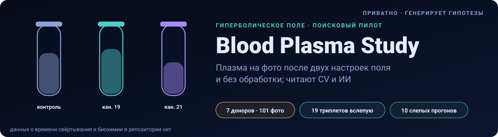
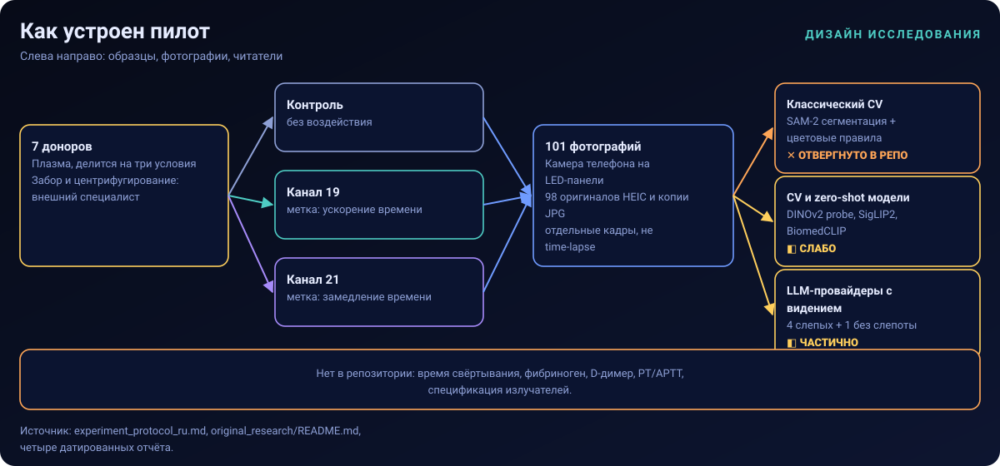
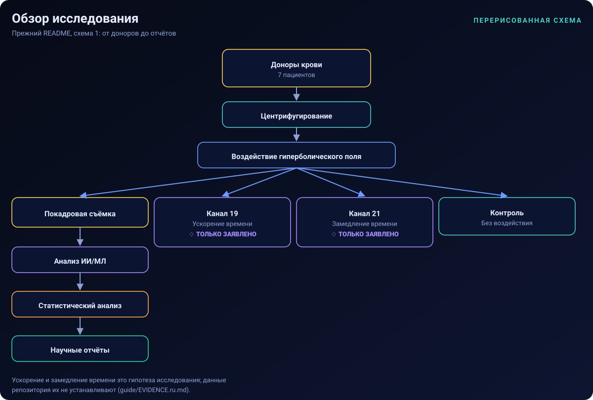
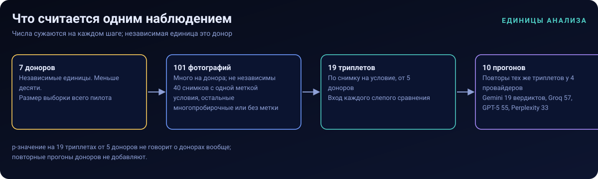
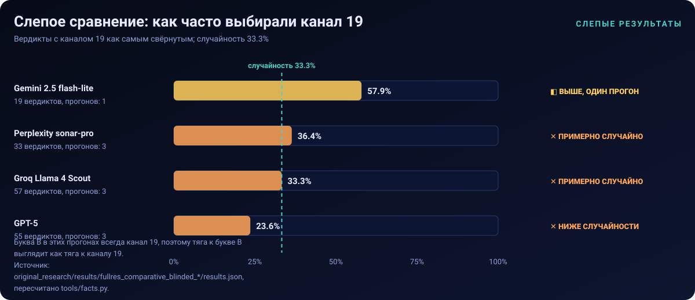
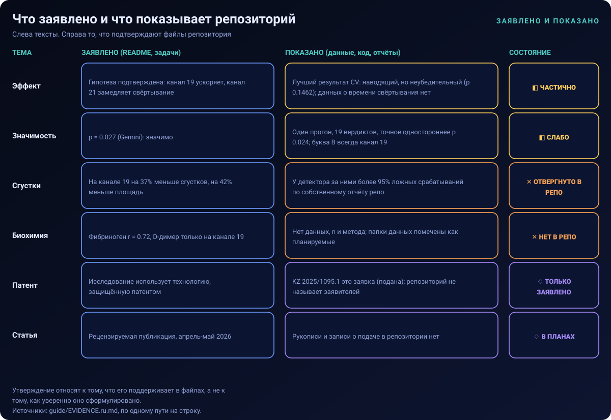
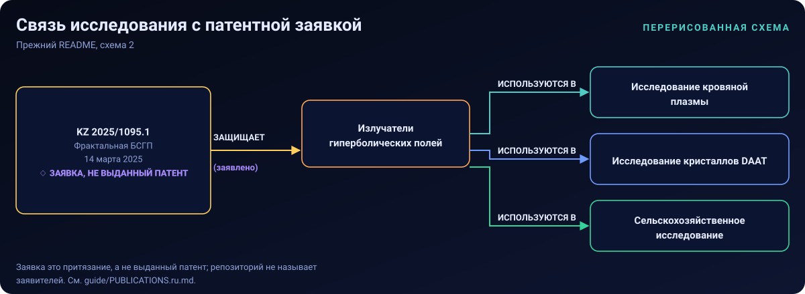

**[English](README.md) | Русский**

<div align="center">



# ИССЛЕДОВАНИЕ ПЛАЗМЫ КРОВИ ПОД ГИПЕРБОЛИЧЕСКИМИ ПОЛЯМИ

**Экспериментальные наборы данных, результаты визуализации и аналитические материалы воздействия излучателей гиперболических полей на плазму крови. Включает исходные данные, документацию контролируемой среды и ссылки на протоколы.**

| Репозиторий | Статус |
|---|---|
| `Hyperbolic_Field_BloodPlasma_Study` | Active Research (предварительно; содержание обновлено 26 марта 2026) |

**Часть экосистемы Advanced Scientific Research Projects (ASRP)**

[](https://github.com/AdvancedScientificResearchProjects)


<!-- badges -->


<!-- /badges -->

[](https://asrp.tech/en/patrons)

> **Если эта работа вам полезна, поддержите нас.** 7 уровней меценатства: от Главного Филантропа до Индивидуального Вкладчика.
>
> **Поддержать:** <https://asrp.tech/en/patrons><br>
> **Инвестиционные запросы:** _в ожидании, URL будет добавлен при появлении_

</div>

> Это публичный исследовательский репозиторий. Результаты предварительные и порождают гипотезы. Патентная заявка — притязание в области интеллектуальной собственности, а не подтверждение этого исследования.

## Коротко

- **Что это.** Поисковый пилот: плазма <!--n:donors_ru-->7 доноров<!--/n-->, разделённая на контроль без обработки и две настройки излучателя гиперболического поля (канал 19, метка «ускорение времени»; канал 21, метка «замедление времени»), сфотографированная телефоном. <!--n:photos-->101<!--/n--> фотографию оценивают компьютерное зрение, модели зрения и LLM-провайдеры с видением.
- **Что есть.** Настоящий согласованный набор данных: <!--n:photos-->101<!--/n--> фотографий, <!--n:pdfs_ru-->11 протоколов<!--/n--> в PDF, <!--n:result_files_ru-->47 файлов<!--/n--> результатов LLM, <!--n:ml_result_files_ru-->102 файла<!--/n--> ML-выходов по фото, около <!--n:scripts_lines-->7290<!--/n--> строк кода анализа, четыре датированных отчёта.
- **Что показано.** Лучший слепой прогон LLM выбрал канал 19 в <!--n:gemini_ch19-->11<!--/n--> из <!--n:triplets_ru-->19 триплетов<!--/n--> (<!--n:gemini_pct-->57.9<!--/n-->%), но буква B всегда канал 19, а точное одностороннее p равно <!--n:gemini_p_exact-->0.024<!--/n-->; остальные провайдеры на уровне случайности или ниже; ни одна модель CV не достигает p ниже 0.05. Авторы называют лучший результат CV «наводящим, но неубедительным».
- **Что не установлено.** В репозитории нет измерений времени свёртывания, фибриногена, D-димера, PT и APTT. Прежний README называл p = 0.027 «значимым» и сигнал «воспроизводимым»; собственные отчёты репозитория этого не подтверждают. Спецификации излучателей нет.
- **ИС.** Патентная связь — заявка KZ 2025/1095.1, подана и не выдана; репозиторий не называет заявителей.
- **С чего начать.** [Свидетельства](guide/EVIDENCE.ru.md) (заявлено и показано, с источниками), затем [Результаты](guide/RESULTS.ru.md).
- **Что открыто.** Расходящиеся документы протокола, непроверенный сдвиг часов и публикация, статус которой репозиторий не фиксирует: см. [Открытые вопросы](guide/OPEN.ru.md).

## Быстрая навигация

| &nbsp;&nbsp;Иконка&nbsp;&nbsp; | Раздел | Что внутри |
|:---:|---|---|
|  | **[Исследование](guide/STUDY.ru.md)** | что такое пилот, гипотеза, дизайн и протокол, ID образцов |
|  | **[Данные и фотографии](guide/DATA.ru.md)** | <!--n:photos-->101<!--/n--> фотографий, съёмка, категории, объём данных |
|  | **[Методы анализа](guide/METHODS.ru.md)** | читатели CV, zero-shot и LLM, слепота, датированные отчёты |
|  | **[Результаты](guide/RESULTS.ru.md)** | прежние таблицы, затем пересчитанные слепые подсчёты |
|  | **[Галерея рисунков](guide/FIGURES.ru.md)** | все диаграммы и схемы репозитория с папкой-источником |
|  | **[Свидетельства](guide/EVIDENCE.ru.md)** | заявлено и показано, у каждой строки путь к источнику |
|  | **[Патент, регистрация, публикация](guide/PUBLICATIONS.ru.md)** | заявка KZ, регистрация OSF, план статьи |
|  | **[Команда, задачи, экосистема](guide/ECOSYSTEM.ru.md)** | команда, таблица задач, соседние исследования |
|  | **[Навигация и структура](guide/NAVIGATION.ru.md)** | где что лежит, маршруты чтения, дерево папок |
|  | **[Открытые вопросы](guide/OPEN.ru.md)** | что расходится, что не проверено |
|  | **[Этика, поддержка, контакты](guide/ETHICS.ru.md)** | данные доноров, классификация, корпоративный контакт |

Полный список: [указатель гида](guide/README.ru.md).

**На этой странице:** [Что за исследование](#что-за-исследование) · [Дизайн и протокол](#дизайн-и-протокол) · [Данные и фотографии](#данные-и-фотографии) · [Методы анализа](#методы-анализа-и-отчёты) · [Результаты](#результаты-и-как-их-читать) · [Заявлено и показано](#заявлено-и-показано) · [Патент и регистрация](#публикации-патент-и-регистрация) · [Команда](#команда-исследования) · [Задачи](#текущие-задачи) · [Экосистема](#экосистема-asrp) · [Структура](#навигация-и-структура) · [Открытые вопросы](#открытые-вопросы) · [Этика](#этика-и-безопасность) · [Контакты](#контакты) · [Лицензия](#оговорка-и-лицензия)

---

## Что за исследование

<!-- excerpt STUDY 0 -->
Репозиторий документирует **небольшой поисковый пилот** о влиянии излучателей гиперболического поля на плазму крови. Плазма <!--n:donors_ru-->7 доноров<!--/n--> делится на контроль без обработки и два образца, помещённых на излучатели с настройками «канал 19» и «канал 21». Названия каналов — только метки: репозиторий называет канал 19 «ускорением времени», а канал 21 «замедлением времени» и нигде не приводит частоту, мощность или геометрию излучателей. После экспозиции пробирки фотографируют телефоном на светодиодной панели, а <!--n:photos-->101<!--/n--> фотографий оценивают компьютерное зрение, модели зрения и LLM-провайдеры с видением.

Гипотеза протокола (задача 1): воздействие гиперболического поля влияет на динамику свёртывания плазмы через временну́ю модуляцию: быстрый сгусток с последующим лизисом на канале 19, отложенный, но плотный сгусток на канале 21. Исследование названо первым биологическим испытанием излучателей из патентной заявки и плазменной ветвью программы 2026-2027 по гиперболическим полям (см. [Публикации, патент, регистрация](guide/PUBLICATIONS.ru.md)).

**Чем оно не является.** Во всём репозитории нет ни одного измерения времени свёртывания, фибриногена, D-димера, PT или APTT. Всё ниже фотографий вычислено по картинкам. Собственный отчёт авторов по компьютерному зрению называет лучший результат «наводящим, но неубедительным» (suggestive but inconclusive). Исследование нужно читать как порождающее гипотезы, а не как доказательство влияния поля на свёртывание (см. [Свидетельства](guide/EVIDENCE.ru.md)).

| Репозиторий | Статус |
|---|---|
| `Hyperbolic_Field_BloodPlasma_Study` | Active Research (заявлено самим репозиторием; содержание обновлено 26 марта 2026) |

**Организация:** Advanced Scientific Research Projects (ASRP), часть экосистемы ASRP. Репозиторий публичный.
<!-- /excerpt -->

Полная страница: [Исследование](guide/STUDY.ru.md)

---

## Дизайн и протокол

<!-- excerpt STUDY 1 -->
<div align="center">
<a href="guide/assets/diagrams/study-design.ru.svg"></a>
</div>

Резюме протокола (`original_research/reports/experiment_protocol_ru.md`) сообщает:

- <!--n:donors_ru-->7 доноров<!--/n-->; кровь центрифугируют (2000 об/мин, 5 мин) и отделяют плазму.
- Плазму из 4 пробирок объединяют и делят на 4 образца: 2 контрольных (не облучались, стояли в 1,5 м от излучателей), 1 образец в излучателе канала 19, 1 образец в излучателе канала 21.
- Облучение около 1 ч 12 мин на донора; объём 1 мл на образец (в некоторых случаях 1,5 мл); температура 17°C постоянно (система умного дома).
- Съёмка: камера смартфона (HEIC, конвертация в JPG), подсветка снизу (светодиодная панель), стеклянные пробирки, искусственное освещение.
- Лабораторную работу (забор крови, центрифугирование, оборудование) относят к внешнему специалисту по плазме из независимой лаборатории; руководитель исследования автор экспериментальной программы.

**Документы протокола расходятся** по нескольким пунктам (время экспозиции, тип пробирок, режим центрифугирования, антикоагулянт); различия перечислены на странице [Открытые вопросы](guide/OPEN.ru.md), здесь ни одно не разрешено. Предрегистрированный дизайн (OSF): смешанный дизайн между донорами и внутри доноров, 5-10 доноров и 30-60 аликвот, первичные исходы время образования сгустка и скорость его деградации, ANOVA с двусторонним p ниже .05 и сравнениями Tukey-Kramer. Времена свёртывания никогда не измерялись; их заменяют фотографии.

<a href="guide/assets/diagrams/redraw-overview.ru.svg"></a>

Исходная схема: <a href="original_research/charts/mermaid/root_1.png"><code>original_research/charts/mermaid/root_1.png</code></a>
<!-- /excerpt -->

Полная страница: [Исследование](guide/STUDY.ru.md#дизайн-и-протокол)

---

## Данные и фотографии

<!-- excerpt DATA 0 stop=^###.Просмотр -->
Набор данных: фотографии пробирок с плазмой (<!--n:photos-->101<!--/n-->) от <!--n:donors_ru-->7 доноров<!--/n-->, отсканированные протоколы в PDF (<!--n:pdfs-->11<!--/n-->) и журналы по донорам. Числа заново выведены из файлов `analysis.json` по донорам и из дерева файлов (`tools/facts.py`) и сходятся с цифрами README папки исследования. Сырой материал чувствителен (см. [Этика](guide/ETHICS.ru.md)): журналы доноров содержат группу крови и поминутные времена, поэтому здесь только агрегаты.

<div align="center">
<a href="guide/assets/diagrams/units.ru.svg"></a>
</div>

### Спецификации визуализации

| Параметр | Значение |
|---|---|
| Камера | Камера смартфона с высоким разрешением |
| Разрешение | 4032×3024 (12 MP) |
| Формат | <!--n:heic-->98<!--/n--> оригиналов HEIC и копии JPG |
| Частота кадров по документам | 1 кадр в 5 минут |
| Длительность по документам | 24-48 часов на образец |
| Всего кадров по документам | ~500-1000 на образец |
| Образцы в сравнении | 19 триплетов (5 доноров) |

**Строки про покадровую съёмку описывают планируемую систему, а не набор данных.** В репозитории лежат <!--n:photos-->101<!--/n--> отдельных снимков, а не серия на 24-48 часов; покадровая съёмка к тому же указана как будущая рекомендация (см. [Открытые вопросы](guide/OPEN.ru.md)).

### Категории фотографий

Прежний README перечислял такие категории <!--n:photos-->101<!--/n--> фотографий:

| Категория | Количество | Описание |
|---|---|---|
| Размеченные одноканальные | 40 фото | 13 контроль, 14 канал 19, 13 канал 21 |
| Одноканальные, выведенные из EXIF | 15 фото | Один донор, канал выведен по меткам времени камеры |
| Многоканальные сравнения | 34 фото | 2-6 пробирок на фото, всего 75 пробирок |
| Неклассифицированные | 12 фото | Метки протокола нет |

Категории дают в сумме 101 фотографию. Отчёт по CV считает те же снимки как 67 одноканальных и 34 многопробирочных, поэтому число одноканальных зависит от того, включены ли снимки, выведенные из EXIF.
<!-- /excerpt -->

Полная страница: [Данные и фотографии](guide/DATA.ru.md)

---

## Методы анализа и отчёты

<!-- excerpt METHODS 0 stop=^###.Шкала -->
<!--n:photos-->101<!--/n--> фотографий оценивают три вида читателей. Ни один не измеряет свёртывание напрямую: каждый читает картинку.

1. **Классическое компьютерное зрение.** SAM-2 выделяет область плазмы, а цветовые правила HSV считают «сгустки» (отчёт от 2026-02-25). Более поздний отчёт самого репозитория отвергает этот детектор: «<!--n:cv_false_pos-->95<!--/n-->%+ false positive rate», стенки стеклянной пробирки приняты за плазму (отчёт от 2026-02-26).
2. **Модели CV и zero-shot.** Замороженный DINOv2-large с линейным пробом (leave-one-set-out по <!--n:triplets_ru-->19 триплетов<!--/n-->), SigLIP2, BiomedCLIP и исключённый как не подходящий по распределению MedSigLIP (отчёт от 2026-03-14).
3. **LLM-провайдеры с видением.** Фото или триплеты отправляют в GPT-5, Groq Llama 4 Scout, Gemini 2.5 flash-lite, Perplexity sonar-pro и Mistral Pixtral с промптами без слепоты (реальные названия каналов) и слепыми промптами («Sample A/B/C»). Claude использовался только в проходе без слепоты от 2026-02-26.

### Провайдеры анализа (как в прежнем README)

| Провайдер | Модель | Тип анализа | Статус |
|---|---|---|---|
| ASRP Science-LLM | SAM-2 + SigLIP2 + DINOv2 | Computer Vision + ML | Завершено |
| Claude Opus 4.6 | Multimodal | LLM Vision | Завершено |
| Gemini 2.5 Flash | Google | LLM Vision | Завершено (p=0.027) |
| GPT-5 | OpenAI | LLM Vision | Завершено |
| Perplexity | Perplexity | LLM Vision | Завершено |
| DINOv2 Linear Probe | Meta | Computer Vision | Завершено (p=0.15) |
| BiomedCLIP | Specialized Medical | Medical CV | Уровень случайности (36.8%) |
| MedSigLIP | Specialized Medical | Medical CV | Вне распределения |

Прежний README называл провайдерами «8 моделей LLM + CV». В слепом сравнении фактически участвовали <!--n:blinded_providers-->4<!--/n--> семейства провайдеров в <!--n:blinded_runs-->10<!--/n--> прогонах (см. [Результаты](guide/RESULTS.ru.md)); колонка статуса фиксирует, что прогон завершён, а не что его результат есть находка.

### Слепота и чего она не делает

Слепые промпты скрывают названия каналов и контекст эксперимента, а буквы вердиктов после прогона переводятся обратно в каналы. **Порядок меток фиксирован, а не случаен:** A всегда контроль, B всегда канал 19, C всегда канал 21 (`BLIND_MAP` в `original_research/scripts/llm_analysis/data.py`). Провайдер, склонный к букве B, поэтому выглядит так, будто узнаёт канал 19. Ранние версии отчёта (1.0-3.0) посчитаны на изображениях, ошибочно уменьшенных до 512×512 пикселей; Mistral остался на этом размере.
<!-- /excerpt -->

### Отчёты

<!-- excerpt METHODS 1 stop=^###.Конвейер -->
### Все отчёты

| # | Отчёт | Дата | Статус | Прямая ссылка |
|---|---|---|---|---|
| 1 | Протокол эксперимента | 2026-02 | Завершено | [EN](original_research/reports/experiment_protocol_en.md) \| [RU](original_research/reports/experiment_protocol_ru.md) |
| 2 | Мультипровайдерный AI-анализ изображений | 2026-02-25 | Завершено | [EN](original_research/reports/2026-02-25_ai-analysis/report_en.md) \| [RU](original_research/reports/2026-02-25_ai-analysis/report_ru.md) |
| 3 | LLM Vision анализ сгустков | 2026-02-26 | Завершено | [EN](original_research/reports/2026-02-26_llm-vision-analysis/report_en.md) \| [RU](original_research/reports/2026-02-26_llm-vision-analysis/report_ru.md) |
| 4 | Сравнительный анализ LLM | 2026-03-12 | Завершено | [EN](original_research/reports/2026-03-12_comparative-llm-analysis/report_en.md) \| [RU](original_research/reports/2026-03-12_comparative-llm-analysis/report_ru.md) |
| 5 | Computer Vision + ML анализ | 2026-03-14 | Завершено | [EN](original_research/reports/2026-03-14_cv-ml-analysis/report_en.md) \| [RU](original_research/reports/2026-03-14_cv-ml-analysis/report_ru.md) |
| 6 | Интеграция биохимического анализа | In Progress | In Production | [Issue #5](https://github.com/AdvancedScientificResearchProjects/Hyperbolic_Field_BloodPlasma_Study/issues/5) |

У отчёта 6 нет файла отчёта: биохимических данных в репозитории нет (см. [Свидетельства](guide/EVIDENCE.ru.md)).
<!-- /excerpt -->

Полная страница: [Методы анализа](guide/METHODS.ru.md)

---

## Результаты и как их читать

<!-- excerpt RESULTS 1 -->
<div align="center">
<a href="guide/assets/diagrams/blinded-results.ru.svg"></a>
</div>

Слепые вердикты пересчитаны по сырым файлам `results.json` скриптом `tools/facts.py`; итоги равны сводной таблице отчёта.

| Провайдер | Прогонов | Вердиктов | Канал 19 | Контроль | Канал 21 | Доля канала 19 |
|---|---:|---:|---:|---:|---:|---:|
| Gemini 2.5 flash-lite | <!--n:gemini_runs-->1<!--/n--> | <!--n:gemini_n-->19<!--/n--> | <!--n:gemini_ch19-->11<!--/n--> | <!--n:gemini_ctrl-->5<!--/n--> | <!--n:gemini_ch21-->3<!--/n--> | <!--n:gemini_pct-->57.9<!--/n-->% |
| Perplexity sonar-pro | <!--n:perplexity_runs-->3<!--/n--> | <!--n:perplexity_n-->33<!--/n--> | <!--n:perplexity_ch19-->12<!--/n--> | <!--n:perplexity_ctrl-->8<!--/n--> | <!--n:perplexity_ch21-->13<!--/n--> | <!--n:perplexity_pct-->36.4<!--/n-->% |
| Groq Llama 4 Scout | <!--n:groq_runs-->3<!--/n--> | <!--n:groq_n-->57<!--/n--> | <!--n:groq_ch19-->19<!--/n--> | <!--n:groq_ctrl-->26<!--/n--> | <!--n:groq_ch21-->12<!--/n--> | <!--n:groq_pct-->33.3<!--/n-->% |
| GPT-5 | <!--n:openai_runs-->3<!--/n--> | <!--n:openai_n-->55<!--/n--> | <!--n:openai_ch19-->13<!--/n--> | <!--n:openai_ctrl-->13<!--/n--> | <!--n:openai_ch21-->29<!--/n--> | <!--n:openai_pct-->23.6<!--/n-->% |

Что из этого следует:

- **Один провайдер выше случайности, и в одном прогоне.** Gemini выбрал канал 19 в <!--n:gemini_ch19-->11<!--/n--> из <!--n:gemini_n-->19<!--/n--> триплетов (<!--n:gemini_pct-->57.9<!--/n-->%). Точная односторонняя биномиальная вероятность <!--n:gemini_ch19-->11<!--/n--> и более из <!--n:gemini_n-->19<!--/n--> при 1/3 равна <!--n:gemini_p_exact-->0.024<!--/n--> (посчитано здесь; отчёты и прежний README называют 0.027, а скрипта, который это выводит, в репозитории нет). Это один тест из многих, без поправки на множественные сравнения.
- **Позиция смешана с каналом.** Канал 19 всегда буква B, поэтому <!--n:gemini_ch19-->11<!--/n--> выборов буквы B у Gemini не отличить от предпочтения второй позиции.
- **Остальные провайдеры на уровне случайности или ниже** (Perplexity <!--n:perplexity_pct-->36.4<!--/n-->%, Groq <!--n:groq_pct-->33.3<!--/n-->%, GPT-5 <!--n:openai_pct-->23.6<!--/n-->% при <!--n:chance_pct-->33.3<!--/n-->%). «Воспроизводимый сигнал на разных моделях» верен, только если эти прогоны не считать.
- **Ни одна модель CV не достигает p ниже 0.05.** Лучшая, проб DINOv2, даёт <!--n:dino_probe-->47.4<!--/n-->% (9 из <!--n:triplets-->19<!--/n-->, точное p <!--n:dino_probe_p-->0.1462<!--/n-->); авторы называют это «наводящим, но неубедительным». Обрезка по плазме снижает результат с <!--n:dino_full-->47.8<!--/n-->% (целое фото) до <!--n:dino_sam-->34.3<!--/n-->%: сигнал в контексте пробирки, а не в жидкости.
- **Промпт имеет значение.** На тех же изображениях Perplexity выбирал канал 19 в <!--n:perplexity_unblinded-->0<!--/n-->% вердиктов без слепоты и в <!--n:perplexity_blinded-->53<!--/n-->% слепых.
- **Единица это донор.** <!--n:triplets_ru-->19 триплетов<!--/n--> получены от <!--n:triplet_donors-->5<!--/n--> доноров; повторные прогоны тех же триплетов доноров не добавляют.
<!-- /excerpt -->

Полная страница: [Результаты](guide/RESULTS.ru.md) (там сохранены таблицы прежнего README)

---

## Заявлено и показано

<!-- excerpt EVIDENCE 0 -->
<div align="center">
<a href="guide/assets/diagrams/claimed-vs-shown.ru.svg"></a>
</div>

Вывод в одном абзаце: это **пилот с настоящим набором данных** (<!--n:photos-->101<!--/n--> фотографий от <!--n:donors_ru-->7 доноров<!--/n-->, сохранены, посчитаны и согласованы) и **слабый, в основном отрицательный анализ этих данных**. Самое сильное число — один слепой прогон Gemini (<!--n:gemini_ch19-->11<!--/n--> из <!--n:triplets_ru-->19 триплетов<!--/n-->), который не отличить от предпочтения позиции; результаты компьютерного зрения на уровне случайности или ниже; а README и документы задач формулируют эффект сильнее, чем отчёты под ними. Ничто здесь не показывает, что поле влияет на свёртывание, и ничто не показывает, что не влияет: эксперимент свёртывание не измерял. У каждой строки ниже есть файл (и строка), который её поддерживает.
<!-- /excerpt -->

Полная страница: [Свидетельства](guide/EVIDENCE.ru.md)

---

## Публикации, патент и регистрация

<!-- excerpt PUBLICATIONS 0 -->
Исследование названо первым биологическим испытанием излучателей гиперболического поля, описанных в патентной **заявке**: KZ 2025/1095.1, «Фрактальная биомедицинская система» (FBHFS). Заявка — это притязание в области интеллектуальной собственности. Она не является выданным патентом и не подтверждает ни метод, ни результаты этого исследования. Прежний README писал, что исследование «использует технологию, защищённую патентом»; репозиторий патента и таблица программы в том же README указывают статус «Подан». Репозиторий не называет заявителей; заявка не является выданным патентом.

<div align="center">
<a href="guide/assets/diagrams/redraw-patent.ru.svg"></a>

Исходная схема: <a href="original_research/charts/mermaid/root_2.png"><code>original_research/charts/mermaid/root_2.png</code></a>
</div>

- **Репозиторий патента:** [Kazpatent_Fractal_Biomedical_System_Patent](https://github.com/denisbanchenko/Kazpatent_Fractal_Biomedical_System_Patent)
- **Задача патента 6 (связь с исследованиями):** [схема связи](https://github.com/denisbanchenko/Kazpatent_Fractal_Biomedical_System_Patent/issues/6)
- **Задача 9 здесь:** «ПАТЕНТНАЯ ЗАЯВКА: ФРАКТАЛЬНАЯ БИОМЕДИЦИНСКАЯ СИСТЕМА (KZ 2025/1095.1)», приоритет Critical, открыта (см. [Команда, задачи, экосистема](guide/ECOSYSTEM.ru.md)).

Исследование не публикует спецификацию излучателей, поэтому не может служить доказательством в заявке; репозиторий упоминает патент как сопровождающий нарратив.
<!-- /excerpt -->

### Предварительная регистрация OSF

<!-- excerpt PUBLICATIONS 1 -->
README сообщает, что исследование было предварительно зарегистрировано на OSF до сбора данных (текст регистрации в [`OSF_PREREGISTRATION.md`](OSF_PREREGISTRATION.md)).

| Параметр | Значение |
|---|---|
| Проект OSF | [osf.io/8q42f](https://osf.io/8q42f) |
| DOI | [10.17605/OSF.IO/GWA9E](https://doi.org/10.17605/OSF.IO/GWA9E) |
| Дата | 25 января 2026 |
| Тип | Предварительная регистрация OSF |
| Название | Хроно-регуляторная и биохрональная терапия: структура темпоральной регуляции в физиологии человека |
| Авторы (README) | Овсянникова, Банченко, Капустин, Савельев, внешний специалист по плазме и др. |
| Предрегистрированный дизайн | Смешанный дизайн, 5-10 доноров, 30-60 аликвот; первичные исходы время образования сгустка и скорость деградации; аналитики ослеплены |

Две оговорки. Регистрация датирована 25 января 2026, а как минимум один журнал донора в репозитории датирован раньше, поэтому «до сбора данных» для этого донора не выполняется. И предрегистрированные первичные исходы (время образования сгустка, скорость деградации) не измерялись; их заменяют фотографии (см. [Свидетельства](guide/EVIDENCE.ru.md)). Название регистрации — общая тема, а не «плазма»; репозиторий нигде не цитирует опубликованную статью под таким названием.

Существует сопутствующая регистрация исследования дрожжей (OSF osf.io/vxkum); у двух исследований общие каналы 17, 19 и 21 (см. [Команда, задачи, экосистема](guide/ECOSYSTEM.ru.md)). Регистрация — внешняя запись: её содержание здесь не проверялось.
<!-- /excerpt -->

Полная страница: [Патент, регистрация, публикация](guide/PUBLICATIONS.ru.md)

---

## Команда исследования

<!-- excerpt ECOSYSTEM 0 -->
### Руководство

| # | Имя | Роль | Обязанности | Email |
|---|---|---|---|---|
| 1 | ОВСЯННИКОВА ВАЛЕРИЯ АЛЕКСАНДРОВНА | CBE (главный биомедицинский инженер) / руководитель департамента биомедицинских исследований; главный исследователь и руководитель экспериментальных работ; соавтор технологии | Автор экспериментальной программы и методологии; разработчик исследовательской инфраструктуры и аппаратных установок; исследования полного цикла; физика гиперболических полей | [valeriaovseannicova@asrp.tech](mailto:valeriaovseannicova@asrp.tech) |
| 2 | БАНЧЕНКО ДЕНИС ЮРЬЕВИЧ | CEO ASRP / директор программы; соавтор технологии | Физика гиперболических полей; системы возбуждения; линзирование и фокусировка; ПО управления | [info@asrp.tech](mailto:info@asrp.tech) |
| 3 | КАПУСТИН МИХАЙЛО МИХАЙЛОВИЧ | CTO / директор департамента информационных технологий и ИИ; соавтор технологии | ИТ/ИИ инфраструктура; системы данных; техническая платформа; системы управления | [mykhailokapustin@asrp.tech](mailto:mykhailokapustin@asrp.tech) |
| 4 | ЗМИЕНКО КИРИЛЛ | Главный ИИ-инженер | Анализ нейронными сетями; координация мульти-LLM; специализированные модели зрения | [kyrylzmiienko@asrp.tech](mailto:kyrylzmiienko@asrp.tech) |
| 5 | ОВСЯННИКОВ АЛЕКСАНДР | Главный инженер по аппаратному обеспечению; инженер технологии | Электрические и силовые системы; системы возбуждения гиперболических излучателей; проектирование силовых компонентов | [alexandrovsyannikov@asrp.tech](mailto:alexandrovsyannikov@asrp.tech) |

### Коллабораторы

| Имя | Организация | Роль | Email |
|---|---|---|---|
| САВЕЛЬЕВ ИВАН | ASRP.science | Директор по науке / главный редактор | не приводится (конфиденциальность) |

Второй коллаборатор, независимый специалист по плазме крови из внешней лаборатории, указан в прежнем README за забор крови и центрифугирование. Имя и личный контакт здесь намеренно не повторяются (см. [Этика и контакты](guide/ETHICS.ru.md)); с этим человеком связываются через ASRP.

Роли приведены по прежнему README. Репозиторий также фиксирует один аккаунт GitHub с 18 из 66 коммитов, который не назван ни в одной таблице команды.
<!-- /excerpt -->

---

## Текущие задачи

<!-- excerpt ECOSYSTEM 1 -->
| Задача # | Название | Статус | Приоритет | Исполнители |
|---|---|---|---|---|
| [#9](https://github.com/AdvancedScientificResearchProjects/Hyperbolic_Field_BloodPlasma_Study/issues/9) | ПАТЕНТНАЯ ЗАЯВКА: ФРАКТАЛЬНАЯ БИОМЕДИЦИНСКАЯ СИСТЕМА (KZ 2025/1095.1) | Открыто | Критический | Valeria Ovseannicova, Denis Banchenko, Mykhailo Kapustin |
| [#8](https://github.com/AdvancedScientificResearchProjects/Hyperbolic_Field_BloodPlasma_Study/issues/8) | ПОДГОТОВКА НАУЧНОЙ СТАТЬИ | Открыто | Высокий | Ivan Savelyev |
| [#7](https://github.com/AdvancedScientificResearchProjects/Hyperbolic_Field_BloodPlasma_Study/issues/7) | ПРОТОКОЛ ОСЛЕПЛЕНИЯ | Открыто | Средний | Kyryl Zmiienko |
| [#6](https://github.com/AdvancedScientificResearchProjects/Hyperbolic_Field_BloodPlasma_Study/issues/6) | СИСТЕМА ПОКАДРОВОЙ СЪЁМКИ | Открыто | Средний | Valeria Ovseannicova, Kyryl Zmiienko |
| [#5](https://github.com/AdvancedScientificResearchProjects/Hyperbolic_Field_BloodPlasma_Study/issues/5) | ИНТЕГРАЦИЯ БИОХИМИЧЕСКОГО АНАЛИЗА | Открыто | Средний | Valeria Ovseannicova |
| [#4](https://github.com/AdvancedScientificResearchProjects/Hyperbolic_Field_BloodPlasma_Study/issues/4) | РАСШИРЕНИЕ БАЗЫ ДОНОРОВ ДО 30 УЧАСТНИКОВ | Открыто | Низкий | Valeria Ovseannicova |
| [#3](https://github.com/AdvancedScientificResearchProjects/Hyperbolic_Field_BloodPlasma_Study/issues/3) | ПРОТОКОЛ КРОВЯНОЙ ПЛАЗМЫ | Открыто | Низкий | Valeria Ovseannicova |
| [#2](https://github.com/AdvancedScientificResearchProjects/Hyperbolic_Field_BloodPlasma_Study/issues/2) | ПРОГРАММА ИССЛЕДОВАНИЙ ГИПЕРБОЛИЧЕСКИХ ПОЛЕЙ ASRP 2026-2027: ГЛАВНЫЙ ХАБ | Открыто | Низкий | Denis Banchenko |
| [#1](https://github.com/AdvancedScientificResearchProjects/Hyperbolic_Field_BloodPlasma_Study/issues/1) | ПРОТОКОЛ ИССЛЕДОВАНИЯ СВЁРТЫВАНИЯ ПЛАЗМЫ КРОВИ ПОД ГИПЕРБОЛИЧЕСКИМИ ПОЛЯМИ | Открыто | Низкий | Valeria Ovseannicova |

В таблице <!--n:issues_listed-->9<!--/n--> задач. Документы задач в репозитории есть только для 1, 2, 3, 5, 6 и 8 (<!--n:issue_docs_ru-->6 документов<!--/n--> в `ADVANCED_SCIENTIFIC_RESEARCH_PROJECTS/`); задачи 4, 7 и 9 существуют лишь как строки таблицы, поэтому список нельзя сверить с GitHub отсюда.
<!-- /excerpt -->

---

## Экосистема ASRP

<!-- excerpt ECOSYSTEM 2 -->
### Связанные исследовательские репозитории

Прежний README утверждает, что все репозитории ниже используют излучатели гиперболического поля, на которые подана патентная заявка KZ 2025/1095.1 (заявка, а не выданный патент; см. [Патент, регистрация, публикация](guide/PUBLICATIONS.ru.md)).

| # | Репозиторий | Прямая ссылка | Направление исследования | Статус |
|---|---|---|---|---|
| 1 | Blood Plasma Study | [Открыть](https://github.com/AdvancedScientificResearchProjects/Hyperbolic_Field_BloodPlasma_Study) | Свёртываемость крови | Активно |
| 2 | DAAT Crystal Study | [Открыть](https://github.com/AdvancedScientificResearchProjects/Hyperbolic_Field_DAAT_Crystal_Study) | Взаимодействие человек-кристалл | Активно |
| 3 | Agricultural Study | [Открыть](https://github.com/AdvancedScientificResearchProjects/Hyperbolic_Field_Agricultural_Study) | Рост растений и грибов | Расширяется |
| 4 | Emitter Programs | [Открыть](https://github.com/AdvancedScientificResearchProjects/Hyperbolic_Field_Emitter_Programs) | ПО управления излучателями | Разработка |
| 5 | Saccharomyces cerevisiae Study | [Открыть](https://github.com/AdvancedScientificResearchProjects/Hyperbolic_Field_SaccharomycesCerevisiae_Study) | Динамика деления дрожжей: сопутствующее исследование, общие каналы CH17/19/21 | Активно |

Исследования — соседи; код и данные одного не импортируются в другое. ПО управления излучателями из репозитория 4 в этот репозиторий не входит.

### Патентные репозитории

| # | Репозиторий | Прямая ссылка | Патент | Статус |
|---|---|---|---|---|
| 1 | Fractal FBHFS Patent | [Открыть](https://github.com/denisbanchenko/Kazpatent_Fractal_Biomedical_System_Patent) | KZ 2025/1095.1 | Подан |

Данные и код этого исследования импортированы из более раннего рабочего репозитория (`HyperbolicField-BloodPlasma-Study`).
<!-- /excerpt -->

Полная страница: [Команда, задачи, экосистема](guide/ECOSYSTEM.ru.md)

---

## Навигация и структура

<!-- excerpt NAVIGATION 0 stop=^###.Быстрые -->
С чего начинать, зависит от вопроса:

| Если нужно | Читать |
|---|---|
| Что за исследование и как оно проводилось | [Исследование](guide/STUDY.ru.md), затем `original_research/reports/experiment_protocol_ru.md` |
| Выдерживают ли утверждения проверку | [Свидетельства](guide/EVIDENCE.ru.md), у каждой строки путь к источнику |
| Числа как заявлены и как их читать | [Результаты](guide/RESULTS.ru.md) |
| Все диаграммы и схемы с их папкой | [Галерея рисунков](guide/FIGURES.ru.md) |
| Фотографии и подсчёты | [Данные и фотографии](guide/DATA.ru.md), затем `original_research/data/` |
| Код анализа и четыре датированных отчёта | [Методы анализа](guide/METHODS.ru.md), затем `original_research/scripts/` и `original_research/reports/` |
| Патент, регистрация, статья | [Патент, регистрация, публикация](guide/PUBLICATIONS.ru.md) |
| Что не решено | [Открытые вопросы](guide/OPEN.ru.md) |

В репозитории три части. `original_research/` содержит всё, что дал эксперимент (данные, код, результаты, отчёты, графики). `ADVANCED_SCIENTIFIC_RESEARCH_PROJECTS/` — зеркало хаба программы: README программы и документы задач. Оно не идентично корневому README по байтам (расходящаяся копия, <!--n:mirror_files-->47<!--/n--> файла), поэтому корень и зеркало могут противоречить друг другу. `OSF_PREREGISTRATION.md` хранит текст регистрации. Главная страница и `guide/` добавлены 2026-11-19; ни один существующий файл не перемещён, не изменён и не удалён, а прежний README сохранён байт в байт в [`archive/`](archive/README_2026-11-19_pre-showcase.md).

### Дерево папок

<!-- tree -->
```
Hyperbolic_Field_BloodPlasma_Study/
├── README.md                               # главная страница (английская)
├── README.ru.md                            # главная страница (русская)
├── guide/                                  # страницы-детали X.md + X.ru.md; assets/ = сгенерированные SVG
├── archive/                                # прежний README, сохранён байт в байт
├── tools/                                  # инструменты витрины: факты, визуалы, выдержки, проверка без потерь
├── tests/                                  # регрессионный гейт витрины
├── OSF_PREREGISTRATION.md                  # текст предварительной регистрации OSF (двуязычный)
├── original_research/                      # все данные, код, результаты и отчёты
│   ├── README.md                           # вход в папку исследования
│   ├── data/                               # 7 папок доноров: фото, PDF-протоколы, журналы (чувствительно)
│   ├── processed/                          # сводный JSON по донорам
│   ├── results/                            # 47 файлов результатов LLM в 48 папках прогонов
│   ├── reports/                            # протокол + 4 отчёта анализа (EN и RU)
│   ├── scripts/                            # 22 файла Python: llm_analysis/, cv_analysis/
│   ├── notebooks/                          # cv_analysis.ipynb, 42.9 МБ
│   ├── charts/                             # 3 сводных графика + 11 PNG Mermaid
│   ├── en/                                 # английский документационный хаб
│   └── ru/                                 # русский документационный хаб
└── ADVANCED_SCIENTIFIC_RESEARCH_PROJECTS/  # зеркало хаба программы: README + 6 документов задач (47 файла)
```
<!-- /tree -->
<!-- /excerpt -->

Полная страница: [Навигация и структура](guide/NAVIGATION.ru.md)

---

## Открытые вопросы

<!-- excerpt OPEN 0 mode=headings -->
- [Документы протокола расходятся](guide/OPEN.ru.md#документы-протокола-расходятся)
- [Ось времени](guide/OPEN.ru.md#ось-времени)
- [Подсчёты и статистика](guide/OPEN.ru.md#подсчёты-и-статистика)
- [Внутри отчётов](guide/OPEN.ru.md#внутри-отчётов)
- [Модели и провайдеры](guide/OPEN.ru.md#модели-и-провайдеры)
- [Вне файлов](guide/OPEN.ru.md#вне-файлов)
- [Не проверено](guide/OPEN.ru.md#не-проверено)
<!-- /excerpt -->

Полная страница: [Открытые вопросы](guide/OPEN.ru.md)

---

## Этика и безопасность

<!-- excerpt ETHICS 0 stop=^###.Утверждения -->
Исследование работает с плазмой крови доноров-людей. В репозитории лежат журналы доноров (группа крови, поминутные времена сессий), отсканированные PDF-протоколы со встроенными фотографиями и метаданные EXIF. **Поэтому на этих страницах только агрегаты:** ни один донор не описан по отдельности, доноры названы только номерами. Информированное согласие и скрининг доноров прописаны в задаче протокола (задача 3), но **документа о согласии в репозитории нет**, а резюме протокола упоминает доноров на антибиотиках (см. [Открытые вопросы](guide/OPEN.ru.md)). Работать с сырым материалом доноров следует по классификации ниже.

### Классификация данных

| Уровень | Доступ | Маркировка | Описание |
|---|---|---|---|
| ПУБЛИЧНЫЙ | Открытый | ЗЕЛЁНЫЙ | Общая информация |
| ИССЛЕДОВАТЕЛЬСКИЙ | Только команда | ЖЁЛТЫЙ | Исследовательские данные |
| ОГРАНИЧЕННЫЙ | Основная команда | КРАСНЫЙ | Конфиденциальный анализ |
| ВНУТРЕННИЙ | Только директор | ЧЁРНЫЙ | Только обзор уровня директора |

Материалы по донорам (`original_research/data/`) следует считать ОГРАНИЧЕННЫМИ. Репозиторий публичный, поэтому всё, что в нём лежит, видно любому читателю. Нужен просмотр журналов доноров, PDF и данных по фото, а также проверка истории git; эта реструктуризация не меняла и не удаляла ни одного файла данных.
<!-- /excerpt -->

Полная страница: [Этика, поддержка, контакты](guide/ETHICS.ru.md)

---

## Контакты

<!-- excerpt ETHICS 1 -->
### Корпоративный контакт

| Поле | Значение |
|---|---|
| Организация | ТОО "Перспективные Научно-Исследовательские Разработки" / Advanced Scientific Research Projects LLP |
| Страна | Республика Казахстан |
| Веб-сайт | [asrp.tech](https://asrp.tech) |
| Email | info@asrp.tech |

### Контакты команды

| Имя | Email | Роль |
|---|---|---|
| Валерия Овсянникова | [valeriaovseannicova@asrp.tech](mailto:valeriaovseannicova@asrp.tech) | CBE / руководитель департамента биомедицинских исследований, главный исследователь и руководитель экспериментальных работ |
| Денис Банченко | [info@asrp.tech](mailto:info@asrp.tech) | CEO / программный директор |
| Михайло Капустин | [mykhailokapustin@asrp.tech](mailto:mykhailokapustin@asrp.tech) | CTO / ИТ и ИИ |
| Кирилл Змиенко | [kyrylzmiienko@asrp.tech](mailto:kyrylzmiienko@asrp.tech) | Главный ИИ-инженер |
| Иван Савельев | не приводится (конфиденциальность) | Директор по науке / ASRP.science |
| Александр Овсянников | [alexandrovsyannikov@asrp.tech](mailto:alexandrovsyannikov@asrp.tech) | Главный инженер оборудования |

Все адреса выше — адреса корпоративного домена. С внешним коллаборатором связываются через ASRP.
<!-- /excerpt -->

---

## Оговорка и лицензия

**© 2026 Перспективные Научно-Исследовательские Разработки (ПНИР). Все права защищены.**

Этот репозиторий — публичная исследовательская запись. Результаты предварительные, порождают гипотезы и не являются клиническими; патентная заявка — притязание в области интеллектуальной собственности, а не подтверждение. Главная страница и страницы в `guide/` реструктурированы <!--n:as_of-->2026-11-19<!--/n-->; прежний README сохранён байт в байт в [`archive/`](archive/README_2026-11-19_pre-showcase.md).

<div align="center">

---

**Последнее обновление:** 26 марта 2026 (содержание); реструктуризация витрины <!--n:as_of-->2026-11-19<!--/n--><br>
**Статус:** Активное исследование<br>
**Язык документации:** English \| Русский (полностью двуязычная)

---

**АКТИВНОЕ ИССЛЕДОВАНИЕ**

**НАУКА НА ОСНОВЕ ДАННЫХ**

**ДВУЯЗЫЧНАЯ ДОКУМЕНТАЦИЯ**

</div>
