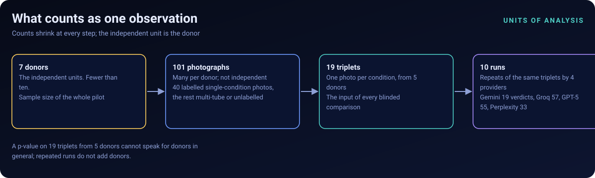
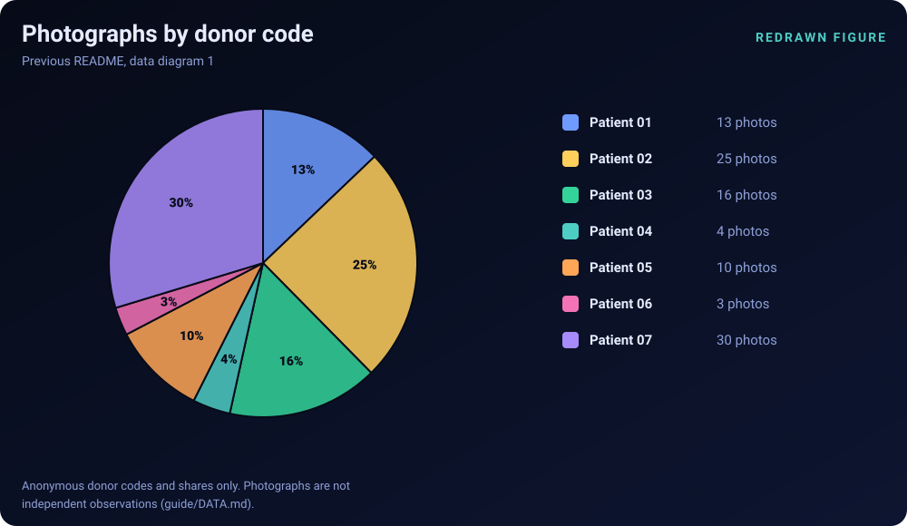
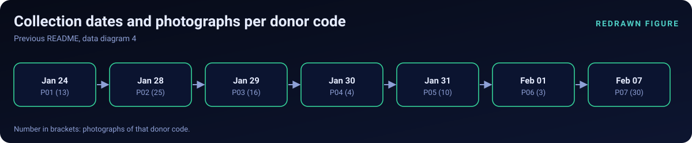

**English | [Русский](DATA.ru.md)**

[← Blood Plasma Study](../README.md) · [Guide index](README.md)

# Data and photographs

## Data and photographs

The dataset is <!--n:photos-->101<!--/n--> photographs of plasma tubes from <!--n:donors-->7<!--/n--> donors, <!--n:pdfs-->11<!--/n--> scanned protocol PDFs, and per-donor logs. The counts were re-derived from the per-donor `analysis.json` files and the file tree (`tools/facts.py`) and agree with the figures of the research folder README. The raw material is sensitive (see [Ethics](ETHICS.md)): per-donor logs carry blood group and minute-level times, so this page gives aggregates only.

### Imaging specifications

| Parameter | Value |
|---|---|
| Camera | High-resolution smartphone camera |
| Resolution | 4032×3024 (12 MP) |
| Format | <!--n:heic-->98<!--/n--> HEIC originals with JPG conversions |
| Frame rate as documented | 1 frame per 5 minutes |
| Duration as documented | 24-48 hours per sample |
| Total frames as documented | ~500-1000 per sample |
| Samples in the comparison | 19 triplets (5 donors) |

**The time-lapse rows describe a planned system, not the dataset.** What the repository holds is <!--n:photos-->101<!--/n--> still photographs, not a 24-48 hour series; time-lapse is also listed as a future recommendation (see [Open questions](OPEN.md)).

### Photo categories

The previous README listed these categories of the <!--n:photos-->101<!--/n--> photographs:

| Category | Count | Description |
|---|---|---|
| Labeled single-channel | 40 photos | 13 control, 14 channel 19, 13 channel 21 |
| EXIF-inferred single-channel | 15 photos | One donor, channel inferred from camera timestamps |
| Multi-channel comparison | 34 photos | 2-6 tubes per photo, 75 tubes total |
| Unclassified | 12 photos | No protocol label available |

The categories add up to 101 photographs. The CV report counts the same photographs as 67 single-channel and 34 multi-tube, so the single-channel figure depends on whether EXIF-inferred photos are included.

### Browse the photographs

Photographs are kept per donor in `original_research/data/patient-XX/photos/` (`original/` holds the HEIC files, `jpg/` the converted copies). Open [`original_research/data/`](../original_research/data/) to browse; each donor folder also holds the protocol PDFs, `metadata.json` (EXIF) and `en/` and `ru/` logs.

### Data volume

| Data type | Volume | Location |
|---|---|---|
| Total photos | <!--n:photos-->101<!--/n--> images | `original_research/data/patient-XX/photos/` |
| PDF protocols | ~637 MB per the previous README (<!--n:pdfs-->11<!--/n--> files; <!--n:pdf_mb-->667<!--/n--> MB in decimal units, about 636 MiB) | `original_research/data/patient-XX/` |
| Jupyter notebooks | <!--n:notebook_mb-->42.9<!--/n--> MB | `original_research/notebooks/` |
| JSON analysis files | ~1.2 MB | `original_research/data/patient-XX/en/`, `original_research/processed/` |
| LLM result files | <!--n:result_files-->47<!--/n--> files in <!--n:result_folders-->48<!--/n--> folders | `original_research/results/` |
| Per-photo ML outputs | <!--n:ml_result_files-->102<!--/n--> files | `original_research/scripts/cv_analysis/ml_results/` |
| Reports | <!--n:reports_dated-->4<!--/n--> dated reports plus the protocol | `original_research/reports/` |

The protocol PDFs (19.7 to 93.5 MB each) are ordinary Git blobs, not Git LFS; the working tree is about 1.8 GB. Folder layout: see [Navigation and structure](NAVIGATION.md).

## More figures redrawn from the previous README and the programme issues

Each figure below was a Mermaid PNG; it is redrawn with the same content and the original stays in the repository.

Original figure: <a href="../original_research/charts/mermaid/data_1.png"><code>original_research/charts/mermaid/data_1.png</code></a> · <a href="../ADVANCED_SCIENTIFIC_RESEARCH_PROJECTS/Hyperbolic_Field_BloodPlasma_Study/charts/mermaid/advdataretry_1.png"><code>ADVANCED_SCIENTIFIC_RESEARCH_PROJECTS/Hyperbolic_Field_BloodPlasma_Study/charts/mermaid/advdataretry_1.png</code></a>

Original figure: <a href="../original_research/charts/mermaid/data_4.png"><code>original_research/charts/mermaid/data_4.png</code></a> · <a href="../ADVANCED_SCIENTIFIC_RESEARCH_PROJECTS/Hyperbolic_Field_BloodPlasma_Study/charts/mermaid/advdata_2.png"><code>ADVANCED_SCIENTIFIC_RESEARCH_PROJECTS/Hyperbolic_Field_BloodPlasma_Study/charts/mermaid/advdata_2.png</code></a>

