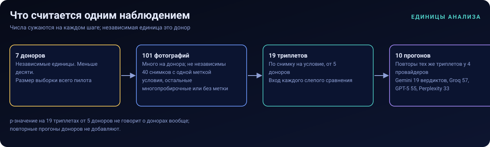
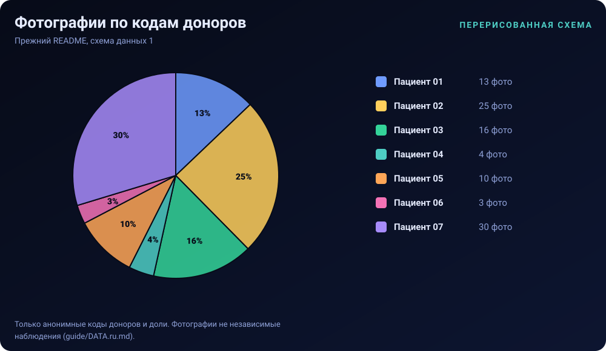
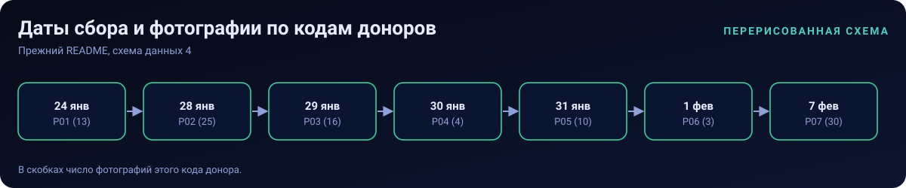

**[English](DATA.md) | Русский**

[← Blood Plasma Study](../README.ru.md) · [Указатель гида](README.ru.md)

# Данные и фотографии

## Данные и фотографии

Набор данных: фотографии пробирок с плазмой (<!--n:photos-->101<!--/n-->) от <!--n:donors_ru-->7 доноров<!--/n-->, отсканированные протоколы в PDF (<!--n:pdfs-->11<!--/n-->) и журналы по донорам. Числа заново выведены из файлов `analysis.json` по донорам и из дерева файлов (`tools/facts.py`) и сходятся с цифрами README папки исследования. Сырой материал чувствителен (см. [Этика](ETHICS.ru.md)): журналы доноров содержат группу крови и поминутные времена, поэтому здесь только агрегаты.

### Спецификации визуализации

| Параметр | Значение |
|---|---|
| Камера | Камера смартфона с высоким разрешением |
| Разрешение | 4032×3024 (12 MP) |
| Формат | <!--n:heic-->98<!--/n--> оригиналов HEIC и копии JPG |
| Частота кадров по документам | 1 кадр в 5 минут |
| Длительность по документам | 24-48 часов на образец |
| Всего кадров по документам | ~500-1000 на образец |
| Образцы в сравнении | 19 триплетов (5 доноров) |

**Строки про покадровую съёмку описывают планируемую систему, а не набор данных.** В репозитории лежат <!--n:photos-->101<!--/n--> отдельных снимков, а не серия на 24-48 часов; покадровая съёмка к тому же указана как будущая рекомендация (см. [Открытые вопросы](OPEN.ru.md)).

### Категории фотографий

Прежний README перечислял такие категории <!--n:photos-->101<!--/n--> фотографий:

| Категория | Количество | Описание |
|---|---|---|
| Размеченные одноканальные | 40 фото | 13 контроль, 14 канал 19, 13 канал 21 |
| Одноканальные, выведенные из EXIF | 15 фото | Один донор, канал выведен по меткам времени камеры |
| Многоканальные сравнения | 34 фото | 2-6 пробирок на фото, всего 75 пробирок |
| Неклассифицированные | 12 фото | Метки протокола нет |

Категории дают в сумме 101 фотографию. Отчёт по CV считает те же снимки как 67 одноканальных и 34 многопробирочных, поэтому число одноканальных зависит от того, включены ли снимки, выведенные из EXIF.

### Просмотр фотографий

Фотографии лежат по донорам в `original_research/data/patient-XX/photos/` (в `original/` файлы HEIC, в `jpg/` конвертированные копии). Откройте [`original_research/data/`](../original_research/data/); в папке каждого донора также PDF-протоколы, `metadata.json` (EXIF) и журналы `en/` и `ru/`.

### Объём данных

| Тип данных | Объём | Расположение |
|---|---|---|
| Всего фотографий | <!--n:photos-->101<!--/n--> изображение | `original_research/data/patient-XX/photos/` |
| PDF-протоколы | ~637 МБ по прежнему README (<!--n:pdfs_ru-->11 протоколов<!--/n-->; <!--n:pdf_mb-->667<!--/n--> МБ в десятичных единицах, около 636 МиБ) | `original_research/data/patient-XX/` |
| Ноутбуки Jupyter | <!--n:notebook_mb-->42.9<!--/n--> МБ | `original_research/notebooks/` |
| JSON-файлы анализа | ~1.2 МБ | `original_research/data/patient-XX/en/`, `original_research/processed/` |
| Файлы результатов LLM | <!--n:result_files_ru-->47 файлов<!--/n--> в <!--n:result_folders-->48<!--/n--> папках | `original_research/results/` |
| Выходы ML по фото | <!--n:ml_result_files_ru-->102 файла<!--/n--> | `original_research/scripts/cv_analysis/ml_results/` |
| Отчёты | <!--n:reports_dated-->4<!--/n--> датированных отчёта и протокол | `original_research/reports/` |

PDF-протоколы (по 19,7-93,5 МБ) лежат обычными блобами Git, не в Git LFS; рабочее дерево около 1,8 ГБ. Структура папок: см. [Навигация и структура](NAVIGATION.ru.md).

## Ещё схемы, перерисованные из прежнего README и задач программы

Каждая схема ниже была Mermaid-PNG; она перерисована с тем же содержанием, оригинал остаётся в репозитории.

Исходная схема: <a href="../original_research/charts/mermaid/data_1.png"><code>original_research/charts/mermaid/data_1.png</code></a> · <a href="../ADVANCED_SCIENTIFIC_RESEARCH_PROJECTS/Hyperbolic_Field_BloodPlasma_Study/charts/mermaid/advdataretry_1.png"><code>ADVANCED_SCIENTIFIC_RESEARCH_PROJECTS/Hyperbolic_Field_BloodPlasma_Study/charts/mermaid/advdataretry_1.png</code></a>

Исходная схема: <a href="../original_research/charts/mermaid/data_4.png"><code>original_research/charts/mermaid/data_4.png</code></a> · <a href="../ADVANCED_SCIENTIFIC_RESEARCH_PROJECTS/Hyperbolic_Field_BloodPlasma_Study/charts/mermaid/advdata_2.png"><code>ADVANCED_SCIENTIFIC_RESEARCH_PROJECTS/Hyperbolic_Field_BloodPlasma_Study/charts/mermaid/advdata_2.png</code></a>

