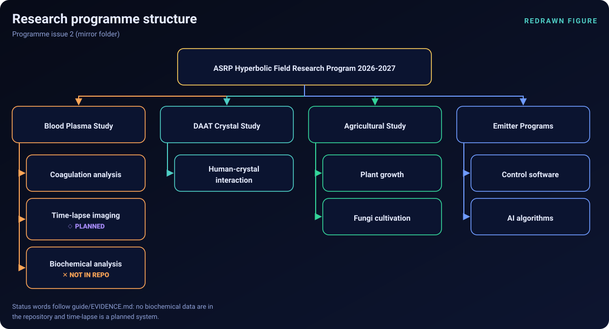
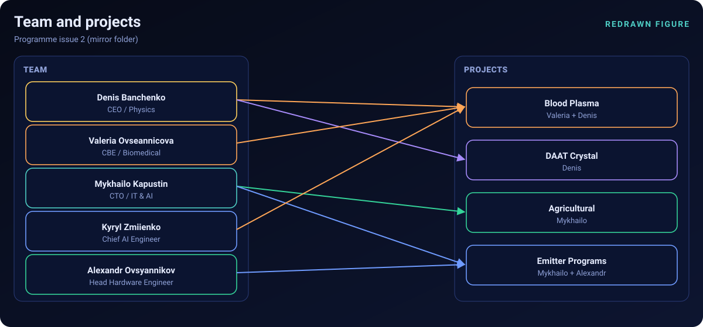
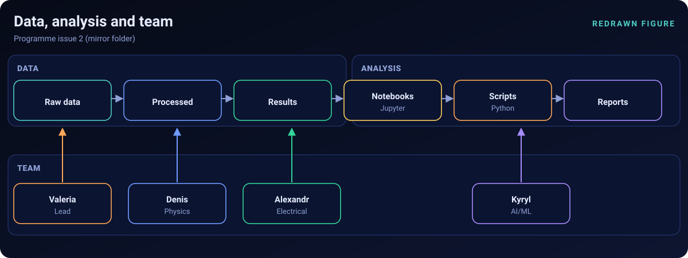
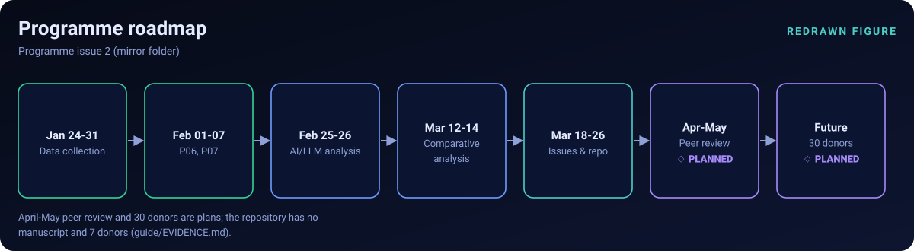

**English | [Русский](ECOSYSTEM.ru.md)**

[← Blood Plasma Study](../README.md) · [Guide index](README.md)

# Team, issues and the ASRP ecosystem

## Research team

### Leadership

| # | Name | Role | Responsibilities | Email |
|---|---|---|---|---|
| 1 | OVSEANNICOVA VALERIA ALEXANDROVNA | CBE (Chief Biomedical Engineer) / Director of Biomedical Research Department; Chief Researcher & Head of Experimental Work; Technology Co-Author | Author of the experimental program and methodology; research infrastructure and hardware development; full-cycle research; hyperbolic field physics | [valeriaovseannicova@asrp.tech](mailto:valeriaovseannicova@asrp.tech) |
| 2 | BANCHENKO DENIS YURIEVICH | CEO ASRP / Program Director; Technology Co-Author | Hyperbolic field physics; excitation systems; lensing & focusing; control software | [info@asrp.tech](mailto:info@asrp.tech) |
| 3 | KAPUSTIN MYKHAILO MYKHALOVICH | CTO (Chief Technology Officer) / Director of IT & AI Department; Technology Co-Author | IT/AI infrastructure; data systems; technical platform; control systems | [mykhailokapustin@asrp.tech](mailto:mykhailokapustin@asrp.tech) |
| 4 | ZMIENKO KYRYL | Chief AI Engineer | Neural network analysis; multi-LLM coordination; specialized vision models | [kyrylzmiienko@asrp.tech](mailto:kyrylzmiienko@asrp.tech) |
| 5 | OVSYANNIKOV ALEXANDR | Head Hardware Engineer; Technology Engineer | Electrical and power systems; hyperbolic emitter excitation; power components design | [alexandrovsyannikov@asrp.tech](mailto:alexandrovsyannikov@asrp.tech) |

### Collaborators

| Name | Organization | Role | Email |
|---|---|---|---|
| SAVELYEV IVAN | ASRP.science | Science Director / Editor-in-Chief | not reproduced (privacy) |

A second collaborator, an independent blood plasma specialist of an external laboratory, is credited in the previous README for blood collection and centrifugation. Name and personal contact are deliberately not repeated here (see [Ethics and contact](ETHICS.md)); the person is reached via ASRP.

Roles are as stated in the previous README. The repository also records one GitHub account with 18 of its 66 commits that is not named anywhere in the team tables.

## Active issues and tasks

| Issue # | Title | Status | Priority | Assignees |
|---|---|---|---|---|
| [#9](https://github.com/AdvancedScientificResearchProjects/Hyperbolic_Field_BloodPlasma_Study/issues/9) | PATENT APPLICATION: FRACTAL BIOMEDICAL (KZ 2025/1095.1) | Open | Critical | Valeria Ovseannicova, Denis Banchenko, Mykhailo Kapustin |
| [#8](https://github.com/AdvancedScientificResearchProjects/Hyperbolic_Field_BloodPlasma_Study/issues/8) | PEER REVIEW PUBLICATION PREPARATION | Open | High | Ivan Savelyev |
| [#7](https://github.com/AdvancedScientificResearchProjects/Hyperbolic_Field_BloodPlasma_Study/issues/7) | BLIND ANALYSIS PROTOCOL | Open | Medium | Kyryl Zmiienko |
| [#6](https://github.com/AdvancedScientificResearchProjects/Hyperbolic_Field_BloodPlasma_Study/issues/6) | TIME-LAPSE PHOTOGRAPHY SYSTEM | Open | Medium | Valeria Ovseannicova, Kyryl Zmiienko |
| [#5](https://github.com/AdvancedScientificResearchProjects/Hyperbolic_Field_BloodPlasma_Study/issues/5) | BIOCHEMICAL ANALYSIS INTEGRATION | Open | Medium | Valeria Ovseannicova |
| [#4](https://github.com/AdvancedScientificResearchProjects/Hyperbolic_Field_BloodPlasma_Study/issues/4) | EXPAND DONOR BASE TO 30 PARTICIPANTS | Open | Low | Valeria Ovseannicova |
| [#3](https://github.com/AdvancedScientificResearchProjects/Hyperbolic_Field_BloodPlasma_Study/issues/3) | BLOOD PLASMA PROTOCOL | Open | Low | Valeria Ovseannicova |
| [#2](https://github.com/AdvancedScientificResearchProjects/Hyperbolic_Field_BloodPlasma_Study/issues/2) | ASRP HYPERBOLIC FIELD RESEARCH PROGRAM 2026-2027: MASTER HUB | Open | Low | Denis Banchenko |
| [#1](https://github.com/AdvancedScientificResearchProjects/Hyperbolic_Field_BloodPlasma_Study/issues/1) | HYPERBOLIC FIELD BLOOD PLASMA COAGULATION STUDY PROTOCOL | Open | Low | Valeria Ovseannicova |

The table lists <!--n:issues_listed-->9<!--/n--> issues. Issue documents exist in the repository for 1, 2, 3, 5, 6 and 8 only (<!--n:issue_docs-->6<!--/n--> files under `ADVANCED_SCIENTIFIC_RESEARCH_PROJECTS/`); issues 4, 7 and 9 exist only as table rows, so the list cannot be checked against GitHub from here.

## ASRP ecosystem

### Related research repositories

The previous README states that all repositories below use hyperbolic field emitters covered by the patent application KZ 2025/1095.1 (an application, not a granted patent; see [Publications, patent, preregistration](PUBLICATIONS.md)).

| # | Repository | Direct link | Research focus | Status |
|---|---|---|---|---|
| 1 | Blood Plasma Study | [View](https://github.com/AdvancedScientificResearchProjects/Hyperbolic_Field_BloodPlasma_Study) | Blood coagulation | Active |
| 2 | DAAT Crystal Study | [View](https://github.com/AdvancedScientificResearchProjects/Hyperbolic_Field_DAAT_Crystal_Study) | Human-crystal interaction | Active |
| 3 | Agricultural Study | [View](https://github.com/AdvancedScientificResearchProjects/Hyperbolic_Field_Agricultural_Study) | Plant & fungi growth | Growing |
| 4 | Emitter Programs | [View](https://github.com/AdvancedScientificResearchProjects/Hyperbolic_Field_Emitter_Programs) | Emitter control software | Development |
| 5 | Saccharomyces cerevisiae Study | [View](https://github.com/AdvancedScientificResearchProjects/Hyperbolic_Field_SaccharomycesCerevisiae_Study) | Yeast cell division dynamics: companion study, shared CH17/19/21 | Active |

The studies are siblings; no code or data from one is imported into another. The emitter control software of repository 4 is not part of this repository.

### Patent repositories

| # | Repository | Direct link | Patent | Status |
|---|---|---|---|---|
| 1 | Fractal FBHFS Patent | [View](https://github.com/denisbanchenko/Kazpatent_Fractal_Biomedical_System_Patent) | KZ 2025/1095.1 | Filed |

The data and code of this study were imported from an earlier working repository (`HyperbolicField-BloodPlasma-Study`).

## More figures redrawn from the previous README and the programme issues

Each figure below was a Mermaid PNG; it is redrawn with the same content and the original stays in the repository.

Original figure: <a href="../ADVANCED_SCIENTIFIC_RESEARCH_PROJECTS/Hyperbolic_Field_BloodPlasma_Study/charts/mermaid/issue_2_1.png"><code>ADVANCED_SCIENTIFIC_RESEARCH_PROJECTS/Hyperbolic_Field_BloodPlasma_Study/charts/mermaid/issue_2_1.png</code></a>

Original figure: <a href="../ADVANCED_SCIENTIFIC_RESEARCH_PROJECTS/Hyperbolic_Field_BloodPlasma_Study/charts/mermaid/issue_2_2.png"><code>ADVANCED_SCIENTIFIC_RESEARCH_PROJECTS/Hyperbolic_Field_BloodPlasma_Study/charts/mermaid/issue_2_2.png</code></a>

Original figure: <a href="../ADVANCED_SCIENTIFIC_RESEARCH_PROJECTS/Hyperbolic_Field_BloodPlasma_Study/charts/mermaid/issue_2retry_1.png"><code>ADVANCED_SCIENTIFIC_RESEARCH_PROJECTS/Hyperbolic_Field_BloodPlasma_Study/charts/mermaid/issue_2retry_1.png</code></a>

Original figure: <a href="../ADVANCED_SCIENTIFIC_RESEARCH_PROJECTS/Hyperbolic_Field_BloodPlasma_Study/charts/mermaid/issue_2_4.png"><code>ADVANCED_SCIENTIFIC_RESEARCH_PROJECTS/Hyperbolic_Field_BloodPlasma_Study/charts/mermaid/issue_2_4.png</code></a>

