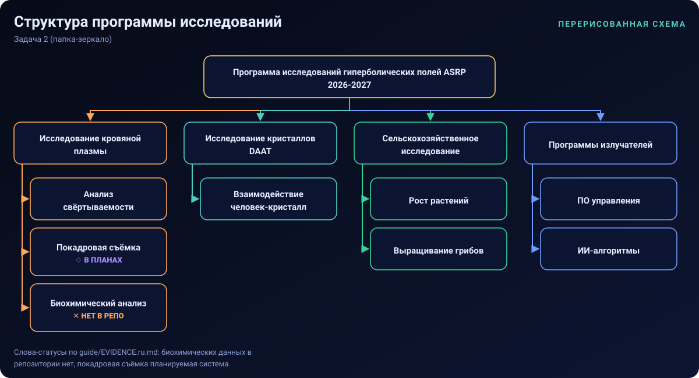
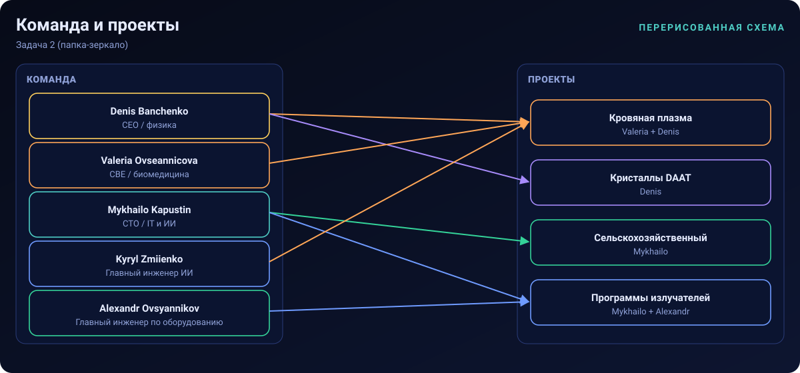
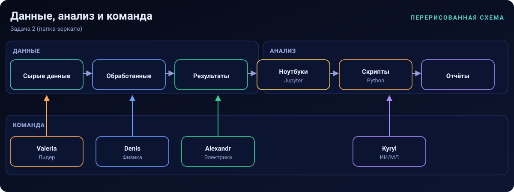
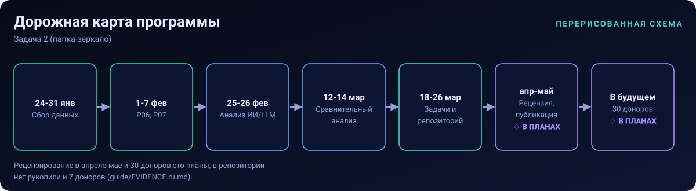

**[English](ECOSYSTEM.md) | Русский**

[← Blood Plasma Study](../README.ru.md) · [Указатель гида](README.ru.md)

# Команда, задачи и экосистема ASRP

## Команда исследования

### Руководство

| # | Имя | Роль | Обязанности | Email |
|---|---|---|---|---|
| 1 | ОВСЯННИКОВА ВАЛЕРИЯ АЛЕКСАНДРОВНА | CBE (главный биомедицинский инженер) / руководитель департамента биомедицинских исследований; главный исследователь и руководитель экспериментальных работ; соавтор технологии | Автор экспериментальной программы и методологии; разработчик исследовательской инфраструктуры и аппаратных установок; исследования полного цикла; физика гиперболических полей | [valeriaovseannicova@asrp.tech](mailto:valeriaovseannicova@asrp.tech) |
| 2 | БАНЧЕНКО ДЕНИС ЮРЬЕВИЧ | CEO ASRP / директор программы; соавтор технологии | Физика гиперболических полей; системы возбуждения; линзирование и фокусировка; ПО управления | [info@asrp.tech](mailto:info@asrp.tech) |
| 3 | КАПУСТИН МИХАЙЛО МИХАЙЛОВИЧ | CTO / директор департамента информационных технологий и ИИ; соавтор технологии | ИТ/ИИ инфраструктура; системы данных; техническая платформа; системы управления | [mykhailokapustin@asrp.tech](mailto:mykhailokapustin@asrp.tech) |
| 4 | ЗМИЕНКО КИРИЛЛ | Главный ИИ-инженер | Анализ нейронными сетями; координация мульти-LLM; специализированные модели зрения | [kyrylzmiienko@asrp.tech](mailto:kyrylzmiienko@asrp.tech) |
| 5 | ОВСЯННИКОВ АЛЕКСАНДР | Главный инженер по аппаратному обеспечению; инженер технологии | Электрические и силовые системы; системы возбуждения гиперболических излучателей; проектирование силовых компонентов | [alexandrovsyannikov@asrp.tech](mailto:alexandrovsyannikov@asrp.tech) |

### Коллабораторы

| Имя | Организация | Роль | Email |
|---|---|---|---|
| САВЕЛЬЕВ ИВАН | ASRP.science | Директор по науке / главный редактор | [ivansavelev@asrp.science](mailto:ivansavelev@asrp.science) |

Второй коллаборатор, независимый специалист по плазме крови из внешней лаборатории, указан в прежнем README за забор крови и центрифугирование. Имя и личный контакт здесь намеренно не повторяются (см. [Этика и контакты](ETHICS.ru.md)); с этим человеком связываются через ASRP.

Роли приведены по прежнему README. Репозиторий также фиксирует один аккаунт GitHub с 18 из 66 коммитов, который не назван ни в одной таблице команды.

## Текущие задачи

| Задача # | Название | Статус | Приоритет | Исполнители |
|---|---|---|---|---|
| [#9](https://github.com/AdvancedScientificResearchProjects/Hyperbolic_Field_BloodPlasma_Study/issues/9) | ПАТЕНТНАЯ ЗАЯВКА: ФРАКТАЛЬНАЯ БИОМЕДИЦИНСКАЯ СИСТЕМА (KZ 2025/1095.1) | Открыто | Критический | Valeria Ovseannicova, Denis Banchenko, Mykhailo Kapustin |
| [#8](https://github.com/AdvancedScientificResearchProjects/Hyperbolic_Field_BloodPlasma_Study/issues/8) | ПОДГОТОВКА НАУЧНОЙ СТАТЬИ | Открыто | Высокий | Ivan Savelyev |
| [#7](https://github.com/AdvancedScientificResearchProjects/Hyperbolic_Field_BloodPlasma_Study/issues/7) | ПРОТОКОЛ ОСЛЕПЛЕНИЯ | Открыто | Средний | Kyryl Zmiienko |
| [#6](https://github.com/AdvancedScientificResearchProjects/Hyperbolic_Field_BloodPlasma_Study/issues/6) | СИСТЕМА ПОКАДРОВОЙ СЪЁМКИ | Открыто | Средний | Valeria Ovseannicova, Kyryl Zmiienko |
| [#5](https://github.com/AdvancedScientificResearchProjects/Hyperbolic_Field_BloodPlasma_Study/issues/5) | ИНТЕГРАЦИЯ БИОХИМИЧЕСКОГО АНАЛИЗА | Открыто | Средний | Valeria Ovseannicova |
| [#4](https://github.com/AdvancedScientificResearchProjects/Hyperbolic_Field_BloodPlasma_Study/issues/4) | РАСШИРЕНИЕ БАЗЫ ДОНОРОВ ДО 30 УЧАСТНИКОВ | Открыто | Низкий | Valeria Ovseannicova |
| [#3](https://github.com/AdvancedScientificResearchProjects/Hyperbolic_Field_BloodPlasma_Study/issues/3) | ПРОТОКОЛ КРОВЯНОЙ ПЛАЗМЫ | Открыто | Низкий | Valeria Ovseannicova |
| [#2](https://github.com/AdvancedScientificResearchProjects/Hyperbolic_Field_BloodPlasma_Study/issues/2) | ПРОГРАММА ИССЛЕДОВАНИЙ ГИПЕРБОЛИЧЕСКИХ ПОЛЕЙ ASRP 2026-2027: ГЛАВНЫЙ ХАБ | Открыто | Низкий | Denis Banchenko |
| [#1](https://github.com/AdvancedScientificResearchProjects/Hyperbolic_Field_BloodPlasma_Study/issues/1) | ПРОТОКОЛ ИССЛЕДОВАНИЯ СВЁРТЫВАНИЯ ПЛАЗМЫ КРОВИ ПОД ГИПЕРБОЛИЧЕСКИМИ ПОЛЯМИ | Открыто | Низкий | Valeria Ovseannicova |

В таблице <!--n:issues_listed-->9<!--/n--> задач. Документы задач в репозитории есть только для 1, 2, 3, 5, 6 и 8 (<!--n:issue_docs_ru-->6 документов<!--/n--> в `ADVANCED_SCIENTIFIC_RESEARCH_PROJECTS/`); задачи 4, 7 и 9 существуют лишь как строки таблицы, поэтому список нельзя сверить с GitHub отсюда.

## Экосистема ASRP

### Связанные исследовательские репозитории

Прежний README утверждает, что все репозитории ниже используют излучатели гиперболического поля, на которые подана патентная заявка KZ 2025/1095.1 (заявка, а не выданный патент; см. [Патент, регистрация, публикация](PUBLICATIONS.ru.md)).

| # | Репозиторий | Прямая ссылка | Направление исследования | Статус |
|---|---|---|---|---|
| 1 | Blood Plasma Study | [Открыть](https://github.com/AdvancedScientificResearchProjects/Hyperbolic_Field_BloodPlasma_Study) | Свёртываемость крови | Активно |
| 2 | DAAT Crystal Study | [Открыть](https://github.com/AdvancedScientificResearchProjects/Hyperbolic_Field_DAAT_Crystal_Study) | Взаимодействие человек-кристалл | Активно |
| 3 | Agricultural Study | [Открыть](https://github.com/AdvancedScientificResearchProjects/Hyperbolic_Field_Agricultural_Study) | Рост растений и грибов | Расширяется |
| 4 | Emitter Programs | [Открыть](https://github.com/AdvancedScientificResearchProjects/Hyperbolic_Field_Emitter_Programs) | ПО управления излучателями | Разработка |
| 5 | Saccharomyces cerevisiae Study | [Открыть](https://github.com/AdvancedScientificResearchProjects/Hyperbolic_Field_SaccharomycesCerevisiae_Study) | Динамика деления дрожжей: сопутствующее исследование, общие каналы CH17/19/21 | Активно |

Исследования — соседи; код и данные одного не импортируются в другое. ПО управления излучателями из репозитория 4 в этот репозиторий не входит.

### Патентные репозитории

| # | Репозиторий | Прямая ссылка | Патент | Статус |
|---|---|---|---|---|
| 1 | Fractal FBHFS Patent | [Открыть](https://github.com/denisbanchenko/Kazpatent_Fractal_Biomedical_System_Patent) | KZ 2025/1095.1 | Подан |

Данные и код этого исследования импортированы из более раннего рабочего репозитория (`HyperbolicField-BloodPlasma-Study`).

## Ещё схемы, перерисованные из прежнего README и задач программы

Каждая схема ниже была Mermaid-PNG; она перерисована с тем же содержанием, оригинал остаётся в репозитории.

Исходная схема: <a href="../ADVANCED_SCIENTIFIC_RESEARCH_PROJECTS/Hyperbolic_Field_BloodPlasma_Study/charts/mermaid/issue_2_1.png"><code>ADVANCED_SCIENTIFIC_RESEARCH_PROJECTS/Hyperbolic_Field_BloodPlasma_Study/charts/mermaid/issue_2_1.png</code></a>

Исходная схема: <a href="../ADVANCED_SCIENTIFIC_RESEARCH_PROJECTS/Hyperbolic_Field_BloodPlasma_Study/charts/mermaid/issue_2_2.png"><code>ADVANCED_SCIENTIFIC_RESEARCH_PROJECTS/Hyperbolic_Field_BloodPlasma_Study/charts/mermaid/issue_2_2.png</code></a>

Исходная схема: <a href="../ADVANCED_SCIENTIFIC_RESEARCH_PROJECTS/Hyperbolic_Field_BloodPlasma_Study/charts/mermaid/issue_2retry_1.png"><code>ADVANCED_SCIENTIFIC_RESEARCH_PROJECTS/Hyperbolic_Field_BloodPlasma_Study/charts/mermaid/issue_2retry_1.png</code></a>

Исходная схема: <a href="../ADVANCED_SCIENTIFIC_RESEARCH_PROJECTS/Hyperbolic_Field_BloodPlasma_Study/charts/mermaid/issue_2_4.png"><code>ADVANCED_SCIENTIFIC_RESEARCH_PROJECTS/Hyperbolic_Field_BloodPlasma_Study/charts/mermaid/issue_2_4.png</code></a>

