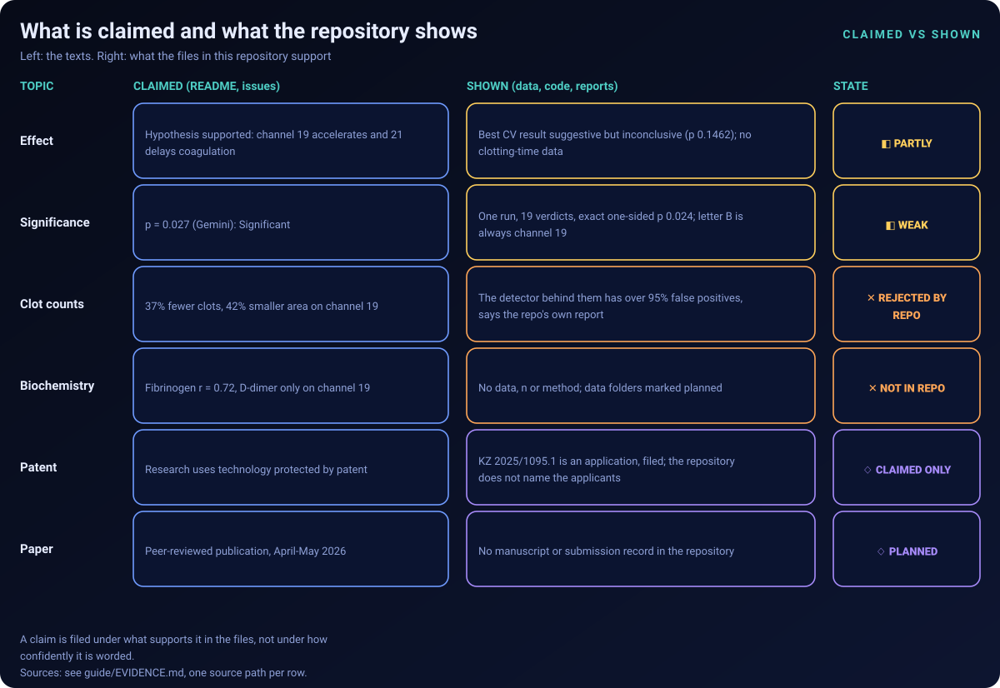
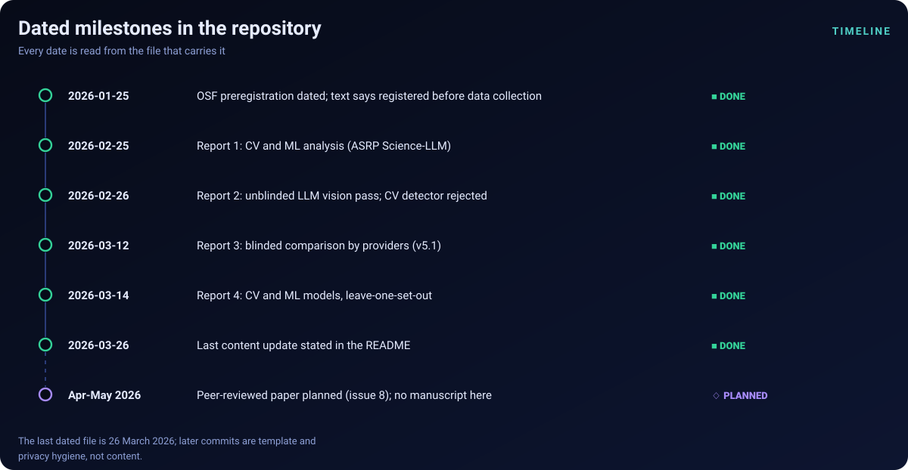

**English | [Русский](EVIDENCE.ru.md)**

[← Blood Plasma Study](../README.md) · [Guide index](README.md)

# Evidence: claimed versus shown

## Claimed versus shown

The verdict in one paragraph: this is a **pilot with a real dataset** (<!--n:photos-->101<!--/n--> photographs from <!--n:donors-->7<!--/n--> donors, kept, counted and consistent) and **weak, mostly negative, analysis of it**. The strongest single number is one blinded Gemini run (<!--n:gemini_ch19-->11<!--/n--> of <!--n:triplets-->19<!--/n--> triplets) that cannot be separated from a position preference; the computer-vision results are at or below chance; and the README and the issue documents state the effect more strongly than the reports under them. Nothing here shows that the field affects coagulation, and nothing shows that it does not: the experiment never measured clotting. Every row below carries the file (and line) that supports it.

## Proven in the repository

| What the files support | Source |
|---|---|
| The dataset exists as described: <!--n:donors-->7<!--/n--> donors, <!--n:photos-->101<!--/n--> photographs, <!--n:pdfs-->11<!--/n--> protocol PDFs; the <!--n:photos-->101<!--/n--> reconcile with the per-donor logs | `original_research/README.md:77` |
| One blinded Gemini run picked channel 19 in <!--n:gemini_ch19-->11<!--/n--> of <!--n:gemini_n-->19<!--/n--> triplets (recounted from the raw results: B=<!--n:gemini_ch19-->11<!--/n-->, A=<!--n:gemini_ctrl-->5<!--/n-->, C=<!--n:gemini_ch21-->3<!--/n-->) | `original_research/reports/2026-03-12_comparative-llm-analysis/report_en.md:114` |
| No CV model reaches p below 0.05 on the <!--n:triplets-->19<!--/n--> triplets; zero-shot models sit at or below chance (26-37%) | `original_research/reports/2026-03-14_cv-ml-analysis/report_en.md:231` |
| Cropping to the plasma removes the DINOv2 signal (<!--n:dino_full-->47.8<!--/n-->% on the full photo, <!--n:dino_sam-->34.3<!--/n-->% on the SAM-2 crop): the signal is tube context | `original_research/reports/2026-03-14_cv-ml-analysis/report_en.md:277` |
| Prompt priming is real: on identical photos Perplexity gave <!--n:perplexity_unblinded-->0<!--/n-->% channel 19 unblinded and <!--n:perplexity_blinded-->53<!--/n-->% blinded | `original_research/reports/2026-03-12_comparative-llm-analysis/report_en.md:296` |
| The repository rejects its own CV clot detector: over <!--n:cv_false_pos-->95<!--/n-->% false positives, glass artefacts detected | `original_research/reports/2026-02-26_llm-vision-analysis/report_en.md:228` |
| Exactly one photograph of <!--n:photos-->101<!--/n--> shows lysis (channel 19): an n=1 observation | `original_research/reports/2026-02-26_llm-vision-analysis/report_en.md:150` |
| Report versions 1.0-3.0 used images wrongly downscaled to 512×512 (a preprocessing bug) | `original_research/reports/2026-03-12_comparative-llm-analysis/report_en.md:9` |
| Blinding labels are in fixed order (A control, B channel 19, C channel 21); there is no shuffle anywhere | `original_research/scripts/llm_analysis/data.py:18` |
| The authors' own verdict on the best CV result: "suggestive but inconclusive" (p=<!--n:dino_probe_p-->0.1462<!--/n--> on 19 sets) | `original_research/reports/2026-03-14_cv-ml-analysis/report_en.md:253` |

## Claimed, not proven

| Claim in the files | What the repository shows | Source |
|---|---|---|
| Issue 1 declares "Hypothesis Supported" | The analysis behind it is unblinded CV and LLM description with no inferential test | `ADVANCED_SCIENTIFIC_RESEARCH_PROJECTS/Hyperbolic_Field_BloodPlasma_Study/ISSUE_1_UPDATED.md:482` |
| README: p = 0.027 (Gemini) is "Significant" | One run of 19 verdicts, one-sided, uncorrected; the exact binomial is <!--n:gemini_p_exact-->0.024<!--/n-->, and letter position is confounded with channel | `README.md:84` (kept in `archive/README_2026-11-19_pre-showcase.md`) |
| Issue 8: "statistically significant findings ready for publication" | No test stands behind the -37% and -42% clot figures | `ADVANCED_SCIENTIFIC_RESEARCH_PROJECTS/Hyperbolic_Field_BloodPlasma_Study/ISSUE_8_UPDATED.md:317` |
| Peer-reviewed paper, April-May 2026 | A plan: no manuscript and no submission record in the repository | `ADVANCED_SCIENTIFIC_RESEARCH_PROJECTS/Hyperbolic_Field_BloodPlasma_Study/ISSUE_8_UPDATED.md:50` |
| Preregistered before data collection | Dated 25 January 2026, while the donor logs include a session dated earlier | `OSF_PREREGISTRATION.md:3` |
| Biochemistry: fibrinogen r = 0.72, D-dimer only on channel 19 | Reported as preliminary with no data, n or method; the data folders are marked planned and are absent | `ADVANCED_SCIENTIFIC_RESEARCH_PROJECTS/Hyperbolic_Field_BloodPlasma_Study/ISSUE_5_UPDATED.md:179` |
| Time-lapse imaging, 1 frame per 5 minutes for 24-48 h | The dataset is <!--n:photos-->101<!--/n--> stills; time-lapse is also listed as a future recommendation | `README.md:159` (archived) |
| Channel 19 is "time acceleration", channel 21 "time deceleration" | These are channel labels; no frequency, power or geometry is given anywhere | `original_research/reports/experiment_protocol_en.md:15` |
| "Reproducible signal across different models" | Most blinded runs are at or below chance (GPT-5 <!--n:openai_pct-->23.6<!--/n-->%, Groq <!--n:groq_pct-->33.3<!--/n-->%) | `README.md:448` (archived) |
| Channel 19 "consistently identified as most coagulated" (03-12 report) | Its own aggregate table shows GPT-5 <!--n:openai_pct-->23.6<!--/n-->% and Groq <!--n:groq_pct-->33.3<!--/n-->% | `original_research/reports/2026-03-12_comparative-llm-analysis/report_en.md:379` |
| Informed consent and donor screening are specified in the protocol issue | No consent artefact is in the repository, and the protocol summary says some donors were on antibiotics | `ADVANCED_SCIENTIFIC_RESEARCH_PROJECTS/Hyperbolic_Field_BloodPlasma_Study/ISSUE_3_UPDATED.md:33` |
| "This research uses technology protected by patent" | KZ 2025/1095.1 is an application with individual applicants, not a granted patent; the repository itself says only "Filed" | `README.md:90` (archived) |
| Expansion to 30 donors (issue 4) | A plan, priority Low | `README.md:311` (archived) |

## Not yet done

| Item | State | Source |
|---|---|---|
| Clotting-time measurement (the preregistered primary outcomes) | Not in the repository | `OSF_PREREGISTRATION.md` (design), no data file |
| Biochemical panel (fibrinogen, D-dimer, PT, APTT) | "In progress" / "In production"; no data | `README.md:273` (archived) |
| Randomised blinding labels | Fixed order A/B/C; issue 7 "blind analysis protocol" is open | `original_research/scripts/llm_analysis/data.py:18` |
| Specification of the channel 19 and 21 emitters | Not published here | `original_research/reports/experiment_protocol_en.md:15` |
| Manuscript | Planned only | `ADVANCED_SCIENTIFIC_RESEARCH_PROJECTS/Hyperbolic_Field_BloodPlasma_Study/ISSUE_8_UPDATED.md:50` |
| More donors (30) | Planned, priority Low | `README.md:311` (archived) |

Chronology of the dated files: see the picture below. The "Complete" statuses of the previous README record that a document exists, not that a result is established.

