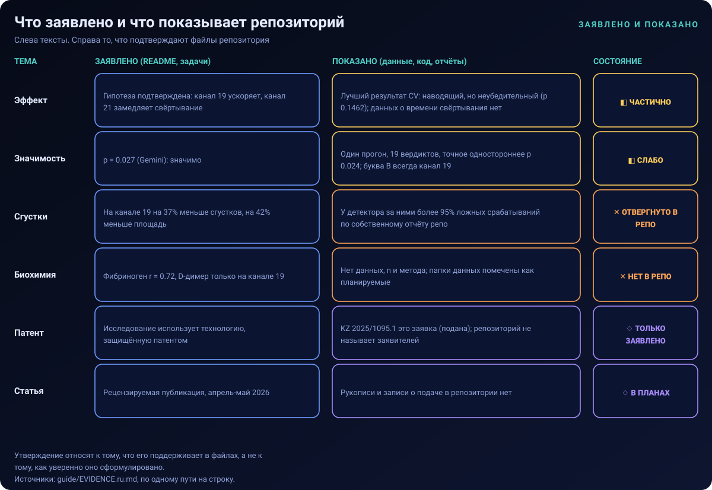
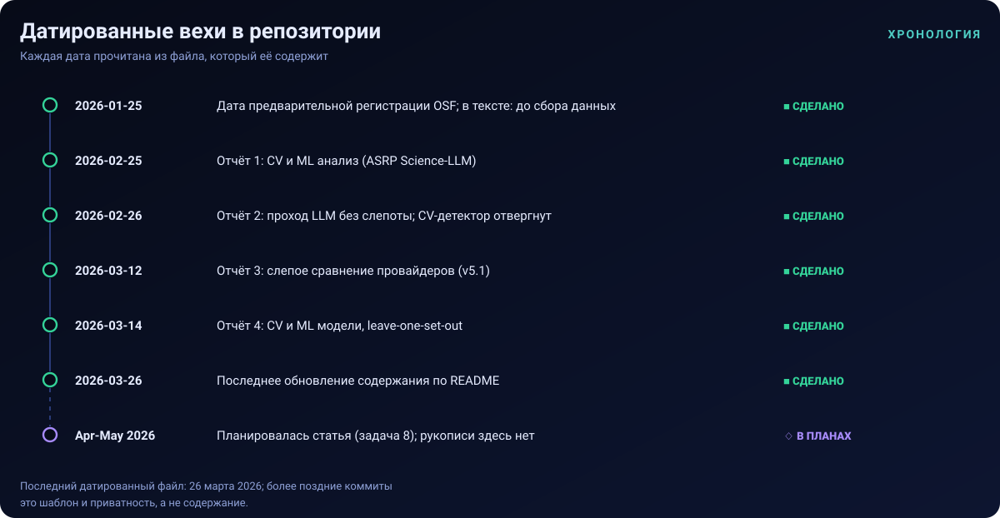

**[English](EVIDENCE.md) | Русский**

[← Blood Plasma Study](../README.ru.md) · [Указатель гида](README.ru.md)

# Свидетельства: заявлено и показано

## Заявлено и показано

Вывод в одном абзаце: это **пилот с настоящим набором данных** (<!--n:photos-->101<!--/n--> фотографий от <!--n:donors_ru-->7 доноров<!--/n-->, сохранены, посчитаны и согласованы) и **слабый, в основном отрицательный анализ этих данных**. Самое сильное число — один слепой прогон Gemini (<!--n:gemini_ch19-->11<!--/n--> из <!--n:triplets_ru-->19 триплетов<!--/n-->), который не отличить от предпочтения позиции; результаты компьютерного зрения на уровне случайности или ниже; а README и документы задач формулируют эффект сильнее, чем отчёты под ними. Ничто здесь не показывает, что поле влияет на свёртывание, и ничто не показывает, что не влияет: эксперимент свёртывание не измерял. У каждой строки ниже есть файл (и строка), который её поддерживает.

## Доказано в репозитории

| Что поддерживают файлы | Источник |
|---|---|
| Набор данных существует как описан: <!--n:donors_ru-->7 доноров<!--/n-->, <!--n:photos-->101<!--/n--> фотографий, <!--n:pdfs_ru-->11 протоколов<!--/n-->; <!--n:photos-->101<!--/n--> сходятся с журналами по донорам | `original_research/README.md:77` |
| Один слепой прогон Gemini выбрал канал 19 в <!--n:gemini_ch19-->11<!--/n--> из <!--n:gemini_n-->19<!--/n--> триплетов (пересчёт по сырым результатам: B=<!--n:gemini_ch19-->11<!--/n-->, A=<!--n:gemini_ctrl-->5<!--/n-->, C=<!--n:gemini_ch21-->3<!--/n-->) | `original_research/reports/2026-03-12_comparative-llm-analysis/report_en.md:114` |
| Ни одна модель CV не достигает p ниже 0.05 на <!--n:triplets_ru-->19 триплетов<!--/n-->; zero-shot модели на уровне случайности или ниже (26-37%) | `original_research/reports/2026-03-14_cv-ml-analysis/report_en.md:231` |
| Обрезка по плазме убирает сигнал DINOv2 (<!--n:dino_full-->47.8<!--/n-->% на целом фото, <!--n:dino_sam-->34.3<!--/n-->% на обрезке SAM-2): сигнал в контексте пробирки | `original_research/reports/2026-03-14_cv-ml-analysis/report_en.md:277` |
| Эффект подсказки реален: на тех же фото Perplexity дал <!--n:perplexity_unblinded-->0<!--/n-->% канала 19 без слепоты и <!--n:perplexity_blinded-->53<!--/n-->% вслепую | `original_research/reports/2026-03-12_comparative-llm-analysis/report_en.md:296` |
| Репозиторий отвергает собственный CV-детектор сгустков: более <!--n:cv_false_pos-->95<!--/n-->% ложных срабатываний, детектируются артефакты стекла | `original_research/reports/2026-02-26_llm-vision-analysis/report_en.md:228` |
| Ровно одна фотография из <!--n:photos-->101<!--/n--> показывает лизис (канал 19): наблюдение n=1 | `original_research/reports/2026-02-26_llm-vision-analysis/report_en.md:150` |
| Версии отчёта 1.0-3.0 использовали изображения, ошибочно уменьшенные до 512×512 (ошибка предобработки) | `original_research/reports/2026-03-12_comparative-llm-analysis/report_en.md:9` |
| Слепые метки идут в фиксированном порядке (A контроль, B канал 19, C канал 21); перемешивания нигде нет | `original_research/scripts/llm_analysis/data.py:18` |
| Собственный вердикт авторов о лучшем результате CV: «suggestive but inconclusive» (p=<!--n:dino_probe_p-->0.1462<!--/n--> на 19 наборах) | `original_research/reports/2026-03-14_cv-ml-analysis/report_en.md:253` |

## Заявлено, но не доказано

| Утверждение в файлах | Что показывает репозиторий | Источник |
|---|---|---|
| Задача 1 объявляет «Hypothesis Supported» | Анализ за ней — CV и описания LLM без слепоты и без проверки гипотез | `ADVANCED_SCIENTIFIC_RESEARCH_PROJECTS/Hyperbolic_Field_BloodPlasma_Study/ISSUE_1_UPDATED.md:482` |
| README: p = 0.027 (Gemini) «Significant» | Один прогон из 19 вердиктов, односторонний, без поправки; точный биномиальный <!--n:gemini_p_exact-->0.024<!--/n-->, позиция буквы смешана с каналом | `README.md:84` (сохранён в `archive/README_2026-11-19_pre-showcase.md`) |
| Задача 8: «statistically significant findings ready for publication» | За цифрами −37% и −42% по сгусткам нет теста | `ADVANCED_SCIENTIFIC_RESEARCH_PROJECTS/Hyperbolic_Field_BloodPlasma_Study/ISSUE_8_UPDATED.md:317` |
| Рецензируемая статья, апрель-май 2026 | План: рукописи и записи о подаче в репозитории нет | `ADVANCED_SCIENTIFIC_RESEARCH_PROJECTS/Hyperbolic_Field_BloodPlasma_Study/ISSUE_8_UPDATED.md:50` |
| Зарегистрировано до сбора данных | Дата 25 января 2026, при этом среди журналов доноров есть сессия с более ранней датой | `OSF_PREREGISTRATION.md:3` |
| Биохимия: фибриноген r = 0.72, D-димер только на канале 19 | Заявлено как предварительное без данных, n и метода; папки данных помечены как планируемые и отсутствуют | `ADVANCED_SCIENTIFIC_RESEARCH_PROJECTS/Hyperbolic_Field_BloodPlasma_Study/ISSUE_5_UPDATED.md:179` |
| Покадровая съёмка, 1 кадр в 5 минут в течение 24-48 ч | Набор данных — <!--n:photos-->101<!--/n--> отдельных снимков; покадровая съёмка указана и как будущая рекомендация | `README.md:159` (в архиве) |
| Канал 19 это «ускорение времени», канал 21 «замедление времени» | Это метки каналов; частота, мощность или геометрия нигде не приведены | `original_research/reports/experiment_protocol_en.md:15` |
| «Воспроизводимый сигнал на разных моделях» | Большинство слепых прогонов на уровне случайности или ниже (GPT-5 <!--n:openai_pct-->23.6<!--/n-->%, Groq <!--n:groq_pct-->33.3<!--/n-->%) | `README.md:448` (в архиве) |
| Канал 19 «consistently identified as most coagulated» (отчёт 03-12) | Собственная сводная таблица показывает GPT-5 <!--n:openai_pct-->23.6<!--/n-->% и Groq <!--n:groq_pct-->33.3<!--/n-->% | `original_research/reports/2026-03-12_comparative-llm-analysis/report_en.md:379` |
| Информированное согласие и скрининг доноров прописаны в задаче протокола | Документа о согласии в репозитории нет, а резюме протокола сообщает, что часть доноров принимала антибиотики | `ADVANCED_SCIENTIFIC_RESEARCH_PROJECTS/Hyperbolic_Field_BloodPlasma_Study/ISSUE_3_UPDATED.md:33` |
| «Исследование использует технологию, защищённую патентом» | KZ 2025/1095.1 это заявка, а не выданный патент (репозиторий не называет заявителей); сам репозиторий пишет лишь «Подан» | `README.md:90` (в архиве) |
| Расширение до 30 доноров (задача 4) | План, приоритет Low | `README.md:311` (в архиве) |

## Ещё не сделано

| Пункт | Состояние | Источник |
|---|---|---|
| Измерение времени свёртывания (предрегистрированные первичные исходы) | В репозитории нет | `OSF_PREREGISTRATION.md` (дизайн), файла данных нет |
| Биохимическая панель (фибриноген, D-димер, PT, APTT) | «In progress» / «In production»; данных нет | `README.md:273` (в архиве) |
| Случайные слепые метки | Фиксированный порядок A/B/C; задача 7 «протокол слепого анализа» открыта | `original_research/scripts/llm_analysis/data.py:18` |
| Спецификация излучателей каналов 19 и 21 | Здесь не опубликована | `original_research/reports/experiment_protocol_en.md:15` |
| Рукопись | Только план | `ADVANCED_SCIENTIFIC_RESEARCH_PROJECTS/Hyperbolic_Field_BloodPlasma_Study/ISSUE_8_UPDATED.md:50` |
| Больше доноров (30) | План, приоритет Low | `README.md:311` (в архиве) |

Хронология датированных файлов на рисунке ниже. Статусы «Завершено» в прежнем README фиксируют, что документ существует, а не что результат установлен.

