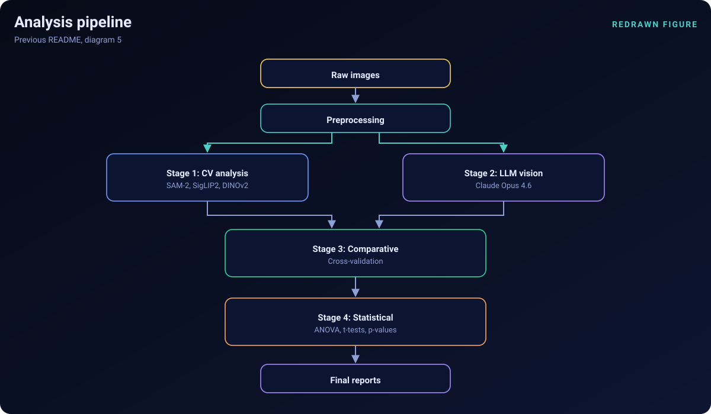
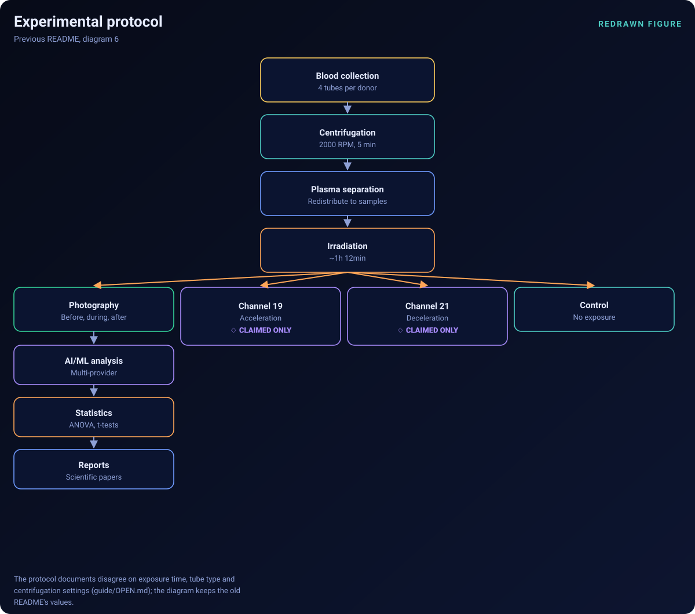
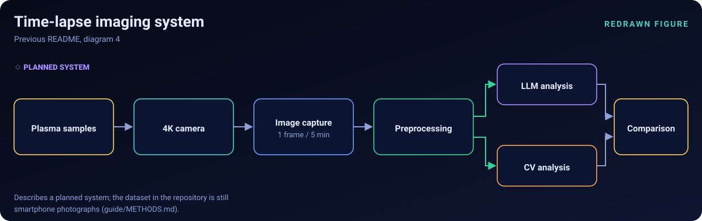

**English | [Русский](METHODS.ru.md)**

[← Blood Plasma Study](../README.md) · [Guide index](README.md)

# Analysis methods and reports

## Analysis methods

Three kinds of reader score the <!--n:photos-->101<!--/n--> photographs. None of them measures coagulation directly; each reads a picture.

1. **Classical computer vision.** SAM-2 segments the plasma region and HSV colour rules count "clots" (report of 2026-02-25). The repository's own later report rejects this detector: "<!--n:cv_false_pos-->95<!--/n-->%+ false positive rate", glass tube walls detected as plasma (report of 2026-02-26).
2. **CV and zero-shot models.** A frozen DINOv2-large with a linear probe (leave-one-set-out over the <!--n:triplets-->19<!--/n--> triplets), SigLIP2, BiomedCLIP and, excluded as out of distribution, MedSigLIP (report of 2026-03-14).
3. **LLM vision providers.** Photos or triplets are sent to GPT-5, Groq Llama 4 Scout, Gemini 2.5 flash-lite, Perplexity sonar-pro and Mistral Pixtral, with unblinded prompts (real channel names) and blinded prompts ("Sample A/B/C"). Claude was used only in the unblinded pass of 2026-02-26.

### Analysis providers (as listed in the previous README)

| Provider | Model | Analysis type | Status |
|---|---|---|---|
| ASRP Science-LLM | SAM-2 + SigLIP2 + DINOv2 | Computer Vision + ML | Complete |
| Claude Opus 4.6 | Multimodal | LLM Vision | Complete |
| Gemini 2.5 Flash | Google | LLM Vision | Complete (p=0.027) |
| GPT-5 | OpenAI | LLM Vision | Complete |
| Perplexity | Perplexity | LLM Vision | Complete |
| DINOv2 Linear Probe | Meta | Computer Vision | Complete (p=0.15) |
| BiomedCLIP | Specialized Medical | Medical CV | Chance level (36.8%) |
| MedSigLIP | Specialized Medical | Medical CV | Out-of-distribution |

The previous README counted "8 LLM + CV models" as providers. The blinded comparison actually used <!--n:blinded_providers-->4<!--/n--> provider families in <!--n:blinded_runs-->10<!--/n--> runs (see [Results](RESULTS.md)); the status column records that a run finished, not that its result is a finding.

### Blinding, and what it does not do

Blinded prompts hide the channel names and the experiment context, and the verdict letters are remapped to channels after the run. **The label order is fixed, not randomised:** A is always control, B always channel 19, C always channel 21 (`BLIND_MAP` in `original_research/scripts/llm_analysis/data.py`). A provider that leans toward the letter B therefore looks as if it recognises channel 19. Earlier report versions (1.0-3.0) were computed on images wrongly downscaled to 512×512 pixels; Mistral stayed at that size.

### Coagulation stage scale

| Stage | Description |
|---|---|
| none | No visible coagulation: clear or homogeneous plasma |
| early_fibrin | Initial fibrin formation: faint strands, films, or hazing |
| partial_clot | Defined clot mass present, not fully consolidated |
| full_coagulation | Large, dense, well-formed clot occupying significant volume |
| lysis | Clot decomposition: cracked, fragmented, or dissolving fibrin network |

### ML models used

| Model | Developer | Type | Purpose |
|---|---|---|---|
| SAM-2 | Meta | Segmentation | Clot segmentation |
| SigLIP2-base | Google | Zero-shot classification | Coagulation stage classification |
| DINOv2-small | Meta | Image embeddings | Feature extraction |
| Claude Opus 4.6 | Anthropic | Multimodal LLM | Direct vision analysis |

## Reports

### All reports

| # | Report | Date | Status | Direct link |
|---|---|---|---|---|
| 1 | Experiment Protocol | 2026-02 | Complete | [EN](../original_research/reports/experiment_protocol_en.md) \| [RU](../original_research/reports/experiment_protocol_ru.md) |
| 2 | Multi-AI Image Analysis | 2026-02-25 | Complete | [EN](../original_research/reports/2026-02-25_ai-analysis/report_en.md) \| [RU](../original_research/reports/2026-02-25_ai-analysis/report_ru.md) |
| 3 | LLM Vision Clot Analysis | 2026-02-26 | Complete | [EN](../original_research/reports/2026-02-26_llm-vision-analysis/report_en.md) \| [RU](../original_research/reports/2026-02-26_llm-vision-analysis/report_ru.md) |
| 4 | Comparative LLM Analysis | 2026-03-12 | Complete | [EN](../original_research/reports/2026-03-12_comparative-llm-analysis/report_en.md) \| [RU](../original_research/reports/2026-03-12_comparative-llm-analysis/report_ru.md) |
| 5 | CV/ML Analysis | 2026-03-14 | Complete | [EN](../original_research/reports/2026-03-14_cv-ml-analysis/report_en.md) \| [RU](../original_research/reports/2026-03-14_cv-ml-analysis/report_ru.md) |
| 6 | Biochemical Analysis Integration | In Progress | In Production | [Issue #5](https://github.com/AdvancedScientificResearchProjects/Hyperbolic_Field_BloodPlasma_Study/issues/5) |

Report 6 has no report file: the repository holds no biochemical data (see [Evidence](EVIDENCE.md)).

### Analysis pipeline

Original figure: <a href="../original_research/charts/mermaid/root_5.png"><code>original_research/charts/mermaid/root_5.png</code></a>

### Experimental protocol and time-lapse diagrams

The previous README illustrated the protocol and the imaging system with two Mermaid diagrams. They are redrawn here in the house style with the same boxes and labels; the original PNGs stay in the repository.

Original figure: <a href="../original_research/charts/mermaid/root_6.png"><code>original_research/charts/mermaid/root_6.png</code></a>

Original figure: <a href="../original_research/charts/mermaid/root_4.png"><code>original_research/charts/mermaid/root_4.png</code></a>

### References

Code lives in `original_research/scripts/` (<!--n:scripts_py-->22<!--/n--> Python files, about <!--n:scripts_lines-->7290<!--/n--> lines): `llm_analysis/` (providers, prompts, imaging, data, parsing, run_batch, run_comparative, run_multi_tube, run_single) and `cv_analysis/` (segment, ml_models, run scripts, per-photo outputs). No script computes the p-values quoted in the reports; they appear only in report text.
