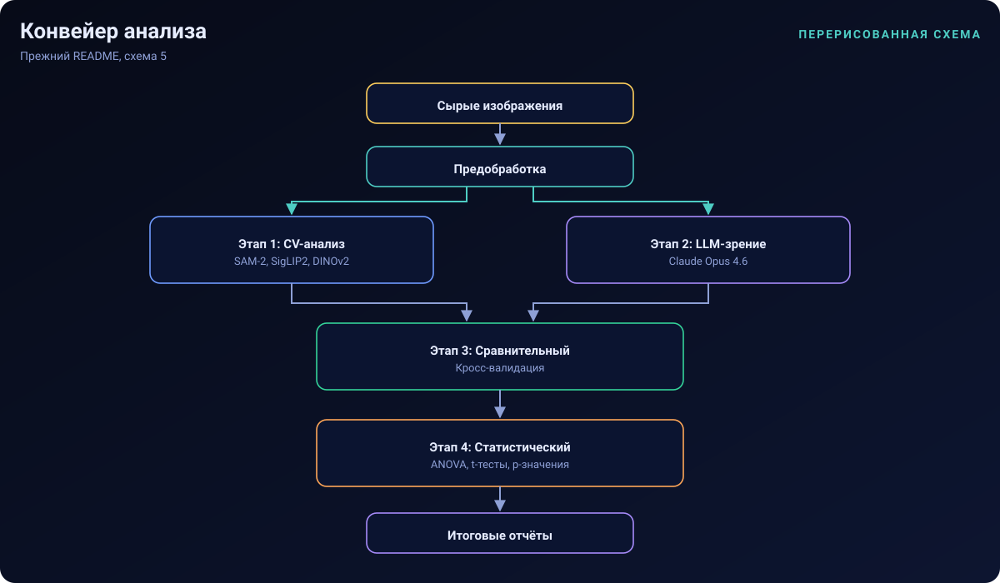
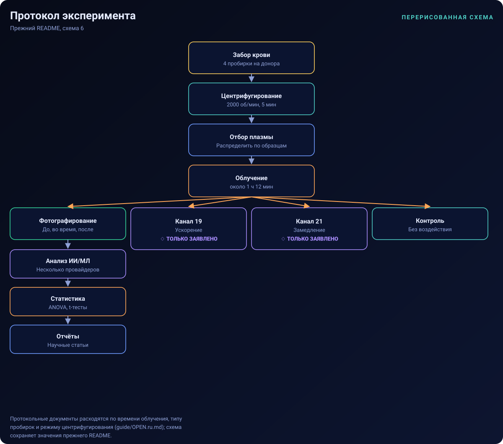
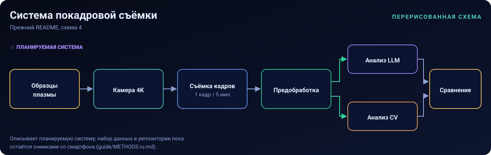

**[English](METHODS.md) | Русский**

[← Blood Plasma Study](../README.ru.md) · [Указатель гида](README.ru.md)

# Методы анализа и отчёты

## Методы анализа

<!--n:photos-->101<!--/n--> фотографий оценивают три вида читателей. Ни один не измеряет свёртывание напрямую: каждый читает картинку.

1. **Классическое компьютерное зрение.** SAM-2 выделяет область плазмы, а цветовые правила HSV считают «сгустки» (отчёт от 2026-02-25). Более поздний отчёт самого репозитория отвергает этот детектор: «<!--n:cv_false_pos-->95<!--/n-->%+ false positive rate», стенки стеклянной пробирки приняты за плазму (отчёт от 2026-02-26).
2. **Модели CV и zero-shot.** Замороженный DINOv2-large с линейным пробом (leave-one-set-out по <!--n:triplets_ru-->19 триплетов<!--/n-->), SigLIP2, BiomedCLIP и исключённый как не подходящий по распределению MedSigLIP (отчёт от 2026-03-14).
3. **LLM-провайдеры с видением.** Фото или триплеты отправляют в GPT-5, Groq Llama 4 Scout, Gemini 2.5 flash-lite, Perplexity sonar-pro и Mistral Pixtral с промптами без слепоты (реальные названия каналов) и слепыми промптами («Sample A/B/C»). Claude использовался только в проходе без слепоты от 2026-02-26.

### Провайдеры анализа (как в прежнем README)

| Провайдер | Модель | Тип анализа | Статус |
|---|---|---|---|
| ASRP Science-LLM | SAM-2 + SigLIP2 + DINOv2 | Computer Vision + ML | Завершено |
| Claude Opus 4.6 | Multimodal | LLM Vision | Завершено |
| Gemini 2.5 Flash | Google | LLM Vision | Завершено (p=0.027) |
| GPT-5 | OpenAI | LLM Vision | Завершено |
| Perplexity | Perplexity | LLM Vision | Завершено |
| DINOv2 Linear Probe | Meta | Computer Vision | Завершено (p=0.15) |
| BiomedCLIP | Specialized Medical | Medical CV | Уровень случайности (36.8%) |
| MedSigLIP | Specialized Medical | Medical CV | Вне распределения |

Прежний README называл провайдерами «8 моделей LLM + CV». В слепом сравнении фактически участвовали <!--n:blinded_providers-->4<!--/n--> семейства провайдеров в <!--n:blinded_runs-->10<!--/n--> прогонах (см. [Результаты](RESULTS.ru.md)); колонка статуса фиксирует, что прогон завершён, а не что его результат есть находка.

### Слепота и чего она не делает

Слепые промпты скрывают названия каналов и контекст эксперимента, а буквы вердиктов после прогона переводятся обратно в каналы. **Порядок меток фиксирован, а не случаен:** A всегда контроль, B всегда канал 19, C всегда канал 21 (`BLIND_MAP` в `original_research/scripts/llm_analysis/data.py`). Провайдер, склонный к букве B, поэтому выглядит так, будто узнаёт канал 19. Ранние версии отчёта (1.0-3.0) посчитаны на изображениях, ошибочно уменьшенных до 512×512 пикселей; Mistral остался на этом размере.

### Шкала стадий свёртывания

| Стадия | Описание |
|---|---|
| none / нет | Нет видимого свёртывания: прозрачная или однородная плазма |
| early_fibrin / ранний фибрин | Начальное образование фибрина: слабые нити, плёнки или помутнение |
| partial_clot / частичный сгусток | Определённая масса сгустка, не полностью консолидирована |
| full_coagulation / полная коагуляция | Большой, плотный, хорошо сформированный сгусток, занимающий значительный объём |
| lysis / лизис | Разложение сгустка: потрескавшаяся, фрагментированная или растворяющаяся сеть фибрина |

### Использованные ML-модели

| Модель | Разработчик | Тип | Назначение |
|---|---|---|---|
| SAM-2 | Meta | Сегментация | Сегментация сгустков |
| SigLIP2-base | Google | Классификация zero-shot | Классификация стадий свёртывания |
| DINOv2-small | Meta | Эмбеддинги изображений | Извлечение признаков |
| Claude Opus 4.6 | Anthropic | Мультимодальная LLM | Прямой визуальный анализ |

## Отчёты

### Все отчёты

| # | Отчёт | Дата | Статус | Прямая ссылка |
|---|---|---|---|---|
| 1 | Протокол эксперимента | 2026-02 | Завершено | [EN](../original_research/reports/experiment_protocol_en.md) \| [RU](../original_research/reports/experiment_protocol_ru.md) |
| 2 | Мультипровайдерный AI-анализ изображений | 2026-02-25 | Завершено | [EN](../original_research/reports/2026-02-25_ai-analysis/report_en.md) \| [RU](../original_research/reports/2026-02-25_ai-analysis/report_ru.md) |
| 3 | LLM Vision анализ сгустков | 2026-02-26 | Завершено | [EN](../original_research/reports/2026-02-26_llm-vision-analysis/report_en.md) \| [RU](../original_research/reports/2026-02-26_llm-vision-analysis/report_ru.md) |
| 4 | Сравнительный анализ LLM | 2026-03-12 | Завершено | [EN](../original_research/reports/2026-03-12_comparative-llm-analysis/report_en.md) \| [RU](../original_research/reports/2026-03-12_comparative-llm-analysis/report_ru.md) |
| 5 | Computer Vision + ML анализ | 2026-03-14 | Завершено | [EN](../original_research/reports/2026-03-14_cv-ml-analysis/report_en.md) \| [RU](../original_research/reports/2026-03-14_cv-ml-analysis/report_ru.md) |
| 6 | Интеграция биохимического анализа | In Progress | In Production | [Issue #5](https://github.com/AdvancedScientificResearchProjects/Hyperbolic_Field_BloodPlasma_Study/issues/5) |

У отчёта 6 нет файла отчёта: биохимических данных в репозитории нет (см. [Свидетельства](EVIDENCE.ru.md)).

### Конвейер анализа

Исходная схема: <a href="../original_research/charts/mermaid/root_5.png"><code>original_research/charts/mermaid/root_5.png</code></a>

### Схемы протокола и покадровой съёмки

Прежний README иллюстрировал протокол и систему съёмки двумя схемами Mermaid. Здесь они перерисованы в общем стиле с теми же блоками и подписями; исходные PNG остаются в репозитории.

Исходная схема: <a href="../original_research/charts/mermaid/root_6.png"><code>original_research/charts/mermaid/root_6.png</code></a>

Исходная схема: <a href="../original_research/charts/mermaid/root_4.png"><code>original_research/charts/mermaid/root_4.png</code></a>

### Ссылки

Код лежит в `original_research/scripts/` (<!--n:scripts_py-->22<!--/n--> файла Python, около <!--n:scripts_lines-->7290<!--/n--> строк): `llm_analysis/` (providers, prompts, imaging, data, parsing, run_batch, run_comparative, run_multi_tube, run_single) и `cv_analysis/` (segment, ml_models, скрипты запуска, выходы по фото). Ни один скрипт не считает p-значения из отчётов; они есть только в тексте отчётов.
