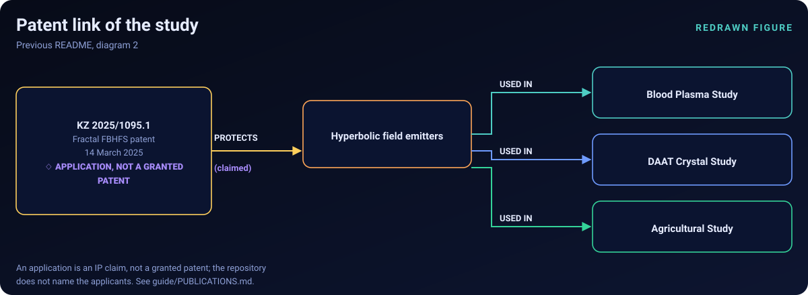
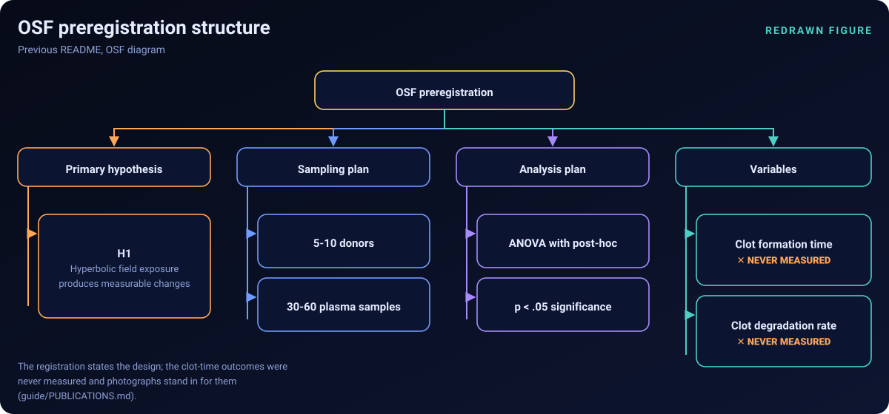
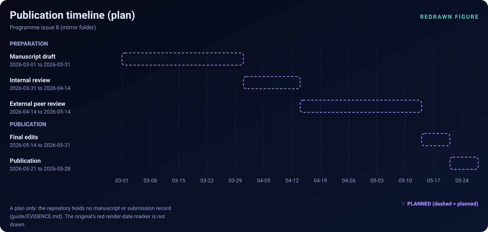

**English | [Русский](PUBLICATIONS.ru.md)**

[← Blood Plasma Study](../README.md) · [Guide index](README.md)

# Patent application, preregistration, publication

## Patent connection

The study is described as the first biological test of hyperbolic-field emitters covered by a patent **application**: KZ 2025/1095.1, "Fractal Biomedical System" (FBHFS). An application is an IP claim. It is not a granted patent, and it is not validation of the method or of this study's results. The previous README said that the research "uses technology protected by patent"; the patent repository and the programme table in the same README give the status as "Filed". The repository does not name the applicants; an application is not a granted patent.

Original figure: <a href="../original_research/charts/mermaid/root_2.png"><code>original_research/charts/mermaid/root_2.png</code></a>

- **Patent repository:** [Kazpatent_Fractal_Biomedical_System_Patent](https://github.com/denisbanchenko/Kazpatent_Fractal_Biomedical_System_Patent)
- **Patent issue 6 (research connection):** [view connection diagram](https://github.com/denisbanchenko/Kazpatent_Fractal_Biomedical_System_Patent/issues/6)
- **Issue 9 here:** "PATENT APPLICATION: FRACTAL BIOMEDICAL (KZ 2025/1095.1)", priority Critical, open (see [Ecosystem and team](ECOSYSTEM.md)).

The study does not publish any emitter specification, so it cannot serve as evidence in the filing; the repository mentions the patent as supporting narrative.

## OSF preregistration

The README states that the study was preregistered on OSF before data collection (the text of the registration is in [`OSF_PREREGISTRATION.md`](../OSF_PREREGISTRATION.md)).

| Parameter | Value |
|---|---|
| OSF Project | [osf.io/8q42f](https://osf.io/8q42f) |
| DOI | [10.17605/OSF.IO/GWA9E](https://doi.org/10.17605/OSF.IO/GWA9E) |
| Date | January 25, 2026 |
| Type | OSF Preregistration |
| Title | Chrono-Regulatory and Biochronal Therapeutics: A Framework for Temporal Regulation in Human Physiology |
| Contributors (README) | Ovseannicova, Banchenko, Kapustin, Savelyev, an external plasma specialist, et al. |
| Preregistered design | Mixed design, 5-10 donors, 30-60 aliquots; primary outcomes clot-formation time and degradation rate; data analysts blinded |

Two cautions. The registration is dated 25 January 2026, while at least one donor log in the repository predates it, so "before data collection" does not hold for that donor. And the registered primary outcomes (clot-formation time, degradation rate) were not measured; the photographs stand in for them (see [Evidence](EVIDENCE.md)). The registration title is a general theme, not "plasma"; the repository never cites a published article under that title.

A companion registration for the yeast study exists (OSF osf.io/vxkum); the two studies share the channels 17, 19 and 21 (see [Ecosystem and team](ECOSYSTEM.md)). The registration is an external record: its contents were not verified here.

## Publication plan

Issue 8, "Peer review publication preparation", plans a paper for the ASRP.science journal, assigned to the Science Director. Its timeline runs from a manuscript draft in March 2026 to journal submission and online publication in late May 2026 ("Expected Publication: April-May 2026"). **The repository contains no manuscript and no submission record**, and the issue still reads "In Production". The issue also calls the CV-detector numbers "statistically significant findings ready for publication"; no test stands behind them (see [Evidence](EVIDENCE.md)). The study documents were last updated on 26 March 2026, so the repository is silent on whether a paper appeared.

## More figures redrawn from the previous README and the programme issues

Each figure below was a Mermaid PNG; it is redrawn with the same content and the original stays in the repository.

Original figure: <a href="../original_research/charts/mermaid/osf_1.png"><code>original_research/charts/mermaid/osf_1.png</code></a>

Original figure: <a href="../ADVANCED_SCIENTIFIC_RESEARCH_PROJECTS/Hyperbolic_Field_BloodPlasma_Study/charts/mermaid/issue_8_1.png"><code>ADVANCED_SCIENTIFIC_RESEARCH_PROJECTS/Hyperbolic_Field_BloodPlasma_Study/charts/mermaid/issue_8_1.png</code></a>

