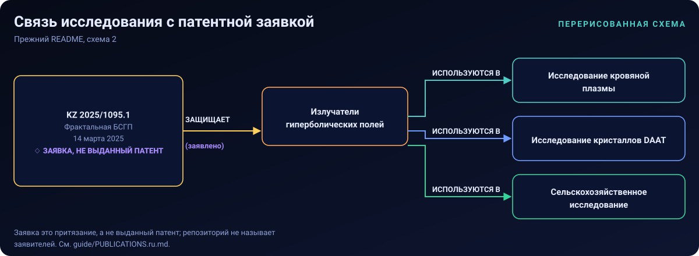

**[English](PUBLICATIONS.md) | Русский**

[← Blood Plasma Study](../README.ru.md) · [Указатель гида](README.ru.md)

# Патентная заявка, предрегистрация, публикация

## Связь с патентом

Исследование названо первым биологическим испытанием излучателей гиперболического поля, описанных в патентной **заявке**: KZ 2025/1095.1, «Фрактальная биомедицинская система» (FBHFS). Заявка — это притязание в области интеллектуальной собственности. Она не является выданным патентом и не подтверждает ни метод, ни результаты этого исследования. Прежний README писал, что исследование «использует технологию, защищённую патентом»; репозиторий патента и таблица программы в том же README указывают статус «Подан». Заявители — физические лица (README называет трёх соавторов технологии, они же исполнители задачи о патентной заявке); компания нигде в этом репозитории не названа правообладателем.

Исходная схема: <a href="../original_research/charts/mermaid/root_2.png"><code>original_research/charts/mermaid/root_2.png</code></a>

- **Репозиторий патента:** [Kazpatent_Fractal_Biomedical_System_Patent](https://github.com/denisbanchenko/Kazpatent_Fractal_Biomedical_System_Patent)
- **Задача патента 6 (связь с исследованиями):** [схема связи](https://github.com/denisbanchenko/Kazpatent_Fractal_Biomedical_System_Patent/issues/6)
- **Задача 9 здесь:** «ПАТЕНТНАЯ ЗАЯВКА: ФРАКТАЛЬНАЯ БИОМЕДИЦИНСКАЯ СИСТЕМА (KZ 2025/1095.1)», приоритет Critical, открыта (см. [Команда, задачи, экосистема](ECOSYSTEM.ru.md)).

Исследование не публикует спецификацию излучателей, поэтому не может служить доказательством в заявке; репозиторий упоминает патент как сопровождающий нарратив.

## Предварительная регистрация OSF

README сообщает, что исследование было предварительно зарегистрировано на OSF до сбора данных (текст регистрации в [`OSF_PREREGISTRATION.md`](../OSF_PREREGISTRATION.md)).

| Параметр | Значение |
|---|---|
| Проект OSF | [osf.io/8q42f](https://osf.io/8q42f) |
| DOI | [10.17605/OSF.IO/GWA9E](https://doi.org/10.17605/OSF.IO/GWA9E) |
| Дата | 25 января 2026 |
| Тип | Предварительная регистрация OSF |
| Название | Хроно-регуляторная и биохрональная терапия: структура темпоральной регуляции в физиологии человека |
| Авторы (README) | Овсянникова, Банченко, Капустин, Савельев, внешний специалист по плазме и др. |
| Предрегистрированный дизайн | Смешанный дизайн, 5-10 доноров, 30-60 аликвот; первичные исходы время образования сгустка и скорость деградации; аналитики ослеплены |

Две оговорки. Регистрация датирована 25 января 2026, а как минимум один журнал донора в репозитории датирован раньше, поэтому «до сбора данных» для этого донора не выполняется. И предрегистрированные первичные исходы (время образования сгустка, скорость деградации) не измерялись; их заменяют фотографии (см. [Свидетельства](EVIDENCE.ru.md)). Название регистрации — общая тема, а не «плазма»; репозиторий нигде не цитирует опубликованную статью под таким названием.

Существует сопутствующая регистрация исследования дрожжей (OSF osf.io/vxkum); у двух исследований общие каналы 17, 19 и 21 (см. [Команда, задачи, экосистема](ECOSYSTEM.ru.md)). Регистрация — внешняя запись: её содержание здесь не проверялось.

## План публикации

Задача 8, «Подготовка научной статьи», планирует статью для журнала ASRP.science, исполнитель — директор по науке. Её график идёт от черновика рукописи в марте 2026 до подачи в журнал и онлайн-публикации в конце мая 2026 («Ожидаемая публикация: апрель-май 2026»). **В репозитории нет ни рукописи, ни записи о подаче**, а задача по-прежнему в статусе «В производстве». Задача также называет цифры CV-детектора «статистически значимыми находками, готовыми к публикации»; теста за ними нет (см. [Свидетельства](EVIDENCE.ru.md)). Документы исследования обновлялись последний раз 26 марта 2026, поэтому репозиторий молчит о том, вышла ли статья.
