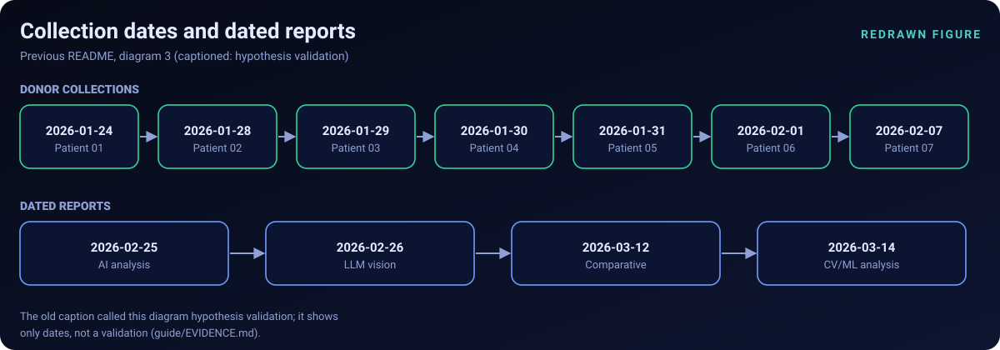
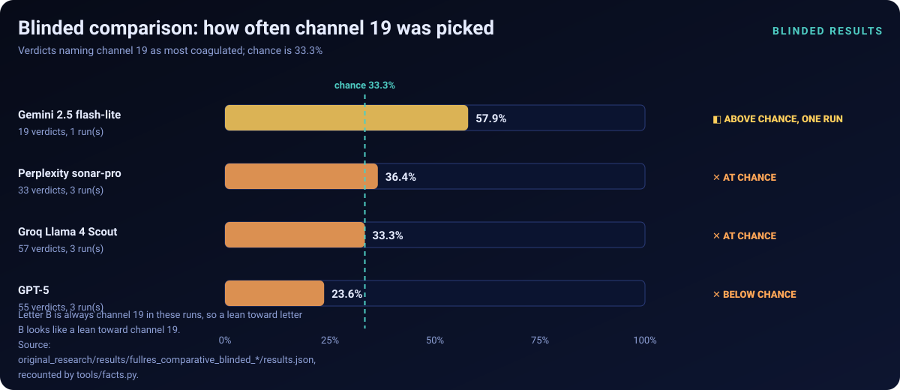
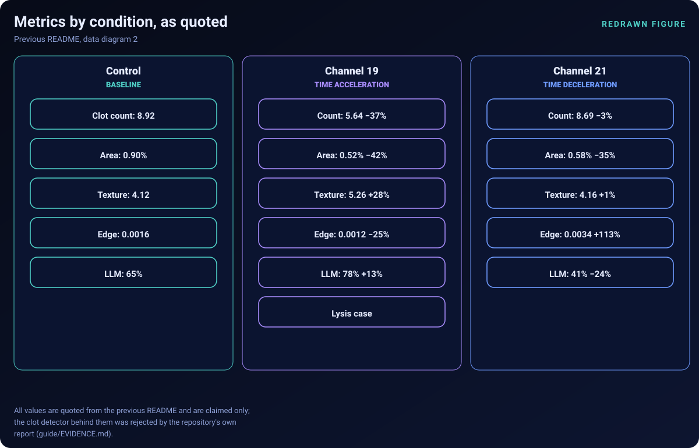
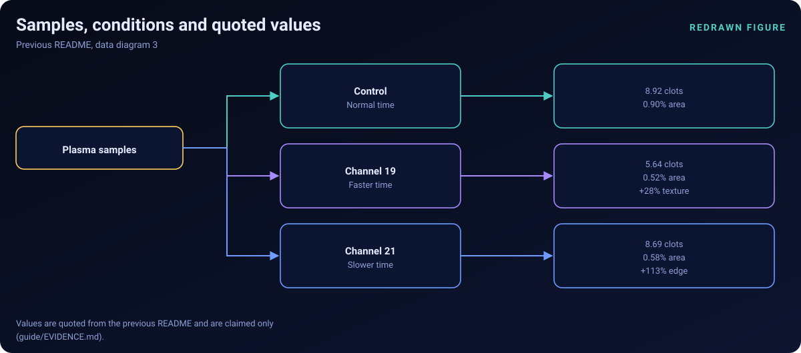

**English | [Русский](RESULTS.ru.md)**

[← Blood Plasma Study](../README.md) · [Guide index](README.md)

# Results as reported, and how to read them

## Results as reported

This section keeps the results tables of the previous README. They are **what the README said**, not findings the repository confirms: the next section and [Evidence](EVIDENCE.md) say what survives the repository's own reports.

### Key metrics

| Metric | Value | Status in the previous README |
|---|---|---|
| Donors | 7 patients | Complete |
| Total photographs | 101 images | Complete |
| Samples | 40+ single-channel | Complete |
| Irradiation duration | ~1h 12min per patient | Complete |
| Temperature | 17°C constant | Monitored |
| AI providers | 8 LLM + CV models | Complete |
| Statistical significance | p = 0.027 (Gemini) | Significant |

### Hypothesis validation

Original figure: <a href="../original_research/charts/mermaid/root_3.png"><code>original_research/charts/mermaid/root_3.png</code></a>

### Comparative results

Photographs per donor code (101 photographs; anonymous codes and shares only, no names). Shown as in the previous README: the donors are not independent units, and the shares are a sample-size picture, not a result.

| Parameter | Control | Channel 19 (acceleration) | Channel 21 (deceleration) |
|---|---|---|---|
| Photos with clots | 62-65% | 71-78% | 41-54% |
| Clot count (mean) | 8.92 | 5.64 **(−37%)** | 8.69 (−3%) |
| Total clot area | 0.90% | 0.52% **(−42%)** | 0.58% (−35%) |
| Lysis cases | 0 | **1 (only channel)** | 0 |
| GLCM contrast | 4.12 | 5.26 **(+28%)** | 4.16 (+1%) |
| Edge density | 0.0016 | 0.0012 (−25%) | 0.0034 **(+113%)** |

These numbers come from the first (CV and ML) report. Its clot detector is the one the repository itself later rejects (<!--n:cv_false_pos-->95<!--/n-->%+ false positives, glass walls counted as plasma). The single lysis case is one photograph of <!--n:photos-->101<!--/n-->.

### Key findings (previous README)

| Channel | Effect | Interpretation |
|---|---|---|
| Channel 19 | 37% fewer clots, 42% smaller area, ONLY channel with lysis | Samples appear "OLDER": accelerated coagulation lifecycle |
| Channel 21 | 41% clot rate vs 65% control, dense formation | Samples appear "YOUNGER": delayed coagulation onset |
| Control | Baseline coagulation progression | Normal coagulation without exposure |

### Statistical significance (previous README)

| Model | Accuracy | P-value | Status |
|---|---|---|---|
| Gemini 2.5 Flash | 57.9% | p = 0.027 | Statistically significant |
| DINOv2 Linear Probe | 47.4% | p = 0.15 | Suggestive |
| GPT-5 Batch | 46.7% | - | Consistent |
| Perplexity Batch | 53.3% | - | Consistent |

The previous README concluded: if no effect existed, all models would show about 33% (chance level); instead, multiple architectures show 46-58% accuracy; "this is not proof of effect, but reproducible signal across different models". The next section checks that sentence against the raw result files.

## Reading the numbers

The blinded verdicts were recounted from the raw `results.json` files by `tools/facts.py`; the totals equal the report's aggregate table.

| Provider | Runs | Verdicts | Channel 19 | Control | Channel 21 | Channel 19 share |
|---|---:|---:|---:|---:|---:|---:|
| Gemini 2.5 flash-lite | <!--n:gemini_runs-->1<!--/n--> | <!--n:gemini_n-->19<!--/n--> | <!--n:gemini_ch19-->11<!--/n--> | <!--n:gemini_ctrl-->5<!--/n--> | <!--n:gemini_ch21-->3<!--/n--> | <!--n:gemini_pct-->57.9<!--/n-->% |
| Perplexity sonar-pro | <!--n:perplexity_runs-->3<!--/n--> | <!--n:perplexity_n-->33<!--/n--> | <!--n:perplexity_ch19-->12<!--/n--> | <!--n:perplexity_ctrl-->8<!--/n--> | <!--n:perplexity_ch21-->13<!--/n--> | <!--n:perplexity_pct-->36.4<!--/n-->% |
| Groq Llama 4 Scout | <!--n:groq_runs-->3<!--/n--> | <!--n:groq_n-->57<!--/n--> | <!--n:groq_ch19-->19<!--/n--> | <!--n:groq_ctrl-->26<!--/n--> | <!--n:groq_ch21-->12<!--/n--> | <!--n:groq_pct-->33.3<!--/n-->% |
| GPT-5 | <!--n:openai_runs-->3<!--/n--> | <!--n:openai_n-->55<!--/n--> | <!--n:openai_ch19-->13<!--/n--> | <!--n:openai_ctrl-->13<!--/n--> | <!--n:openai_ch21-->29<!--/n--> | <!--n:openai_pct-->23.6<!--/n-->% |

What to take from it:

- **One provider is above chance, and in one run.** Gemini picked channel 19 in <!--n:gemini_ch19-->11<!--/n--> of <!--n:gemini_n-->19<!--/n--> triplets (<!--n:gemini_pct-->57.9<!--/n-->%). The exact one-sided binomial probability of <!--n:gemini_ch19-->11<!--/n--> or more of <!--n:gemini_n-->19<!--/n--> at 1/3 is <!--n:gemini_p_exact-->0.024<!--/n--> (computed here; the reports and the previous README quote 0.027, and no script in the repository derives it). It is one test among many, uncorrected for multiple testing.
- **Position is confounded with channel.** Channel 19 is always letter B, so Gemini's <!--n:gemini_ch19-->11<!--/n--> B-picks cannot be told apart from a preference for the second position.
- **The other providers sit at or below chance** (Perplexity <!--n:perplexity_pct-->36.4<!--/n-->%, Groq <!--n:groq_pct-->33.3<!--/n-->%, GPT-5 <!--n:openai_pct-->23.6<!--/n-->%, against <!--n:chance_pct-->33.3<!--/n-->%). "Reproducible signal across models" holds only if these runs are left out.
- **No CV model reaches p below 0.05.** The best, the DINOv2 probe, scores <!--n:dino_probe-->47.4<!--/n-->% (9 of <!--n:triplets-->19<!--/n-->, exact p <!--n:dino_probe_p-->0.1462<!--/n-->); the authors call it "suggestive but inconclusive". Cropping to the plasma drops it from <!--n:dino_full-->47.8<!--/n-->% (full photo) to <!--n:dino_sam-->34.3<!--/n-->%: the signal sits in the tube context, not in the liquid.
- **The prompt matters.** On identical images Perplexity picked channel 19 in <!--n:perplexity_unblinded-->0<!--/n-->% of unblinded and <!--n:perplexity_blinded-->53<!--/n-->% of blinded verdicts.
- **The unit is the donor.** <!--n:triplets-->19<!--/n--> triplets come from <!--n:triplet_donors-->5<!--/n--> donors; repeated runs of the same triplets add no donors.

## More figures redrawn from the previous README and the programme issues

Each figure below was a Mermaid PNG; it is redrawn with the same content and the original stays in the repository.

Original figure: <a href="../original_research/charts/mermaid/data_2.png"><code>original_research/charts/mermaid/data_2.png</code></a>

Original figure: <a href="../original_research/charts/mermaid/data_3.png"><code>original_research/charts/mermaid/data_3.png</code></a>

