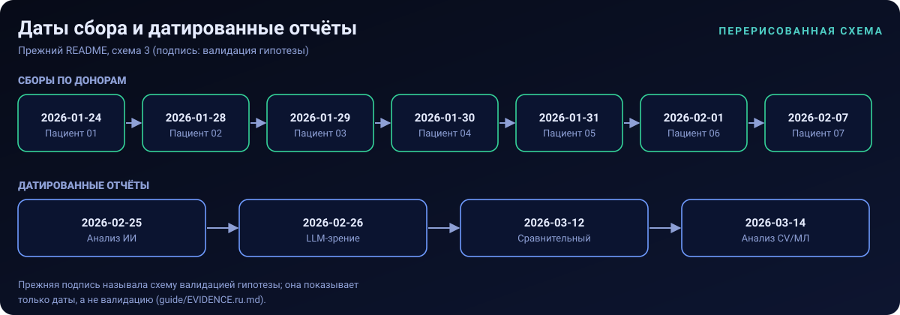
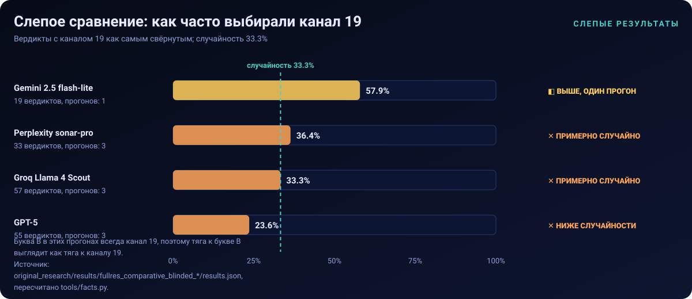

**[English](RESULTS.md) | Русский**

[← Blood Plasma Study](../README.ru.md) · [Указатель гида](README.ru.md)

# Результаты как заявлены и как их читать

## Результаты как заявлены

Этот раздел сохраняет таблицы результатов прежнего README. Это **то, что говорил README**, а не находки, подтверждённые репозиторием: следующий раздел и [Свидетельства](EVIDENCE.ru.md) показывают, что выдерживает проверку собственными отчётами репозитория.

### Ключевые метрики

| Метрика | Значение | Статус в прежнем README |
|---|---|---|
| Доноры | 7 пациентов | Завершено |
| Всего фотографий | 101 изображение | Завершено |
| Образцы | 40+ одноканальных | Завершено |
| Длительность облучения | ~1ч 12мин на пациента | Завершено |
| Температура | 17°C постоянно | Monitored |
| ИИ-провайдеры | 8 моделей LLM + CV | Завершено |
| Статистическая значимость | p = 0.027 (Gemini) | Значимо |

### Валидация гипотезы

Исходная схема: <a href="../original_research/charts/mermaid/root_3.png"><code>original_research/charts/mermaid/root_3.png</code></a>

### Сравнительные результаты

Фотографии по кодам доноров (101 фотография; только анонимные коды и доли, без имён). Показано как в прежнем README: доноры не независимые единицы, а доли описывают объём выборки, а не результат.

| Параметр | Контроль | Канал 19 (ускорение) | Канал 21 (замедление) |
|---|---|---|---|
| Фото со сгустками | 62-65% | 71-78% | 41-54% |
| Количество сгустков (среднее) | 8.92 | 5.64 **(−37%)** | 8.69 (−3%) |
| Общая площадь сгустков | 0.90% | 0.52% **(−42%)** | 0.58% (−35%) |
| Случаи лизиса | 0 | **1 (единственный канал)** | 0 |
| Контраст GLCM | 4.12 | 5.26 **(+28%)** | 4.16 (+1%) |
| Плотность краёв | 0.0016 | 0.0012 (−25%) | 0.0034 **(+113%)** |

Эти числа взяты из первого отчёта (CV и ML). Его детектор сгустков тот самый, который репозиторий позже сам отвергает (<!--n:cv_false_pos-->95<!--/n-->%+ ложных срабатываний, стенки стекла приняты за плазму). Единственный случай лизиса — одна фотография из <!--n:photos-->101<!--/n-->.

### Ключевые выводы (прежний README)

| Канал | Эффект | Интерпретация |
|---|---|---|
| Канал 19 | На 37% меньше сгустков, на 42% меньше площадь, ЕДИНСТВЕННЫЙ канал с лизисом | Образцы выглядят «СТАРШЕ»: ускоренный жизненный цикл свёртывания |
| Канал 21 | 41% доля сгустков против 65% в контроле, плотное образование | Образцы выглядят «МОЛОЖЕ»: замедленное начало свёртывания |
| Контроль | Базовая динамика свёртывания | Нормальное свёртывание без воздействия |

### Статистическая значимость (прежний README)

| Модель | Точность | P-значение | Статус |
|---|---|---|---|
| Gemini 2.5 Flash | 57.9% | p = 0.027 | Статистически значимо |
| DINOv2 Linear Probe | 47.4% | p = 0.15 | Предположительно |
| GPT-5 Batch | 46.7% | - | Согласованно |
| Perplexity Batch | 53.3% | - | Согласованно |

Прежний README заключал: если бы эффекта не существовало, все модели показывали бы около 33% (уровень случайности); вместо этого разные архитектуры показывают 46-58% точности; «это не доказательство эффекта, но воспроизводимый сигнал на разных моделях». Следующий раздел сверяет эту фразу с сырыми файлами результатов.

## Как читать числа

Слепые вердикты пересчитаны по сырым файлам `results.json` скриптом `tools/facts.py`; итоги равны сводной таблице отчёта.

| Провайдер | Прогонов | Вердиктов | Канал 19 | Контроль | Канал 21 | Доля канала 19 |
|---|---:|---:|---:|---:|---:|---:|
| Gemini 2.5 flash-lite | <!--n:gemini_runs-->1<!--/n--> | <!--n:gemini_n-->19<!--/n--> | <!--n:gemini_ch19-->11<!--/n--> | <!--n:gemini_ctrl-->5<!--/n--> | <!--n:gemini_ch21-->3<!--/n--> | <!--n:gemini_pct-->57.9<!--/n-->% |
| Perplexity sonar-pro | <!--n:perplexity_runs-->3<!--/n--> | <!--n:perplexity_n-->33<!--/n--> | <!--n:perplexity_ch19-->12<!--/n--> | <!--n:perplexity_ctrl-->8<!--/n--> | <!--n:perplexity_ch21-->13<!--/n--> | <!--n:perplexity_pct-->36.4<!--/n-->% |
| Groq Llama 4 Scout | <!--n:groq_runs-->3<!--/n--> | <!--n:groq_n-->57<!--/n--> | <!--n:groq_ch19-->19<!--/n--> | <!--n:groq_ctrl-->26<!--/n--> | <!--n:groq_ch21-->12<!--/n--> | <!--n:groq_pct-->33.3<!--/n-->% |
| GPT-5 | <!--n:openai_runs-->3<!--/n--> | <!--n:openai_n-->55<!--/n--> | <!--n:openai_ch19-->13<!--/n--> | <!--n:openai_ctrl-->13<!--/n--> | <!--n:openai_ch21-->29<!--/n--> | <!--n:openai_pct-->23.6<!--/n-->% |

Что из этого следует:

- **Один провайдер выше случайности, и в одном прогоне.** Gemini выбрал канал 19 в <!--n:gemini_ch19-->11<!--/n--> из <!--n:gemini_n-->19<!--/n--> триплетов (<!--n:gemini_pct-->57.9<!--/n-->%). Точная односторонняя биномиальная вероятность <!--n:gemini_ch19-->11<!--/n--> и более из <!--n:gemini_n-->19<!--/n--> при 1/3 равна <!--n:gemini_p_exact-->0.024<!--/n--> (посчитано здесь; отчёты и прежний README называют 0.027, а скрипта, который это выводит, в репозитории нет). Это один тест из многих, без поправки на множественные сравнения.
- **Позиция смешана с каналом.** Канал 19 всегда буква B, поэтому <!--n:gemini_ch19-->11<!--/n--> выборов буквы B у Gemini не отличить от предпочтения второй позиции.
- **Остальные провайдеры на уровне случайности или ниже** (Perplexity <!--n:perplexity_pct-->36.4<!--/n-->%, Groq <!--n:groq_pct-->33.3<!--/n-->%, GPT-5 <!--n:openai_pct-->23.6<!--/n-->% при <!--n:chance_pct-->33.3<!--/n-->%). «Воспроизводимый сигнал на разных моделях» верен, только если эти прогоны не считать.
- **Ни одна модель CV не достигает p ниже 0.05.** Лучшая, проб DINOv2, даёт <!--n:dino_probe-->47.4<!--/n-->% (9 из <!--n:triplets-->19<!--/n-->, точное p <!--n:dino_probe_p-->0.1462<!--/n-->); авторы называют это «наводящим, но неубедительным». Обрезка по плазме снижает результат с <!--n:dino_full-->47.8<!--/n-->% (целое фото) до <!--n:dino_sam-->34.3<!--/n-->%: сигнал в контексте пробирки, а не в жидкости.
- **Промпт имеет значение.** На тех же изображениях Perplexity выбирал канал 19 в <!--n:perplexity_unblinded-->0<!--/n-->% вердиктов без слепоты и в <!--n:perplexity_blinded-->53<!--/n-->% слепых.
- **Единица это донор.** <!--n:triplets_ru-->19 триплетов<!--/n--> получены от <!--n:triplet_donors-->5<!--/n--> доноров; повторные прогоны тех же триплетов доноров не добавляют.
