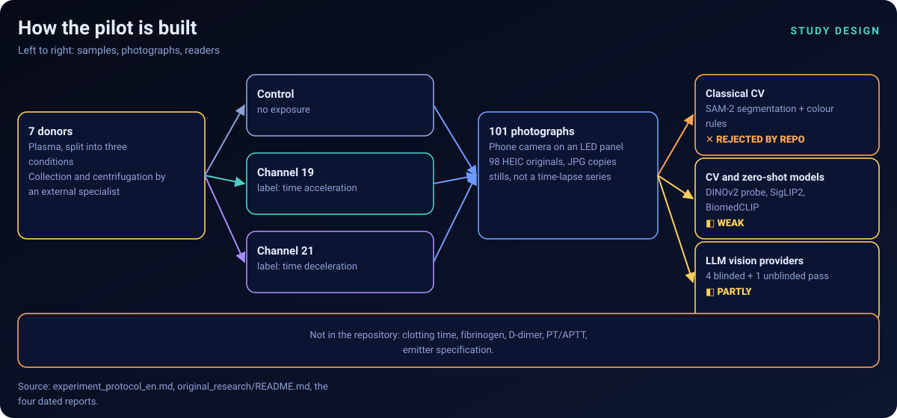
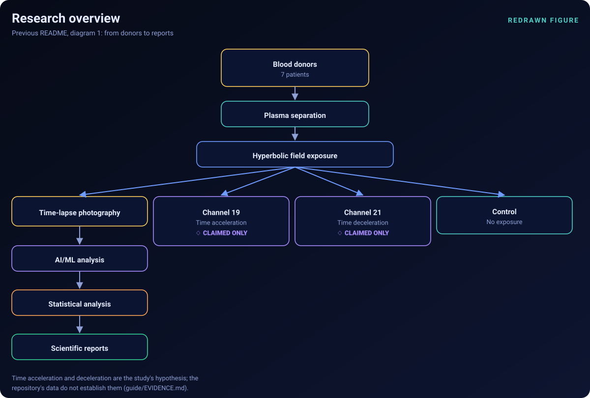

**English | [Русский](STUDY.ru.md)**

[← Blood Plasma Study](../README.md) · [Guide index](README.md)

# The study: what it is, design and protocol

## What this study is

This repository documents a **small, exploratory pilot** of the effect of hyperbolic-field emitters on blood plasma. Plasma from <!--n:donors-->7<!--/n--> donors is split into an untreated control and two samples placed on emitters set to "channel 19" and "channel 21". The channel names are labels only: the repository calls channel 19 "time acceleration" and channel 21 "time deceleration" and gives no frequency, power or geometry of the emitters. After exposure the tubes are photographed with a phone on an LED panel, and the <!--n:photos-->101<!--/n--> photographs are scored by computer vision, vision models and LLM vision providers.

The hypothesis of the protocol issue is that hyperbolic-field exposure affects plasma coagulation dynamics through temporal modulation: a fast clot followed by lysis on channel 19, a delayed but dense clot on channel 21. The study is the first biological test of the emitters described in the patent application and the plasma branch of the 2026-2027 hyperbolic-field programme (see [Publications, patent, preregistration](PUBLICATIONS.md)).

**What it is not.** There is no clotting-time, fibrinogen, D-dimer, PT or APTT measurement anywhere in the repository. Everything below the photographs is computed from pictures. The authors' own computer-vision report calls its best result "suggestive but inconclusive". Read the study as hypothesis-generating, not as evidence that the field affects coagulation (see [Evidence](EVIDENCE.md)).

| Repository | Status |
|---|---|
| `Hyperbolic_Field_BloodPlasma_Study` | Active Research (self-declared; content last updated 26 March 2026) |

**Organization:** Advanced Scientific Research Projects (ASRP), part of the ASRP ecosystem. The repository is public.

## Design and protocol

The protocol summary (`original_research/reports/experiment_protocol_en.md`) states:

- <!--n:donors-->7<!--/n--> donors; blood is centrifuged (2000 RPM, 5 min) and the plasma separated.
- Plasma from 4 tubes is combined and split into 4 samples: 2 controls (not irradiated, placed 1.5 m from the emitters), 1 sample in the channel 19 emitter, 1 sample in the channel 21 emitter.
- Irradiation is about 1 h 12 min per donor; volume 1 ml per sample (some 1.5 ml); temperature 17°C constant (smart home system).
- Photography: smartphone camera (HEIC, converted to JPG), backlight from below (LED panel), glass test tubes, artificial lighting.
- Laboratory work (blood collection, centrifugation, equipment) is attributed to an external plasma specialist of an independent laboratory; the research lead designed the experimental programme.

**The protocol documents disagree** on several points (exposure time, tube type, centrifugation settings, anticoagulant); the differences are listed on [Open questions](OPEN.md) and none is resolved here. The preregistered design (OSF) is a mixed between- and within-donor design with 5-10 donors and 30-60 aliquots, primary outcomes clot-formation time and clot degradation rate, ANOVA with two-sided p below .05 and Tukey-Kramer comparisons. The clot-time outcomes were never measured; the photographs stand in for them.

Original figure: <a href="../original_research/charts/mermaid/root_1.png"><code>original_research/charts/mermaid/root_1.png</code></a>

## Sample identification

Sample ID format: `{channel}.{patient}.{number}`.

| Component | Value | Meaning |
|---|---|---|
| Channel | 0 | Control, no irradiation |
| | 19 | Channel 19, label "time acceleration" |
| | 21 | Channel 21, label "time deceleration" |
| Patient | 1–7 | Donor number (the repository folders are called `patient-01` to `patient-07`) |
| Number | 1, 2 | Sequential sample number |

Examples: `0.2.1` is control sample 1 of donor 02, `19.2.1` is channel 19 sample 1 of donor 02, `21.7.2` is channel 21 sample 2 of donor 07. Donors appear only as numbers; no donor-level detail is reproduced on these pages.
