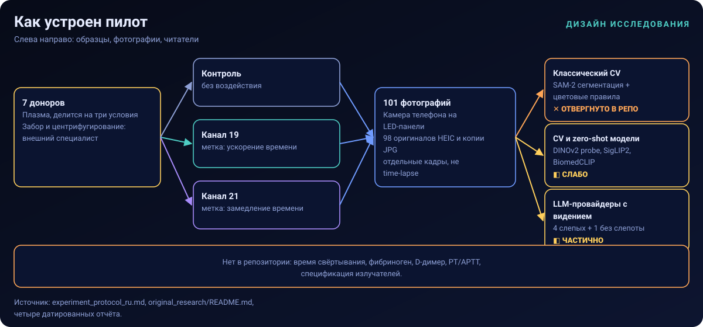
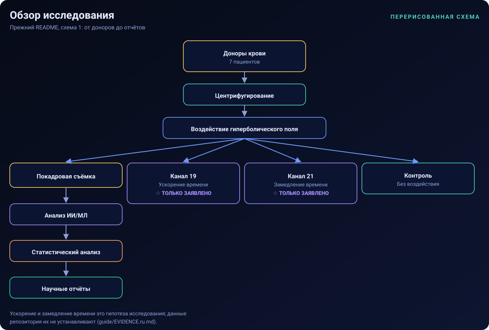

**[English](STUDY.md) | Русский**

[← Blood Plasma Study](../README.ru.md) · [Указатель гида](README.ru.md)

# Исследование: что это, дизайн и протокол

## Что это за исследование

Репозиторий документирует **небольшой поисковый пилот** о влиянии излучателей гиперболического поля на плазму крови. Плазма <!--n:donors_ru-->7 доноров<!--/n--> делится на контроль без обработки и два образца, помещённых на излучатели с настройками «канал 19» и «канал 21». Названия каналов — только метки: репозиторий называет канал 19 «ускорением времени», а канал 21 «замедлением времени» и нигде не приводит частоту, мощность или геометрию излучателей. После экспозиции пробирки фотографируют телефоном на светодиодной панели, а <!--n:photos-->101<!--/n--> фотографий оценивают компьютерное зрение, модели зрения и LLM-провайдеры с видением.

Гипотеза протокола (задача 1): воздействие гиперболического поля влияет на динамику свёртывания плазмы через временну́ю модуляцию: быстрый сгусток с последующим лизисом на канале 19, отложенный, но плотный сгусток на канале 21. Исследование названо первым биологическим испытанием излучателей из патентной заявки и плазменной ветвью программы 2026-2027 по гиперболическим полям (см. [Публикации, патент, регистрация](PUBLICATIONS.ru.md)).

**Чем оно не является.** Во всём репозитории нет ни одного измерения времени свёртывания, фибриногена, D-димера, PT или APTT. Всё ниже фотографий вычислено по картинкам. Собственный отчёт авторов по компьютерному зрению называет лучший результат «наводящим, но неубедительным» (suggestive but inconclusive). Исследование нужно читать как порождающее гипотезы, а не как доказательство влияния поля на свёртывание (см. [Свидетельства](EVIDENCE.ru.md)).

| Репозиторий | Статус |
|---|---|
| `Hyperbolic_Field_BloodPlasma_Study` | Active Research (заявлено самим репозиторием; содержание обновлено 26 марта 2026) |

**Организация:** Advanced Scientific Research Projects (ASRP), часть экосистемы ASRP. Репозиторий публичный.

## Дизайн и протокол

Резюме протокола (`original_research/reports/experiment_protocol_ru.md`) сообщает:

- <!--n:donors_ru-->7 доноров<!--/n-->; кровь центрифугируют (2000 об/мин, 5 мин) и отделяют плазму.
- Плазму из 4 пробирок объединяют и делят на 4 образца: 2 контрольных (не облучались, стояли в 1,5 м от излучателей), 1 образец в излучателе канала 19, 1 образец в излучателе канала 21.
- Облучение около 1 ч 12 мин на донора; объём 1 мл на образец (в некоторых случаях 1,5 мл); температура 17°C постоянно (система умного дома).
- Съёмка: камера смартфона (HEIC, конвертация в JPG), подсветка снизу (светодиодная панель), стеклянные пробирки, искусственное освещение.
- Лабораторную работу (забор крови, центрифугирование, оборудование) относят к внешнему специалисту по плазме из независимой лаборатории; руководитель исследования автор экспериментальной программы.

**Документы протокола расходятся** по нескольким пунктам (время экспозиции, тип пробирок, режим центрифугирования, антикоагулянт); различия перечислены на странице [Открытые вопросы](OPEN.ru.md), здесь ни одно не разрешено. Предрегистрированный дизайн (OSF): смешанный дизайн между донорами и внутри доноров, 5-10 доноров и 30-60 аликвот, первичные исходы время образования сгустка и скорость его деградации, ANOVA с двусторонним p ниже .05 и сравнениями Tukey-Kramer. Времена свёртывания никогда не измерялись; их заменяют фотографии.

Исходная схема: <a href="../original_research/charts/mermaid/root_1.png"><code>original_research/charts/mermaid/root_1.png</code></a>

## Идентификация образцов

Формат ID образца: `{channel}.{patient}.{number}`.

| Компонент | Значение | Смысл |
|---|---|---|
| Канал | 0 | Контроль, без облучения |
| | 19 | Канал 19, метка «ускорение времени» |
| | 21 | Канал 21, метка «замедление времени» |
| Пациент | 1–7 | Номер донора (папки репозитория называются `patient-01` ... `patient-07`) |
| Номер | 1, 2 | Порядковый номер образца |

Примеры: `0.2.1` — контрольный образец 1 донора 02, `19.2.1` — образец 1 канала 19 донора 02, `21.7.2` — образец 2 канала 21 донора 07. Доноры названы только номерами; данные отдельных доноров на этих страницах не воспроизводятся.
